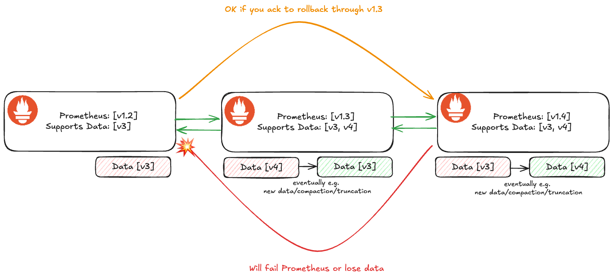

## Recommendations for WAL Format Changes

* **Owners:**
  * [@bwplotka](https://github.com/bwplotka)

* **Contributors:**
  * [@krajorama](https://github.com/krajorama)
  * [@bboreham](https://github.com/bboreham)
  * [@carrieedwards](https://github.com/carrieedwards)
  * [@machine424](https://github.com/machine424)

* **Implementation Status:** Partially implemented (adopted in [PROM-60](0060-st-storage.md))

* **Related Issues and PRs:**
  * https://github.com/prometheus/prometheus/issues/15200
  * https://github.com/prometheus/prometheus/issues/14730
  * [PROM-60: Native TSDB Support for Start Timestamp (ST)](0060-st-storage.md)
  * [WAL changes for NHCB](https://docs.google.com/document/d/1oYmvK7rrRFNrkM4Hrze8OsaK4z0GGj4pXl6VT6S_ef0/edit?tab=t.0#heading=h.545ogb8wlxze)
  * [Segment versioning prototype](https://github.com/prometheus/prometheus/pull/15565)

* **Other docs or links:**
  * [`#prometheus-wal-dev`](https://cloud-native.slack.com/archives/C082ALTBY4S)
  * https://github.com/prometheus/prometheus/blob/main/tsdb/docs/format/wal.md
  * [Ganesh's blog](https://ganeshvernekar.com/blog/prometheus-tsdb-the-head-block/)

> TL;DR: We need to break forward compatibility of the WAL format. This document proposes a data migration strategy for WAL and lightweight ways to be transparent about compatibility in each Prometheus release.
>
> Instead of versioning WAL segments or directories, we propose introducing new WAL record types (e.g. `SamplesV2`) gated behind feature flags (`--enable-feature=<feature>`) for writing, while using the *LTS-enhanced [Two-Fold Migration Strategy](#how-two-fold-migration-strategy)* before enabling new record writes by default.

## Glossary

For this document, I use the following wording:

* **Prometheus Backward Compatibility**: When new Prometheus can read old WAL format.
* **Prometheus Forward Compatibility**: When old Prometheus can read the new WAL format, which is required for the potential reverts.
* **WAL Breaking Change**: Change to the WAL that will break Prometheus backward or forward compatibility, e.g. adding a new format that will replace the existing one.

In this document, data "compatibility" means both:

* Prometheus won't crash during compatible rollout or reverts.
* No data is lost during compatible rollouts or reverts.

## Why

Recently we discussed various improvements to Prometheus Write-Ahead-Log (WAL, also used as WBL for OOO) to:

* Support new features (e.g. created timestamp (CT), native histograms with custom buckets (nhcb)).
* Efficiency improvements and tech debt cleanup (e.g. parallelization/sharding, combining records, different decoding formats).

The [current WAL data](https://github.com/prometheus/prometheus/blob/975d5d7357a220192fe1307b10ded9b35130ab1c/tsdb/docs/format/wal.md) is written into a handwritten variadic-encoding binary format. It's generally not versioned, and it does not support unknown fields or data except 3 specific places:

* [record type](https://github.com/prometheus/prometheus/blob/e410a215fbe89b67f0e8edef9de25ede503ea4e0/tsdb/record/record.go#L38)
* [metric type in metadata record](https://github.com/prometheus/prometheus/blob/e410a215fbe89b67f0e8edef9de25ede503ea4e0/tsdb/record/record.go#L111)
* [metadata fields are arbitrary labels in metadata record](https://github.com/prometheus/prometheus/blob/e410a215fbe89b67f0e8edef9de25ede503ea4e0/tsdb/record/record.go#L608).

Historically, we didn't hit major problems because we were only adding new semantic data (e.g. exemplars, metadata, new native histograms) as separate, additive records.
However, these days, we need to add fields to existing sample data (e.g. custom buckets that replace classic histograms, cleanup of histogram records, or start timestamps on samples). If we write samples using a new record type (such as `SamplesV2`) and immediately roll back to an older Prometheus version that does not yet know how to decode that record type, the older version will treat the entire record as unknown and **lose the whole sample** (not just the newly added field). Avoiding this requires ensuring the target rollback version already knows how to read the new record type before enabling writes by default.

For the TSDB changes (see the [context](#context-tsdb-format-changes)), tribally, we use an undocumented ["2-fold" migration strategy](#how-two-fold-migration-strategy). Compared to full TSDB retention, WAL data on disk spans at most ~3h of samples right before head compaction (plus 2h of series records), and when memory-mapped head chunks are intact, only the last ~30m of samples (the open chunk of 120 samples at a 15s scrape interval) comes strictly from the WAL during replay.

### Pitfalls of the current solution

* We don't have an officially documented migration strategy for WAL and TSDB in general (only tribal knowledge).
* Users don't know if version X of Prometheus works with version X-2 (except on some minor release that makes the change).
* No e2e testing for migration strategies, no consistent documentation when this happens on releases.

As a result:

* Reduced contribution and development velocity, prolonging bugs, important features and efficiency efforts.
* Increased operational cost and reduced trust for users who run highly durable Prometheus setups.

### Context: TSDB format changes

TSDB format, including chunk format (also used in the head with mmapped chunks), is also a handwritten variadic-encoding binary format. Compared to WAL it's generally versioned e.g.

* [Chunk disk file format](https://github.com/prometheus/prometheus/blob/12c39d5421cc29a4bfc13fc57fd9ccd3dbc310f0/tsdb/docs/format/chunks.md#L14).
* [Head chunk disk format](https://github.com/prometheus/prometheus/blob/fd62dbc2918deea0ceae94758baf7a095b52dd5b/tsdb/docs/format/head_chunks.md#L13).
* [Index file](https://github.com/prometheus/prometheus/blob/d699dc3c7706944aafa56682ede765398f925ef0/tsdb/docs/format/index.md#L8).
* [Block meta file](https://github.com/prometheus/prometheus/blob/5e124cf4f2b9467e4ae1c679840005e727efd599/tsdb/block.go#L171).
* Chunks have its own ["encoding type"](https://github.com/prometheus/prometheus/blob/a693dd19f244f000da40bcbac85041846b78cfc1/tsdb/chunkenc/chunk.go#L29) that could be used for versioning.

No docs or formal strategy was developed, but Prometheus generally follow the ["2-fold" migration strategy explained below](#how-two-fold-migration-strategy).

## Goals

* Agree on the official recommendations for **lossless WAL migrations** strategies for devs and users.
* Balancing development velocity with user data stability risks.
* Ability to develop new version across releases in `main` branch.

## Non-Goals

* TSDB format can, but does not need to follow the same recommendations. We want to change the WAL format now, so prioritizing WAL.
* Mentioning Write-Behind-Log (WBL) or checkpoints separately, as both use the WAL format internally. (WBL is stored as a separate WAL on disk because out-of-order samples are only known to be accepted when written into the out-of-order head chunk after the main WAL write, so WBL records only accepted out-of-order samples for replay into the out-of-order head.)
* Unifying WAL and WBL into a single log on disk.
* To reduce the scope we don't mention [memory snapshot format](https://github.com/prometheus/prometheus/blob/fd5ea4e0b590d57df1e2ef41d027f2a4f640a46c/tsdb/docs/format/memory_snapshot.md#L1) for now.

## How

We recommend the [Two-Fold Migration Strategy](#how-two-fold-migration-strategy) using new WAL record types and existing feature flags (`--enable-feature`), with two key rules:

* **New record types behind feature flags**: Unless we need to change the segment or record header format itself, the existing WAL dispatch table (`record.Type` byte mapped to its encoder/decoder) is sufficient to evolve WAL records. When changing how existing data is encoded in the WAL (for example, `SamplesV2` in [PROM-60](0060-st-storage.md)), Prometheus unconditionally supports reading both the old and new record types as soon as the new record type is introduced, while writing the new record type is initially opt-in via a `--enable-feature=<name>` flag.
* **LTS fallback requirement**: There can be multiple forward-compatible releases, but the official minimum before enabling writes of the new WAL record type by default is **the previous [Long-Term-Support (LTS) release](https://prometheus.io/docs/introduction/release-cycle/)**.

An example flow for rolling out a new WAL record format (such as `SamplesV2` for `st-storage`) looks as follows:

1. Prometheus LTS 3.0 only supports `Samples` (v1) records.
2. Prometheus 3.3 adds read and write support for `SamplesV2` records. Reading `SamplesV2` is always enabled; writing `SamplesV2` requires `--enable-feature=st-storage`.
3. We wait until the next LTS release (for example, Prometheus 3.5 LTS), which includes `SamplesV2` read support.
4. A subsequent release after that LTS (once the feature is stable) can switch to writing `SamplesV2` by default, because users can now safely roll back to the previous LTS release (3.5 LTS) without losing samples during WAL replay.
5. Prometheus 4.0 can remove legacy record support if deprecated.

Similar to other storage flags (like compression), enabling a WAL-affecting feature flag before the next LTS has a stateful consequence: once the new record type is written to disk, rolling back to a Prometheus version that predates the new record decoder will skip those records during replay. We propose to document this clearly in:

* The [feature flags documentation](https://prometheus.io/docs/prometheus/latest/feature_flags/), explicitly listing the minimum Prometheus version (and LTS version) that can read the WAL when the flag is enabled, and what happens when the flag is disabled or rolled back.
* Release notes whenever a new WAL record type is added or enabled by default.
* `tsdb/docs` for developers.

See the [alternatives](#alternatives) for other ideas, including explicit WAL segment filename versioning if we ever need to change the segment envelope itself.

### How: Why Feature Flags and New Record Types?

Using new record types with `--enable-feature` flags instead of introducing a separate `--storage.<tsdb|agent>.wal-version` flag and segment versioning has several benefits:

* Allows users to opt in to new features sooner while keeping the default path safe for rollbacks to the previous LTS.
* Avoids introducing a separate numeric WAL segment version (`v2`, `v3`) that does not tell users which specific feature is active, and avoids forcing developers working on independent WAL changes to synchronize on a single monotonic segment version number.
* Gives developers early feedback and makes end-to-end testing of both old and new formats straightforward.

### How: Two-Fold Migration Strategy

Given the following example:



1. We release Prometheus X+1 version that supports reading both Y and Y+1 data, but still writes Y by default (writing Y+1 is opt-in behind a feature flag).
2. After at least one LTS release includes Y+1 read support, we release a Prometheus version that supports reading both Y and Y+1 data and writes new data as Y+1 by default.

While the diagram shows a single intermediate release with forward compatibility (where Y and Y+1 are supported for reading, and Y is written by default), in practice multiple minor releases and at least one LTS release will sit between step 1 and step 2.

Technically we keep read support for the old record format until at least the next major release.

Pros:
* Users have a durable rollout and rollback path to the previous LTS release without needing to change flags when rolling back one LTS version.
* Developers have clear rules on how to ship WAL changes that would otherwise break rollbacks.
* Allows rolling back from X+2 to X by stepping through X+1 (or disabling the feature flag) and waiting for the WAL segments to cycle (~2h).

Cons:
* Users who downgrade across multiple LTS versions without checking release notes can still be caught by surprise.
  * **Mitigation**: Clear documentation in feature flag docs and release notes, plus guaranteeing compatibility with at least the previous LTS release.
* Waiting for an LTS release before enabling by default takes time.
  * **Mitigation**: Users can opt in immediately via `--enable-feature`.

## Alternatives

### Alternative: Version WAL per segment in the filename (`-v<version>`) and add `--storage.<...>.wal-version` flag

Given the WAL [format](https://github.com/prometheus/prometheus/blob/main/tsdb/docs/format/wal.md) is a sequence of segment files, we considered versioning the WAL per segment in the filename alongside an integer `--storage.<tsdb|agent>.wal-version` flag:

```
<8 digit sequence> => <8 digit sequence>[-v<version>]
```

For example, valid segment filenames would be `00000010`, `00000010-v1`, `00000010-v2`. A mixed directory during upgrade/downgrade would look like:

```
wal/ 
├── 00000000
├── 00000001-v2
├── 00000002-v2
├── 00000003-v2
├── 00000004
├── checkpoint.00000001
│   └── 00000000
├── checkpoint.00000003
│   └── 00000000-v2
└── checkpoint.00000004
    └── 00000000
```

Pros:
* Can cleanly mix different segment versions on disk, and a quick `ls` of the `wal` or `wbl` directory shows whether new segments are being written.
* Useful if we ever need to change the outer segment framing or page/record header format rather than just adding record types.
* Current Prometheus code [generally skips segments with non-numeric suffixes](https://github.com/prometheus/prometheus/blob/addaf419efba330c1e8bc7b2c7d59e878b8ac71a/tsdb/wlog/wlog.go#L931) or fails with ["not a valid filename" errors](https://github.com/prometheus/prometheus/blob/addaf419efba330c1e8bc7b2c7d59e878b8ac71a/tsdb/wlog/wlog.go#L163).

Cons:
* Most WAL changes only add or update record types, which the existing `record.Type` byte already handles without changing segment filenames.
* A numeric segment version like `v3` is opaque to users (it does not convey whether it relates to native histograms, start timestamps, or compression) and requires extra coordination when multiple features are developed concurrently.
* Large surface area in the codebase (~1500 LOC in [the prototype](https://github.com/prometheus/prometheus/pull/15565)).
* If we use `.` instead of `-v` as the separator, `.` could be confused with a file extension.

### Alternative: Capture segment version in a segment header

Instead of the filename we could capture the segment version in the preamble or header in the binary format.
This would be more consistent with other files e.g. [`chunks`](https://github.com/prometheus/prometheus/blob/main/tsdb/docs/format/chunks.md#chunks-disk-format) or [`index`](https://github.com/prometheus/prometheus/blob/main/tsdb/docs/format/index.md).

Header might be also easier to implement (less LOCs) and a bit more efficient.

Cons:
* Breaks the design of WAL segment being and array of records with preamble, which was inspired by LevelDB.
* You have to parse each segment programmatically to know what it's version. This will make debugging much harder in case of errors. Additionally, it would be hard to tell when the migration fully completed in the user's directory.
* Accidental use of old Prometheus on new format would result in the corruption error, which is not ideal (it's hard to debug such errors in the future)

### Alternative: Capture segment version in a special record

Instead of special header or filename, we could specify a segment version in the special new record type that has to be first in the segment.

This has a nice benefit of clean handling of new records for old Prometheus.

Cons:
* Similar cons to [header](#alternative-capture-segment-version-in-a-segment-header) around debuggability.
* Introduces snowflake, special record, which is not technically a proper record (e.g. it has to be first)
* Perhaps failing fast is better (e.g. when parsing filename) vs treating new records as empty?

### Alternative: Version WAL per directory.

Instead of the segment versioning, we could propose the addition of a `meta.json` file in the wal directory, similar to [block meta.json](https://github.com/prometheus/prometheus/blob/5e124cf4f2b9467e4ae1c679840005e727efd599/tsdb/block.go#L171), with Version field set to `1` for the current format and `2` for new changes e.g. when we start to write [new records](https://github.com/prometheus/prometheus/pull/15467/files). No `meta.json` is equivalent to `{"version":1} `meta.json` file.

We could propose to also store the new WALs in separate directories e.g. `wal.v2`. Thanks to that the rewrite from one version to another is **eventual** and can be done segment by segment without any forcible rewrite. The WAL will be rewritten within the next 2h of a normal operation. The additional advantage of this way of versioning is that it's clear when your WAL fully migrated to a certain version.

Cons:
* Semantics on reading mixed WAL situation it's more complex to get right.

### Alternative: Record-based WAL versioning

Given we usually change WAL by changing its records, the WAL version could be simply [max number of types](https://github.com/prometheus/prometheus/blob/5e124cf4f2b9467e4ae1c679840005e727efd599/tsdb/record/record.go#L54) we write to WAL.

### Alternative: Maintain two WALs (well four, with WBL)

Duplicating records would be too expensive for already painful latency and CPU/mem usage for e.g. replay.
However, we could write an entirely new WAL with only a disk latency and space penalty, on top of writing old one, for compatibility.

Cons:
* Disk space increased
* Inconsistent with the TSDB format strategy.
* Complex to implement.

### Alternative: Add a CLI tool that rewrites WAL to a specific version

We could add a `promtool` command that rewrites WAL segments to a given version.

Users can then migrate their WAL with a single command either as an init process before reverting or manually on a disk.

This should take ~minutes even for larger WAL files.

Pros:
* Less need for a two-fold strategy?

Cons:
* We need to write migration code and ensure it's efficient enough for bigger data
* A bit painful to use on scale and remotely (e.g. on Kubernetes)

### Alternative: Rewrite WAL before/during replay

Instead of supporting multiple directories for WAL for various versions, we could rewrite WAL on the start.

Pros:
* Simpler implementation

Cons:
* We already suffer from replay problems, so I propose an eventual rewrite.
* Rewrite is more risking than read-only WAL (of previous version)

### Alternative: Don't introduce a feature flag for writing new WAL formats

Pro:
* Users get the new format automatically once the two-fold migration completes, without having to know about or manage a feature flag.

Cons:
* Takes much longer for new features to be available to users who want to test or adopt them before the next LTS cycle completes.
* Slower feedback loop for developers implementing storage changes.
* No straightforward way for users to opt out of writing the new format if they need to prepare for an emergency downgrade.

## Action Plan

The tasks to do in order to adopt this strategy:

* [X] Apply the feature-flag and LTS two-fold WAL migration strategy in [PROM-60 (`st-storage`)](0060-st-storage.md).
* [ ] Document the WAL and TSDB two-fold migration strategy and LTS compatibility guarantees for developers and users.
* [ ] Ensure stateful feature flags and release notes document the minimum Prometheus version required for lossless WAL rollback.
