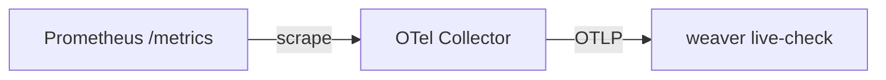

# Prometheus Internal Telemetry as an OTel Semantic Convention Registry

* **Owners:**
  * Nicolas Takashi [@nicolastakashi](https://github.com/nicolastakashi) [nicolas.takashi@dash0.com](mailto:nicolas.takashi@dash0.com)
  * Arthur Silva Sens [@ArthurSens](https://github.com/ArthurSens) [arthursens2005@gmail.com](mailto:arthursens2005@gmail.com)

* **Implementation Status:** `Partially implemented`

* **Related Issues and PRs:**
  * [WIP: Prometheus semconvs](https://github.com/prometheus/prometheus/pull/17868)
  * [promql: Add versioned OTel semantic-conventions read](https://github.com/prometheus/prometheus/pull/18858): the query-time consumer for the schema files this registry would emit.

* **Other docs or links:**
  * [Dev Summit notes: internal telemetry consensus](https://docs.google.com/document/d/1uurQCi5iVufhYHGlBZ8mJMK_freDFKPG0iYBQqJ9fvA/edit?tab=t.0#bookmark=id.ojugisgspwvq)
  * [OTel Semantic Convention specification](https://opentelemetry.io/docs/specs/semconv/): YAML schemas describing telemetry, with tooling to generate code and docs from them.
  * [OpenTelemetry Weaver](https://github.com/open-telemetry/weaver): the toolchain that resolves, validates, and renders those schemas.

> TL;DR: Define the metrics Prometheus itself owns in one [OTel semantic convention registry](https://opentelemetry.io/docs/specs/semconv/). Generate the instrumentation code and the docs from it, check the code against it in CI, and publish it so downstream projects can check their own references.

## Why

Prometheus' internal metrics are `client_golang` constructor calls scattered across dozens of files. Nothing describes them in machine-readable form, which costs us four ways:

* Dashboard and alert authors reverse-engineer it from Go source or a live instance.
* Nothing separates stable metrics from implementation details, so renames and semantic changes ship unannounced.
* Documentation is hand-written, with nothing keeping it honest.
* No test notices when a code change alters which metrics exist or what labels they carry.

### Pitfalls of the current solution

Help strings are inconsistent, some describing counter semantics and some the event counted. Histogram buckets are picked ad hoc and most metrics carry no unit. Nothing marks a metric experimental, stable, or deprecated in a way tooling can act on. Thanos, Mimir, and every dashboard built on our internals can only check against a live instance, and only for whatever that instance happened to emit.

## Goals

* [Required] One machine-readable registry describes every Prometheus-owned metric, in the sense fixed under Scope. The Go code stops being a second source of truth.
* [Required] No hand-written metric descriptors. Instrumentation code comes from the registry.
* [Required] Generated documentation, which therefore cannot drift.
* [Required] Stability (`development`, `stable`) and structured deprecation as schema fields, so lifecycle changes are reviewable.
* [Nice to have] A CI check that catches drift between the registry and the binary. How to run it is still open, see Contract testing for the approach this proposal leans towards and Alternatives for the ones it rejects.
* [Nice to have] A base for multi-language generation and ecosystem tooling built on the same registry.

### Audience

Prometheus maintainers and contributors. Operators who build dashboards, alerts, and other artifacts on these metrics. Downstream projects that consume them, such as mixins.

## Non-Goals

* Changing metric names, labels, or semantics. It changes how metrics are defined, not what they measure. Help text is the exception and does change.
* Adopting the OTel SDK. `client_golang` stays the instrumentation layer.
* Owning metrics whose descriptors a dependency defines, including `go_*`, `process_*`, and `promhttp_*`, even though we register them.
* Settling whether `prometheus_build_info` is an exception to that rule. Scope explains the case; until it is decided the metric stays out.
* Migrating exporters or other ecosystem projects.
* Publishing the registry as upstream OTel semantic conventions.
* Defining traces or logs. Traces are the follow-on; see Signal scope.

## How

### Signal scope

This proposal covers metrics, traces will be the next natural addition, logs should be evaluated in the future.

Metrics come first because more things outside Prometheus depend on them: dashboards, alerts, and the mixins in other repositories hardcode these names and cannot check a reference today. Traces then reuse everything here, since Weaver describes spans in the same schema and the per-package layout extends to them unchanged.

### Scope

A metric is ours when the server binary exposes it *and* we define its descriptor in this repository.

The descriptor half excludes `go_*`, `process_*`, and `promhttp_*`, whose metadata a dependency defines and which are not even a fixed set: `go_*` varies with the Go version and the `WithGoCollectorRuntimeMetrics` options `cmd/prometheus` passes, and `process_*` exists on Linux only. The exposure half excludes descriptors defined here but never served, such as those in `documentation/examples/remote_storage/remote_storage_adapter`. Deciding by descriptor definition rather than name prefix also means no tool has to guess whether an unfamiliar family is ours.

`prometheus_build_info` is the one case on the line: `client_golang` defines its descriptor, but we choose its namespace and our own mixin queries it. The rule excludes it, because adopting it would mean describing metadata we can detect changing but cannot change. Revisit if that changes.

### The registry

A v2 registry under `semconv/` is the authoring source for every metric in scope above, populated package by package during migration. It is a `manifest.yaml` naming the registry and its schema URL, plus one or more definition files. Start with a single definition file, which keeps name uniqueness and stability audits trivial, and split it per package if it gets unwieldy. Tests and consumers read `semconv/resolved.yaml`, the `file_format: resolved/2.0` artifact that `weaver registry package` publishes from them, never these files.

```yaml
file_format: definition/2

attributes:
  - key: prometheus.scrape.interval
    type: string
    stability: development
    brief: The configured scrape interval the observation belongs to.
    examples: ["15s", "1m"]
    annotations:
      prometheus:
        label_name: interval

attribute_groups:
  - id: attr.prometheus.scrape
    visibility: public
    brief: Attributes for scrape metrics.
    stability: development
    attributes:
      - ref: prometheus.scrape.interval

metrics:
  - name: prometheus_tsdb_compaction_duration_seconds
    brief: Duration of compaction runs.
    requirement_level: recommended
    instrument: histogram
    unit: s
    stability: development
    annotations:
      prometheus:
        package: tsdb
        histogram_type: mixed_histogram
        exponential_buckets: {start: 1, factor: 2, count: 14}
        bucket_factor: 1.1
        max_bucket_number: 100
        min_reset_duration: "1h"

  - name: prometheus_target_interval_length_seconds
    brief: Actual intervals between scrapes.
    requirement_level: recommended
    instrument: histogram
    unit: s
    stability: development
    attributes:
      - ref_group: attr.prometheus.scrape
    annotations:
      prometheus:
        package: scrape
        histogram_type: summary
        objectives: {0.01: 0.001, 0.5: 0.05, 0.99: 0.001}
```

Go code, documentation, and the contract test all derive from this file. `annotations.prometheus` carries what OTel has no field for: the owning package, each attribute's Prometheus label name, the histogram variant and its bucket or objective configuration, callback gauges, and construction-time labels.

`brief` is the only description. Generation emits it as the `client_golang` `Help` string, so one sentence feeds the code, the docs, and `# HELP`. A second verbatim-help field would have held today's exposition byte-for-byte, at the cost of two sentences per metric and a policy to keep them together.

OTel attribute keys are unique across the registry, while a Prometheus label name is only unique within one metric. Two metrics that both label something `type` therefore cannot share a key, and Weaver rejects the registry if they try. Each attribute takes a namespaced key instead, and `annotations.prometheus.label_name` carries the wire name that generation and the contract test need. Attribute keys follow `prometheus.<package>.<label>`, their group IDs `attr.<namespace>`.

Generated output lands in `<package>/internal/semconv/` as `metrics.gen.go` and `README.md`, which keeps generated types out of the public API and marks their origin, per review feedback on the [proof-of-concept](https://github.com/prometheus/prometheus/pull/17868).

The Jinja2 templates and Rego policies that produce it have no home yet, see the hosting question.

### Instrumentation code generation

`weaver registry generate` renders Jinja2 templates we write, and ours emit `prometheus.NewHistogram`, `prometheus.NewCounterVec`, and the other `client_golang` constructors Prometheus already calls by hand.

For the `prometheus_tsdb_compaction_duration_seconds` entry above, generation writes `tsdb/internal/semconv/metrics.gen.go`:

```go
func NewPrometheusTsdbCompactionDurationSeconds() prometheus.Histogram {
	return prometheus.NewHistogram(prometheus.HistogramOpts{
		Name:                            "prometheus_tsdb_compaction_duration_seconds",
		Help:                            "Duration of compaction runs.",
		Buckets:                         prometheus.ExponentialBuckets(1, 2, 14),
		NativeHistogramBucketFactor:     1.1,
		NativeHistogramMaxBucketNumber:  100,
		NativeHistogramMinResetDuration: time.Hour,
	})
}
```

`Help` comes from `brief`, the bucket fields from the histogram annotations, where `histogram_type: mixed_histogram` selects both the classic and native sets. `unit: s` stays registry metadata and never reaches `Opts.Unit`, for the reasons under Contract testing.

The `tsdb` package drops its hand-written `prometheus.NewHistogram(...)` block and calls the constructor instead:

```go
m.compactionDuration = semconv.NewPrometheusTsdbCompactionDurationSeconds()
```

Labelled metrics get a typed `.With()` taking a sealed per-metric interface, so a wrong label is a compile error:

```go
func (m PrometheusTargetIntervalLengthSeconds) With(
    interval IntervalAttr,
    extra ...PrometheusTargetIntervalLengthSecondsAttr,
) prometheus.Observer { ... }
```

Unlabelled metrics get a plain constructor, and `const_labels` become constructor parameters. Callback gauges and custom collectors keep their hand-written collection, so generation gives them only an `Opts()` accessor or a descriptor factory.

The generated API shape is not settled; we fix it while writing the POC on the first package.

### Contract testing

Everything else here treats the registry as the truth: documentation is generated from it, renames are reviewed against it, and downstream projects check their references against it. What Prometheus produces has to match it.

Generation covers the definitions, not the wiring. Connecting a generated collector into the right code path stays a human action, and dropping that wire removes a metric without changing the registry, which breaks a downstream consumer silently.

So we need a check that compares the binary against the registry and fails CI on a difference. It is the provider marking its own exam, weaker than consumers declaring what they use, but it catches that failure. How to build it is open, and the alternatives are below.

### Emitting a schema file

Structured deprecation records a rename in the registry, which covers review and generation. It does nothing for a dashboard already deployed against the old name. Closing that requires an [OTel telemetry schema file](https://github.com/open-telemetry/opentelemetry-specification/blob/main/specification/schemas/file_format_v1.1.0.md), a per-version document whose `rename_metrics` and `rename_attributes` sections record what a name used to be called.

Prometheus is gaining the ability to read one. [prometheus#18858](https://github.com/prometheus/prometheus/pull/18858) adds `__semconv_url__` and `__schema_url__` matchers. Given a schema file, they run one query per historical name and merge the results under the version the query asked for. Point that at a schema file for our own internal metrics and an old dashboard query keeps resolving across the release that renamed the metric.

So the schema file belongs beside `resolved.yaml` as a release artifact, and the `renamed_to` fields become its input instead of review-only metadata.

semconv already does this and we can copy the mechanism. Its `make generate-schema-next` runs `weaver registry diff` against the previous release tag, renders the result through a Jinja template, and prepends the new section onto the previous file. The result is committed at `schemas/<version>` and published at `https://opentelemetry.io/schemas/<version>`. Their release workflow generates it and fails the release when it is missing.

What we would add is the per-release wiring, not a new capability. [weaver#450](https://github.com/open-telemetry/weaver/issues/450) is worth reading first, since it explains why the v1.1 format cannot express a reversible transformation, which bounds what a consumer can do with the file.

### Metric lifecycle and evolution

The registry carries OTel stability levels: `development` for anything that may change without notice and `stable` for public API needing a deprecation cycle. Deprecation is a separate structured field rather than a third level. The `deprecated` stability value still parses, but upstream marks it deprecated, and the structured field carries a reason (`renamed`, `obsoleted`, `uncategorized`) plus `renamed_to` for a rename. A deprecated metric therefore keeps its stability and gains that field. Weaver can emit deprecation warnings from these, and removing a stable metric requires a schema change visible in review and in git history.

This proposal adds the field and makes changes to it reviewable. It does not define what `stable` obligates, how long a deprecation cycle runs, or which of today's metrics qualify. That is policy, not schema, and marking a metric `stable` commits us to compatibility we have never promised. Migrated metrics carry `development` until a follow-on decides otherwise.

### What "across the ecosystem" means

Downstream projects hardcode our internal metric names and learn about a change when a user reports a dead panel. [`samber/awesome-prometheus-alerts`](https://github.com/samber/awesome-prometheus-alerts) hardcodes 37 distinct `prometheus_*` names across roughly 1,150 rule entries, spanning the same packages this proposal migrates. [`perses/community-mixins`](https://github.com/perses/community-mixins) writes metric names into Go queries. Neither has an authoritative registry of our declared metrics to check those references against.

A published registry gives them something to read. A mixin can compare its references against the declared metrics and fail its own CI when one stops resolving, changes type, or loses a label it groups by. That runs on the consumer's schedule and needs nothing from us beyond a fetchable artifact. Exporters adopting the format get the same, though migrating them is out of scope.

The registry describes metric *families*, and PromQL queries *series*, so the gap between them is the consumer's to close. A summary's `_sum`, `_count`, and `quantile` series, a classic histogram's `_bucket` and `le`, and a native histogram's single sample all follow from `histogram_type` ([histogram and summary representations](https://prometheus.io/docs/practices/histograms/)). `job` and `instance` come from scraping, relabeling can rewrite anything after exposition, and recording rules add more. So a label missing from the registry is not necessarily invalid, and a declared family may have no samples in a given configuration. This proposal publishes the family registry as input to that tooling; it does not implement a PromQL validator.

So "safe metric evolution across the ecosystem" means consumers detect drift themselves, and nothing more.

### Rego validation policies

[OPA Rego](https://www.openpolicyagent.org/docs/latest/policy-language/) policies validate the registry during generation and fail the build on a violation:

* Every `histogram` declares `annotations.prometheus.histogram_type`, one of `classic_histogram`, `native_histogram`, `mixed_histogram`, `summary`.
* Classic and mixed histograms declare `buckets` or `exponential_buckets`.
* Native and mixed histograms declare `bucket_factor`, `max_bucket_number`, and `min_reset_duration`.
* Summaries declare `objectives`, the one variant in that enum with no rule behind it today.
* Every metric declares `annotations.prometheus.package`, and every metric attribute declares `label_name`.

### Open questions

* **`.With()` allocations on hot paths**: `.With()` allocates a `prometheus.Labels` map per call, likely too much for per-scrape or per-sample metrics. Benchmark a typed `WithX(value string)` fast path first ([reviewer comment](https://github.com/prometheus/prometheus/pull/17868#discussion_r2736198866)).

* **Validator module home**: keep optional registry parsing and validation tooling separate from the broadly used main module so its dependencies can evolve independently. The repository already has an [`exp` submodule](https://github.com/prometheus/client_golang/blob/main/exp/go.mod); a separate module there, a new repository under `prometheus`, or another home could host the validator. It needs only a reader for `resolved/2.0`, not the Weaver authoring schema resolver. Decide its home when implementing the first contract test.

* **Template and policy hosting**: in this repository under `build/`, in `client_golang` for ecosystem reuse, or bundled into Weaver itself. [weaver#1145](https://github.com/open-telemetry/weaver/pull/1145) merged and expanded Weaver's default templates, so a `client_golang` template now has somewhere to go upstream, which would end the question. Decide before the migration is stable.

## Alternatives

### Use Weaver `live-check` for contract testing

Weaver is right for generation and wrong here, because [live-check ingests OTLP, or text and JSON samples from a file or stdin](https://github.com/open-telemetry/weaver/blob/main/crates/weaver_live_check/README.md#ingesters). None of those is a `/metrics` endpoint, and Prometheus does not push OTLP, so the only complete path runs three processes in CI:



The Collector is the real cost here. Live-check reads OTLP that the Collector translated, so a mistranslated metric fails the check as if the registry were wrong. Writing an adapter from Go fixtures to the JSON sample format removes the Collector, but then we maintain the Prometheus-to-OTel mapping ourselves and can get it wrong in the same way.

Observed samples also never establish the full descriptor inventory, so the fixtures stay either way.

We are not choosing it. Descriptor checks in Go test the contract itself.

A live-check ingester that scrapes a Prometheus endpoint would remove both the Collector and the translation, but no issue requests one and we are not filing one. It becomes the remaining option only if review rejects both Go descriptor checks and a Collector in CI. That path means asking the Weaver maintainers and waiting on their answer, which puts our contract testing behind another project's roadmap.

### Hand-written definitions with linting only

Keep the constructor calls and enforce naming, units, and histogram rules with `promlint`, which wires into any registry through `testutil.GatherAndLint`. A linter has no notion of which metrics are *supposed* to exist, so it misses a removal, a rename, or a new label, which are the changes that break consumers. It also cannot generate documentation or hold a lifecycle.

### Generate the registry from instrumentation code

Invert the direction: emit the registry from the binary using the same `Desc` introspection and commit it as a golden file, the way Go tracks its own API in `api/go1.*.txt`. CI fails on a diff.

This costs contributors almost nothing and gives regression safety on its own. It can also carry lifecycle and label semantics, as long as we attach that metadata in Go or a companion source. Introspection cannot recover it, and today's empty descriptor units do not even reveal the intended unit.

That condition decides it. Code stays the authority, the metadata it cannot infer needs its own conventions and its own enforcement, and we maintain two sources anyway. Authoring the schema removes hand-written descriptors and keeps the contract in one place. This alternative stays available as a fallback.

### A Prometheus-specific schema and generator

Define our own YAML schema and write the generator ourselves instead of taking on Weaver. It would fit Prometheus exactly, carry no fields we do not use, and keep a Rust toolchain out of the build.

Against that, we would then own a schema language, a resolver, a validation layer, a documentation renderer, and a code generator, all of which Weaver already provides and maintains. `annotations.prometheus` holds a lot of our metadata, which looks like evidence of a poor fit, but annotations are the designed extension point, and the machinery around them is what we are adopting. Name, brief, instrument, unit, attributes, stability, and structured deprecation are the fields that make the registry worth publishing, and a consumer outside Prometheus already knows how to read them.

It would also settle the signal question the wrong way. Weaver describes spans today; a schema of our own would need traces designed from scratch.

We are not choosing it. The version worth revisiting is upstreaming a `client_golang` template into Weaver, which keeps the toolchain shared and is tracked under Template and policy hosting.

### Adopt OTel SDK for instrumentation

Prometheus is the reference implementation of its own data model. Instrumenting it with a different SDK would surprise contributors and add a heavy dependency.

### Publish registry as upstream OTel semantic conventions

These metrics describe Prometheus' own implementation, not a convention for others to follow. If the schema matures and fits Thanos or Mimir, contributing upstream is a follow-on rather than a prerequisite.

## Action Plan

* [ ] Get consensus on this proposal.
* [ ] Settle how the contract check reads the binary, and add whatever descriptor metadata accessors `client_golang` needs for it.
* [ ] Write the `semconv/` v2 registry by hand, package by package.
* [ ] Move the registry to v2 and add the pinned `weaver registry package` target and its CI freshness check, before the first contract test.
* [ ] Build in-process contract testing with descriptor inventory checks and supplemental collection fixtures for histogram representations and custom-collector types, one package at a time, and run it in CI.
* [ ] Generate code and documentation for one small package through the same target, extend the freshness check to those outputs, and settle the generated API there.
* [ ] Demonstrate reading the first package's artifact by commit SHA; release tags containing the file provide release-version lookup without gating further migration.
* [ ] Benchmark `.With()` before touching hot paths.
* [ ] Generate the rest, one pull request per package.
* [ ] Follow-on: extend the registry to traces, reusing the same generation target and per-package layout.
* [ ] Upstream a `client_golang` template into Weaver's defaults.
* [ ] Generate a per-release schema file with `weaver registry diff`, following semconv's own pipeline.
