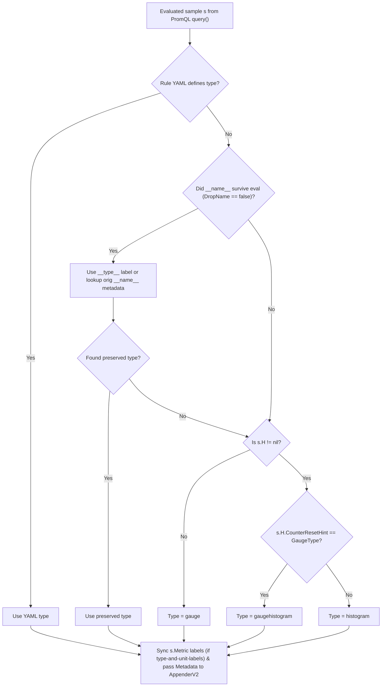

## Recording Rule Metadata Storage and Deduction

* **Owners:**
  * Bartek Plotka [@bwplotka](https://github.com/bwplotka)

* **Implementation Status:** `Not implemented`

* **Related Issues and PRs:**
  * https://github.com/prometheus/prometheus/issues/20027
  * https://github.com/prometheus/prometheus/issues/11969
  * https://github.com/prometheus/prometheus/pull/17864
  * https://github.com/prometheus/prometheus/pull/19555
  * https://github.com/prometheus/prometheus/pull/19563
  * https://github.com/prometheus/prometheus/issues/17632

* **Other docs or links:**
  * [PROM-39: Metric Family Identity Extension: Type and Unit as Labels](./0039-metadata-labels.md)

> TL;DR: This document proposes storing metric metadata (`type`, `unit`, `help`) for series produced by recording rules. It introduces a naive runtime deduction algorithm (behind a feature flag or configuration option) that infers metadata from evaluated samples and preserved schema labels, paired with optional `type`, `unit`, and `help` fields in recording rule YAML definitions to override or enrich the deduced metadata.

## Why

Recording rules evaluate PromQL expressions and write the resulting samples back to storage as new time series. Today, the rule manager appends these samples without any metric metadata (`type`, `unit`, `help`).

As Prometheus evolves toward first-class metadata support through `AppenderV2` ([prometheus#17632](https://github.com/prometheus/prometheus/issues/17632)), native TSDB metadata storage ([prometheus#19563](https://github.com/prometheus/prometheus/pull/19563)), Remote Write 2.0, and type-and-unit labels ([PROM-39](./0039-metadata-labels.md)), leaving recorded series without metadata creates several gaps:

1. Humans and AI tools rely on `/api/v1/metadata` (and UIs such as Grafana's metrics explorer) to discover metrics, understand what a pre-computed recording rule represents, and autocomplete PromQL queries. Recorded series are currently invisible in `/api/v1/metadata`.
2. Strongly typed backends receiving data via Remote Write 2.0 or OTLP (such as Google Cloud Managed Service for Prometheus) require a valid metric type for every series. Because recording rules emit `METRIC_TYPE_UNSPECIFIED` in Remote Write 2.0, receivers have to fall back to heuristics or reject recorded metrics.
3. Type-aware PromQL features (such as warning when `rate()` is applied to a non-counter, or future type-based aggregations) cannot reason about recorded series unless their type is stored.

### Pitfalls of the current solution

* `Group.Eval` in [`rules/group.go`](https://github.com/prometheus/prometheus/blob/10f69629039e0215d056eb4948f0bd0fd22f5c89/rules/group.go#L598-L604) uses the legacy `storage.Appender` v1 interface and never passes `metadata.Metadata` to storage.
* Requiring users to manually annotate thousands of existing recording rules in YAML before getting any `type` metadata in Remote Write 2.0 or `/api/v1/metadata` is impractical.
* When `--enable-feature=type-and-unit-labels` ([PROM-39](./0039-metadata-labels.md)) is enabled, PromQL strips `__type__` and `__unit__` on any operation that drops `__name__` (such as `rate()`, `sum()`, or arithmetic). As a result, most recording rules produce series without `__type__` or `__unit__` labels, while rules that do not drop `__name__` (such as `label_replace()` or plain selectors) silently keep the input series' `__type__` and `__unit__` labels without writing corresponding `metadata.Metadata` records to the WAL.

## Goals

Goals and use cases for the solution as proposed in [How](#how):

* Store `metadata.Metadata` (`Type`, `Unit`, `Help`) for all recording rule series via `AppenderV2` so that WAL metadata records, Remote Write 2.0, `type-and-unit-labels`, and `/api/v1/metadata` (via [prometheus#19563](https://github.com/prometheus/prometheus/pull/19563)) receive consistent metadata.
* Provide a naive automatic type deduction mechanism that works out of the box for existing recording rules without requiring YAML changes.
* Allow users to optionally specify `type`, `unit`, and `help` in recording rule YAML files to document rules and override automatic deduction when needed.

### Audience

Prometheus server maintainers, PromQL maintainers, rule authors, and maintainers of Remote Write 2.0 / OTLP receivers and query UIs.

## Non-Goals

* Full static type and unit inference across arbitrary PromQL AST expressions (for example, deriving that dividing `bytes` by `seconds` yields `bytes_per_second`, or querying TSDB metadata during rule file parsing).
* Attaching resource or target metadata to recording rules (covered separately in proposals such as [PROM-99](https://github.com/prometheus/proposals/pull/99)).

## How

Once the rule manager migrates to `AppenderV2` ([prometheus#17632](https://github.com/prometheus/prometheus/issues/17632)), [`Group.Eval`](https://github.com/prometheus/prometheus/blob/10f69629039e0215d056eb4948f0bd0fd22f5c89/rules/group.go#L598-L604) will append samples using `app.Append(0, s.Metric, 0, s.T, s.F, nil, s.H, storage.AOptions{Metadata: meta})`.

We propose rolling out recording rule metadata in two parts: automatic runtime deduction and optional YAML configuration.

### 1. Automatic metadata deduction (naive algorithm)

Behind a feature flag or configuration setting, Prometheus automatically deduces metadata for every sample `s` produced by a recording rule.

#### Why float samples can default to `gauge`, while native histograms need `CounterResetHint`

* For float samples (`s.H == nil`), almost all recording rules (`rate()`, `irate()`, `increase()`, `histogram_quantile()`, `avg()`, binary arithmetic) produce values that can increase and decrease. Even rules that aggregate counters without `rate()`, such as `sum by (job) (http_requests_total)`, do not produce true monotonic counters in Prometheus: when targets restart or series disappear, the sum decreases without a counter reset, which makes applying `rate()` to a pre-aggregated counter sum a known anti-pattern. Defaulting float samples to `gauge` is safe and accurate for the vast majority of rules.
* For native histogram samples (`s.H != nil`), marking a series as `gauge` is invalid in OpenMetrics, Remote Write 2.0, and OTLP, and breaks downstream typed backends. However, PromQL already tracks whether an evaluated native histogram is a counter histogram or a gauge histogram via `s.H.CounterResetHint` ([`model/histogram/histogram.go#L26-L33`](https://github.com/prometheus/prometheus/blob/10f69629039e0215d056eb4948f0bd0fd22f5c89/model/histogram/histogram.go#L26-L33)). Functions such as `rate()`, `irate()`, `increase()`, `delta()`, `idelta()` ([`promql/functions.go#L441`](https://github.com/prometheus/prometheus/blob/10f69629039e0215d056eb4948f0bd0fd22f5c89/promql/functions.go#L441)), histogram subtraction ([`promql/engine.go#L3628`](https://github.com/prometheus/prometheus/blob/10f69629039e0215d056eb4948f0bd0fd22f5c89/promql/engine.go#L3628)), and negative scalar multiplication/division ([`model/histogram/float_histogram.go#L302`](https://github.com/prometheus/prometheus/blob/10f69629039e0215d056eb4948f0bd0fd22f5c89/model/histogram/float_histogram.go#L302)) explicitly set `CounterResetHint = histogram.GaugeType`, and `sum()` / `avg()` preserve that hint ([`model/histogram/float_histogram.go#L2079-L2086`](https://github.com/prometheus/prometheus/blob/10f69629039e0215d056eb4948f0bd0fd22f5c89/model/histogram/float_histogram.go#L2079-L2086)). Therefore, inspecting `s.H.CounterResetHint` at runtime tells us directly whether the sample is a `gaugehistogram` or a `histogram`.

#### Algorithm

PromQL already tracks whether an expression changes the metric schema via the `DropName` flag on `promql.Series` and `promql.Sample`. Any operation that alters the metric's meaning (`rate()`, `sum()`, arithmetic, `histogram_quantile()`, `bool` comparisons) sets `DropName = true`, and `cleanupMetricLabels` ([`promql/engine.go#L4316-L4338`](https://github.com/prometheus/prometheus/blob/10f69629039e0215d056eb4948f0bd0fd22f5c89/promql/engine.go#L4316-L4338)) strips `__name__`, `__type__`, and `__unit__` before `query()` returns. Conversely, if an expression only filters or relabels an existing metric (`label_replace(http_requests_total, ...)`, `topk(5, http_requests_total)`, `http_requests_total > 10`), `DropName` remains `false` (even when nested, whereas `label_replace(rate(http_requests_total[5m]), ...)` propagates `DropName = true`).

Therefore, in `RecordingRule.Eval`, inspecting `origName := s.Metric.Get(labels.MetricName)` before overwriting `__name__` with `rule.name` tells us directly from `eval` whether the sample preserved an input metric's schema (`origName != ""`) or was computed by a schema-changing operation (`origName == ""`).

For each sample `s` returned by `query()` in `RecordingRule.Eval`:

1. Inspect `preserved := schema.NewMetadataFromLabels(s.Metric)` before `s.Metric` is modified:
   * `preserved.Name` (`__name__`) is non-empty if and only if PromQL evaluation preserved the input metric's schema (`DropName == false`).
   * When `type-and-unit-labels` is enabled, `preserved.Type` (`__type__`) and `preserved.Unit` (`__unit__`) are already populated on `s.Metric` whenever `preserved.Name != ""`.
   * When `type-and-unit-labels` is disabled and `preserved.Name != ""`, `RecordingRule.Eval` can look up `preserved.Name` in the storage/scrape metadata store ([prometheus#19563](https://github.com/prometheus/prometheus/pull/19563)) to populate `preserved.Type` and `preserved.Unit` (or fall back to naming convention suffixes such as `_total` in [`promql/engine.go#L2454-L2460`](https://github.com/prometheus/prometheus/blob/10f69629039e0215d056eb4948f0bd0fd22f5c89/promql/engine.go#L2454-L2460) if no metadata entry is found).
2. Determine `meta.Type`:
   1. If the rule YAML explicitly specifies `type`, use `rule.type`.
   2. Else if `preserved.Type` is not empty/unknown, use `preserved.Type`.
   3. Else if `s.H != nil`:
      * If `s.H.CounterResetHint == histogram.GaugeType`, set `meta.Type = model.MetricTypeGaugeHistogram`.
      * Otherwise, set `meta.Type = model.MetricTypeHistogram`.
   4. Else (`s.H == nil`), set `meta.Type = model.MetricTypeGauge`.
3. Determine `meta.Unit`:
   1. If the rule YAML explicitly specifies `unit`, use `rule.unit`.
   2. Else if `preserved.Unit` is non-empty, use `preserved.Unit`.
   3. Else set `meta.Unit = ""`.
4. Determine `meta.Help`:
   1. If the rule YAML explicitly specifies `help`, use `rule.help`.
   2. Else set `meta.Help = ""`.
5. Synchronize labels and `AppendV2Options`:
   1. When `type-and-unit-labels` is enabled, set `__name__`, `__type__`, and `__unit__` on `s.Metric` using `schema.Metadata{Name: rule.name, Type: meta.Type, Unit: meta.Unit}.SetToLabels(lb)` before checking `vector.ContainsSameLabelset()`.
   2. When `type-and-unit-labels` is disabled, drop any reserved `__type__` and `__unit__` labels from `s.Metric` and set only `__name__ = rule.name`.
   3. Pass `meta` in `storage.AOptions{Metadata: meta}` when appending `s` to `AppenderV2`.



### 2. Optional YAML extension in `rulefmt`

Extend [`rulefmt.Rule`](https://github.com/prometheus/prometheus/blob/10f69629039e0215d056eb4948f0bd0fd22f5c89/model/rulefmt/rulefmt.go#L186-L196) and [`rulefmt.RuleNode`](https://github.com/prometheus/prometheus/blob/10f69629039e0215d056eb4948f0bd0fd22f5c89/model/rulefmt/rulefmt.go#L200-L210) with optional `help`, `type`, and `unit` fields for recording rules:

```yaml
groups:
  - name: example
    rules:
      - record: job:http_requests:rate5m
        expr: sum by (job) (rate(http_requests_total[5m]))
        help: "Per-job HTTP request rate over 5 minutes."
        type: gauge
        unit: requests_per_second
```

Validation rules in `rulefmt` and `promtool check rules`:

* `help`, `type`, and `unit` are only allowed on recording rules (`record:` is set). Setting them on an alerting rule (`alert:` is set) returns a validation error because alerting rules use `annotations` and do not record user-named metrics.
* If `type` is non-empty, it must be a valid OpenMetrics / Prometheus `model.MetricType` (`counter`, `gauge`, `histogram`, `gaugehistogram`, `summary`, `info`, `stateset`, `unknown`).

### 3. Edge cases and implementation details uncovered in the codebase

#### Recording rules that only `label_replace` or select an existing metric

A user can write a recording rule that does not change the metric's semantics or drop `__name__`, such as:

```yaml
- record: cluster:http_requests_total
  expr: label_replace(http_requests_total, "cluster", "$1", "instance", "(.*):.*")
```

or a simple filter:

```yaml
- record: prod:http_requests_total
  expr: http_requests_total{env="prod"}
```

How does the algorithm detect and handle this from `Eval`?

* PromQL's `DropName` tracking already distinguishes `label_replace(http_requests_total, ...)` (`DropName == false`, so `s.Metric` still has `__name__="http_requests_total"` when returned to `RecordingRule.Eval`) from `label_replace(rate(http_requests_total[5m]), ...)` (`DropName == true`, because `evalLabelReplace` in [`promql/functions.go#L2511-L2515`](https://github.com/prometheus/prometheus/blob/10f69629039e0215d056eb4948f0bd0fd22f5c89/promql/functions.go#L2511-L2515) propagates `el.DropName`, so `cleanupMetricLabels` strips `__name__`).
* In `RecordingRule.Eval` ([`rules/recording.go#L95-L99`](https://github.com/prometheus/prometheus/blob/10f69629039e0215d056eb4948f0bd0fd22f5c89/rules/recording.go#L95-L99)), before `lb.Set(labels.MetricName, rule.name)` overwrites `__name__`, we check `origName := sample.Metric.Get(labels.MetricName)`:
  * When `type-and-unit-labels` is enabled and `origName != ""`, `sample.Metric` already carries the preserved `__type__` and `__unit__` labels from the input series.
  * When `type-and-unit-labels` is disabled and `origName != ""`, we still know the exact input metric family name (`origName`) from `sample.Metric`! `RecordingRule.Eval` can query the TSDB metadata store ([prometheus#19563](https://github.com/prometheus/prometheus/pull/19563)) for `origName` (or `s.meta` on the head series) to copy its `Type` and `Unit`, and fall back to suffix heuristics (`_total`, `_count`, `_sum`, `_bucket` as in [`promql/engine.go#L2454-L2460`](https://github.com/prometheus/prometheus/blob/10f69629039e0215d056eb4948f0bd0fd22f5c89/promql/engine.go#L2454-L2460)) or `gauge` if no metadata is stored for `origName`.

#### Inconsistency in `without` vs `by` aggregations with `type-and-unit-labels`

In [`promql/engine.go#L4474-L4487`](https://github.com/prometheus/prometheus/blob/10f69629039e0215d056eb4948f0bd0fd22f5c89/promql/engine.go#L4474-L4487), `generateGroupingLabels` currently handles `without` and `by` inconsistently when `type-and-unit-labels` is enabled:

* `by (job)` calls `enh.lb.Keep(grouping...)`, which drops `__name__`, `__type__`, and `__unit__`.
* `without (instance)` calls `enh.lb.Del(grouping...)` and `enh.lb.Del(labels.MetricName)`, which deletes `__name__` but accidentally keeps `__type__` and `__unit__`! For example, `count without (instance) (http_requests_total)` currently retains `__type__="counter"` and `__unit__="requests"`, violating [PROM-39](./0039-metadata-labels.md) ("When a query drops the metric name in an effect of an operation or function, `__type__` and `__unit__` will also be dropped").

As part of this work, `generateGroupingLabels` in `without` mode should drop all metadata labels (`schema.Metadata{}.SetToLabels(enh.lb)`) unless the aggregation is explicitly designed to preserve them.

#### `AlertingRule.Eval` leaking `__type__` and `__unit__` into `ALERTS` and `ALERTS_FOR_STATE`

In [`rules/alerting.go#L435-L441`](https://github.com/prometheus/prometheus/blob/10f69629039e0215d056eb4948f0bd0fd22f5c89/rules/alerting.go#L435-L441), `AlertingRule.Eval` builds alert labels from the query result sample by calling `lb.Del(labels.MetricName)`. When `type-and-unit-labels` is enabled and an alert expression does not drop `__name__` (such as `http_errors_total > 10`), the alert labels and the resulting `ALERTS` and `ALERTS_FOR_STATE` time series appended in `Group.Eval` inherit `__type__` and `__unit__` from `http_errors_total`.

`AlertingRule.Eval` should strip reserved metadata labels (`schema.IsMetadataLabel`), and `Group.Eval` should append `ALERTS` and `ALERTS_FOR_STATE` with `type = gauge` metadata.

#### Synchronizing `s.Metric` labels, duplicate detection, and staleness tracking

[`headAppenderV2.Append`](https://github.com/prometheus/prometheus/blob/10f69629039e0215d056eb4948f0bd0fd22f5c89/tsdb/head_append_v2.go#L110) does not automatically inject `__type__` and `__unit__` into `ls` from `opts.Metadata`, while Remote Write 2.0 ([`storage/remote/queue_manager.go#L1980-L1989`](https://github.com/prometheus/prometheus/blob/10f69629039e0215d056eb4948f0bd0fd22f5c89/storage/remote/queue_manager.go#L1980-L1989)) reads `Type` and `Unit` from `seriesLabels` when `type-and-unit-labels` is enabled.

Updating `s.Metric` inside `RecordingRule.Eval` (before `vector.ContainsSameLabelset()` at [`rules/recording.go#L110`](https://github.com/prometheus/prometheus/blob/10f69629039e0215d056eb4948f0bd0fd22f5c89/rules/recording.go#L110)) ensures:

1. If a rule combines two series that only differed by their input `__type__` or `__unit__` (for example via `or`), overriding their metadata to the recording rule's single `type` and `unit` will be caught by `vector.ContainsSameLabelset()` as `ErrDuplicateRecordingLabelSet` rather than failing during TSDB append.
2. `g.seriesInPreviousEval` ([`rules/group.go#L629`](https://github.com/prometheus/prometheus/blob/10f69629039e0215d056eb4948f0bd0fd22f5c89/rules/group.go#L629)) stores the exact labelset (including `__type__` and `__unit__`) needed to append `StaleNaN` markers when a recorded series disappears on a subsequent evaluation.

#### Conflict between explicit YAML `type` and runtime sample type

Because PromQL AST expressions of `ValueTypeVector` can evaluate to either float samples or native histogram samples depending on the data in TSDB, `promtool check rules` cannot always verify at parse time whether an expression returns a float or a native histogram. If a user configures `type: gauge` or `type: counter` in YAML, but the expression evaluates at runtime to a native histogram (`s.H != nil`), or configures `type: histogram` on a rule that evaluates to a float (`s.H == nil`), the runtime type deduced from `s.H` should take precedence (or fail the rule evaluation with an error) so that Prometheus never writes a float sample with `histogram` metadata or a native histogram sample with `gauge` metadata.

#### `/api/v1/rules` vs `/api/v1/metadata`

In `/api/v1/rules`, the `RecordingRule` JSON object ([`web/api/v1/api.go#L1696-L1706`](https://github.com/prometheus/prometheus/blob/10f69629039e0215d056eb4948f0bd0fd22f5c89/web/api/v1/api.go#L1696-L1706)) already uses `"type": "recording"` to distinguish recording rules from `"type": "alerting"`. Once [prometheus#19563](https://github.com/prometheus/prometheus/pull/19563) lands, `/api/v1/metadata` will automatically serve the recording rule's `metadata.Metadata` from TSDB storage. If we also expose the configured metadata in `/api/v1/rules`, it should be placed under a nested `metadata` field (or `metricType`, `unit`, `help`) to avoid colliding with `"type": "recording"`.

## Alternatives

### 1. Only support explicit YAML metadata (no automatic deduction)

We could only write metadata when a user explicitly configures `type`, `unit`, or `help` in the rule YAML, as proposed in [prometheus#17864](https://github.com/prometheus/prometheus/pull/17864) and [prometheus#19555](https://github.com/prometheus/prometheus/pull/19555).

We did not choose this as the sole mechanism because existing deployments have thousands of recording rules defined in mixins and community rule packs. Without automatic deduction, all existing recording rules would continue to emit `unknown` / unspecified types to Remote Write 2.0, OTLP receivers, and `/api/v1/metadata` until every rule file is manually edited.

### 2. Nested `metadata:` block in YAML vs flat fields

[prometheus#17864](https://github.com/prometheus/prometheus/pull/17864) proposed nesting `type`, `help`, and `unit` under a `metadata:` key in YAML, whereas [prometheus#19555](https://github.com/prometheus/prometheus/pull/19555) proposed top-level fields on the rule object.

Top-level `help`, `type`, and `unit` fields on the recording rule are flatter, match the existing `labels` and `annotations` style in `rulefmt`, and map 1:1 to `metadata.Metadata`. However, a nested `metadata:` block is also viable if maintainers prefer grouping metadata fields together.

### 3. Static AST-based type and unit inference

Instead of (or in addition to) runtime sample inspection, the rule manager could walk the PromQL AST (`parser.Expr`) to infer types and units (for example, inferring `counter` for `sum(my_counter_total)` or inferring `seconds` for `histogram_quantile(0.9, rate(http_request_duration_seconds_bucket[5m]))`).

We defer deep AST inference because:

* Without querying TSDB metadata at rule load time, the AST alone does not know the types or units of the input vector selectors.
* Even `sum(my_counter_total)` is not a monotonic counter when series churn occurs, so inferring `counter` from `sum()` can mislead downstream consumers.
* The naive runtime check (`s.H == nil` vs `s.H.CounterResetHint`, plus preserved `__type__`/`__unit__` labels) handles float gauges, counter histograms, gauge histograms, and `label_replace` rules with minimal code complexity.

## Action Plan

* [ ] Migrate `rules.Group` from `storage.Appender` v1 to `storage.AppenderV2` ([prometheus#17632](https://github.com/prometheus/prometheus/issues/17632)).
* [ ] Fix `promql.generateGroupingLabels` (`without`) and `rules.AlertingRule.Eval` so `__type__` and `__unit__` labels are not leaked when `--enable-feature=type-and-unit-labels` is enabled.
* [ ] Implement naive automatic metadata deduction for recording rules behind a feature flag / config option ([prometheus#20027](https://github.com/prometheus/prometheus/issues/20027)).
* [ ] Extend `model/rulefmt` and `promtool` with optional `help`, `type`, and `unit` fields for recording rules ([prometheus#20027](https://github.com/prometheus/prometheus/issues/20027)).
