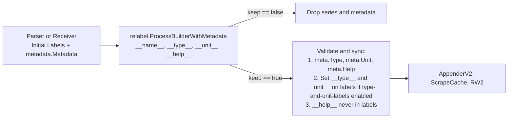

## Metric metadata manipulation via relabeling

* **Owners:**
  * Bartek Plotka [@bwplotka](https://github.com/bwplotka)

* **Implementation Status:** `Not implemented`

* **Related Issues and PRs:**
  * https://github.com/prometheus/prometheus/issues/19832
  * https://github.com/prometheus/prometheus/issues/16610
  * https://github.com/prometheus/prometheus/issues/14013
  * https://github.com/prometheus/prometheus/issues/17619
  * https://github.com/prometheus/prometheus/issues/17900
  * https://github.com/prometheus/prometheus/pull/16743
  * https://github.com/prometheus/prometheus/pull/19563
  * https://github.com/prometheus/prometheus/pull/19675

* **Other docs or links:**
  * [PROM-39: Metric Family Identity Extension: Type and Unit as Labels](./0039-metadata-labels.md)
  * [PROM-103: Recording Rule Metadata Storage and Deduction](https://github.com/prometheus/proposals/pull/103)

> TL;DR: This document proposes allowing operators to inspect, rewrite, and drop metric metadata `type`, `unit`, and `help` across `metric_relabel_configs`, `write_relabel_configs`, and `receive_relabel_configs`. It unifies the two unsynchronized metadata paths in Prometheus so that relabeling `__type__`, `__unit__`, and a virtual `__help__` label updates both the `metadata.Metadata` record and the `type-and-unit-labels` series labels, while fixing metadata loss on metric renames and stale metadata retention on dropped series. It also evaluates the alternative of introducing dedicated `metadata_replace` and `metadata_drop` relabel actions.

## Why

Prometheus gives operators full control over series labels through `metric_relabel_configs` and `write_relabel_configs`, and is adding `receive_relabel_configs` for Remote Write and OTLP ingestion in [prometheus#19675](https://github.com/prometheus/prometheus/pull/19675). However, Prometheus provides no supported, end-to-end mechanism to fix or drop `TYPE`, `UNIT`, and `HELP` metadata.

Historically, metadata in Prometheus was mostly decorative, which made broken or missing metadata tolerable. With [PROM-39](./0039-metadata-labels.md) and `--enable-feature=type-and-unit-labels`, `AppenderV2`, native TSDB metadata storage in [prometheus#19563](https://github.com/prometheus/prometheus/pull/19563), and Remote Write 2.0, metadata is now part of series identity, selectable in PromQL, used to drive PromQL counter-ness annotations in [`promql/engine.go#L2445-L2462`](https://github.com/prometheus/prometheus/blob/10f69629039e0215d056eb4948f0bd0fd22f5c89/promql/engine.go#L2445-L2462), and required by strongly typed downstream backends such as OpenTelemetry and Google Cloud Managed Service for Prometheus.

When third-party or legacy exporters emit broken or missing metadata, operators cannot patch every target binary and need a way to fix metadata at ingestion or forwarding time:

1. Specifying a missing or wrong `TYPE` or `UNIT`. A large share of exposition in the wild is untyped, including textfile collectors, `statsd_exporter`, JMX exporter, and custom `/metrics` handlers. An operator knows that metrics matching `myapp_.*_total` are counters, or that `http_request_latency_ms` has unit `milliseconds`, or wants to strip a misleading unit declared by a broken exporter. Users sending OTLP or Remote Write directly to Prometheus currently have to deploy an OpenTelemetry Collector with a `transform` processor just to fix a metric unit or description.
2. Relabeling metrics based on `TYPE` or `UNIT` while keeping metadata intact. An operator may want to append `_total` to all `counter` metrics that lack the suffix, drop all `info` metrics, or rename a metric family without losing its `TYPE`, `UNIT`, and `HELP`.
3. Dropping or truncating oversized `HELP` strings. Some exporters emit multi-kilobyte `HELP` text containing whole paragraphs, embedded JSON, or stack traces. This inflates scrape cache memory, TSDB head metadata memory in [prometheus#19563](https://github.com/prometheus/prometheus/pull/19563), WAL records, and Remote Write 2.0 bandwidth. Today, the only knob is `metadata_config.send: false` in Remote Write 1.0, which drops all metadata for all metrics including `TYPE` and `UNIT`.

### Pitfalls of the current solution

Today, Prometheus maintains two parallel metadata channels that do not stay in sync:

| Property                     | Channel 1: `metadata.Metadata` record                                          | Channel 2: `__type__` and `__unit__` labels                           |
|------------------------------|--------------------------------------------------------------------------------|-----------------------------------------------------------------------|
| Keyed by                     | Metric family name in `scrapeCache`, or series in `AppenderV2`                 | Series label set `labels.Labels`                                      |
| Source                       | `# TYPE`, `# UNIT`, `# HELP`, RW2 `Metadata`, OTLP descriptor                  | Parsers and ingestion handlers when `type-and-unit-labels` is enabled |
| Carries `HELP`               | Yes                                                                            | No                                                                    |
| Reaches                      | Metadata WAL records, TSDB native metadata, RW2 `Metadata`, `/api/v1/metadata` | TSDB series labels, PromQL, RW2 `Type` and `Unit`                     |
| Mutable via relabeling today | No                                                                             | Yes, partially and inconsistently                                     |

Inspecting the codebase reveals several bugs and inconsistencies between these two channels:

* Relabeling `__type__` and `__unit__` in `metric_relabel_configs` already mutates series labels today, even when `--enable-feature=type-and-unit-labels` is disabled. Scrape parsers inject `__type__` and `__unit__` in [`promparse.go#L250-L254`](https://github.com/prometheus/prometheus/blob/10f69629039e0215d056eb4948f0bd0fd22f5c89/model/textparse/promparse.go#L250-L254) and [`openmetricsparse.go#L228-L232`](https://github.com/prometheus/prometheus/blob/10f69629039e0215d056eb4948f0bd0fd22f5c89/model/textparse/openmetricsparse.go#L228-L232), `mutateSampleLabels` runs `relabel.ProcessBuilder` afterward in [`scrape/scrape_append_v2.go#L224`](https://github.com/prometheus/prometheus/blob/10f69629039e0215d056eb4948f0bd0fd22f5c89/scrape/scrape_append_v2.go#L224), and nothing strips `__`-prefixed labels on the sample path because `__meta_*` stripping in [`scrape/target.go#L691-L697`](https://github.com/prometheus/prometheus/blob/10f69629039e0215d056eb4948f0bd0fd22f5c89/scrape/target.go#L691-L697) only applies to target relabeling. `TestTypeUnitReLabel` in [`scrape/scrape_test.go#L6937-L6965`](https://github.com/prometheus/prometheus/blob/10f69629039e0215d056eb4948f0bd0fd22f5c89/scrape/scrape_test.go#L6937-L6965) tests this behavior without enabling `type-and-unit-labels`.
* The documentation contradicts the implementation. [`docs/feature_flags.md#L252-L253`](https://github.com/prometheus/prometheus/blob/10f69629039e0215d056eb4948f0bd0fd22f5c89/docs/feature_flags.md#L252-L253) states that all user-provided labels with `__type__` and `__unit__` will be overridden, which is only true for labels exposed directly by the target before relabeling, not for labels set via `metric_relabel_configs`.
* The `metadata.Metadata` record ignores relabeling. In [`scrape/scrape_append_v2.go#L312-L323`](https://github.com/prometheus/prometheus/blob/10f69629039e0215d056eb4948f0bd0fd22f5c89/scrape/scrape_append_v2.go#L312-L323) and [`scrape/scrape.go#L2047-L2060`](https://github.com/prometheus/prometheus/blob/10f69629039e0215d056eb4948f0bd0fd22f5c89/scrape/scrape.go#L2047-L2060), the scrape loop attaches `lastMeta` straight from the parser. After relabeling `__type__` or `__unit__`, the series labels in TSDB, the `metadata.Metadata` passed to `AppenderV2`, and `/api/v1/metadata` all disagree.
* Renaming a metric in `metric_relabel_configs` silently drops its `metadata.Metadata`. [`scrape/scrape_append_v2.go#L315`](https://github.com/prometheus/prometheus/blob/10f69629039e0215d056eb4948f0bd0fd22f5c89/scrape/scrape_append_v2.go#L315) calls `isSeriesPartOfFamily(lset.Get(model.MetricNameLabel), lastMFName, lastMeta.Type)` using the post-relabel `__name__`. When a rule renames `foo` to `bar`, `isSeriesPartOfFamily` returns `false`, and line 316 sets `lastMeta = nil`, dropping metadata for `bar` and for any subsequent series in the same family.
* Dropping all series of a metric family in `metric_relabel_configs` still leaves the family's metadata in `scrapeCache.metadata` and `/api/v1/metadata`, tracked in [prometheus#14013](https://github.com/prometheus/prometheus/issues/14013), because [`scrape/scrape_append_v2.go#L173-L183`](https://github.com/prometheus/prometheus/blob/10f69629039e0215d056eb4948f0bd0fd22f5c89/scrape/scrape_append_v2.go#L173-L183) writes `EntryType`, `EntryHelp`, and `EntryUnit` directly into `sl.cache` before series are parsed or relabeled.
* Remote Write 2.0 sender and receiver have opposite precedence. When `type-and-unit-labels` is enabled, the RW2 sender in [`storage/remote/queue_manager.go#L1980-L1989`](https://github.com/prometheus/prometheus/blob/10f69629039e0215d056eb4948f0bd0fd22f5c89/storage/remote/queue_manager.go#L1980-L1989) takes `Type` and `Unit` from `seriesLabels` and `Help` from `d.metadata`. On the RW2 receiver in [`storage/remote/write_handler.go#L327-L339`](https://github.com/prometheus/prometheus/blob/10f69629039e0215d056eb4948f0bd0fd22f5c89/storage/remote/write_handler.go#L327-L339), `ts.ToMetadata(req.Symbols)` overwrites incoming `__type__` and `__unit__` labels whenever `m.Type` or `m.Unit` is non-empty. If a sender does not have `type-and-unit-labels` enabled, `write_relabel_configs` injects `__type__` into `d.seriesLabels` while `d.metadata` still sends the old `Type`, which the receiver then uses to overwrite `__type__`.
* `HELP` has no representation in relabeling and is zeroed when constructing metadata from labels in [`storage/remote/queue_manager.go#L1984`](https://github.com/prometheus/prometheus/blob/10f69629039e0215d056eb4948f0bd0fd22f5c89/storage/remote/queue_manager.go#L1984).

## Goals

Goals and use cases for the solution as proposed in [How](#how):

* Allow operators to inspect, set, rewrite, and clear `type`, `unit`, and `help` metadata in `metric_relabel_configs`, `write_relabel_configs`, and `receive_relabel_configs` from [prometheus#19675](https://github.com/prometheus/prometheus/pull/19675).
* Keep `metadata.Metadata` records and `__type__` and `__unit__` series labels synchronized across scrape, TSDB storage, WAL metadata records, `/api/v1/metadata`, Remote Write 2.0, and OTLP ingestion.
* Work consistently whether `--enable-feature=type-and-unit-labels` is enabled or disabled.
* Preserve a metric's metadata when its `__name__` is renamed during relabeling, and exclude metadata from `scrapeCache` when all series of a metric family are dropped as described in [prometheus#14013](https://github.com/prometheus/prometheus/issues/14013).
* Validate relabeled `type` and `unit` values at config load time when static, and at runtime when dynamic.

### Audience

Prometheus server maintainers, operators managing scrape, Remote Write, and OTLP pipelines, and maintainers of downstream Remote Write 2.0 and OTLP backends.

## Non-Goals

* Introducing a new general-purpose transformation DSL such as OpenTelemetry's OTTL into Prometheus configuration.
* Automatic unit value conversion, such as multiplying sample values by `0.001` when rewriting `milliseconds` to `seconds`.
* Automatic sample value conversion between incompatible data structures, such as converting a float series into a native histogram by relabeling `__type__` to `histogram`.

## How

We propose making metric metadata `type`, `unit`, and `help` first-class virtual schema labels `__type__`, `__unit__`, and `__help__` during relabeling. These labels are backed directly by `metadata.Metadata` in the relabel engine so that standard relabel actions `replace`, `keep`, `drop`, `keepequal`, `dropequal`, `lowercase`, `uppercase`, and `labeldrop` work uniformly across labels and metadata.

We also detail and compare the main alternative design using `action: metadata_replace` and `action: metadata_drop` in [Alternatives](#1-dedicated-metadata-relabel-actions-metadatareplace-metadatadrop).

### 1. Metadata representation during relabeling

Every metric sample or series entering a relabel stage (`metric_relabel_configs` on scrape, `write_relabel_configs` on Remote Write, and `receive_relabel_configs` on Remote Write and OTLP receive) has both a label set `*labels.Builder` and a metadata struct `*metadata.Metadata`.

During `relabel.ProcessBuilderWithMetadata(lb *labels.Builder, meta *metadata.Metadata, cfgs ...*Config)`:

1. Three reserved label names map to the metric's metadata fields:
   * `__type__` (`model.MetricTypeLabel`) maps to `meta.Type`. Following [PROM-39](./0039-metadata-labels.md) and [`schema.Metadata`](https://github.com/prometheus/prometheus/blob/10f69629039e0215d056eb4948f0bd0fd22f5c89/schema/labels.go#L82-L85), `model.MetricTypeUnknown` and `""` are equivalent. Reading `__type__` when `meta.Type == model.MetricTypeUnknown` yields `""`, and setting `__type__` to `""` or `"unknown"` sets `meta.Type = model.MetricTypeUnknown` and removes `__type__` from `lb`.
   * `__unit__` (`model.MetricUnitLabel`) maps to `meta.Unit`.
   * `__help__` (`model.MetricHelpLabel`) maps to `meta.Help`.
2. When `cfg.SourceLabels` or `cfg.TargetLabel` in `keepequal` and `dropequal` references `__type__`, `__unit__`, or `__help__`, the relabeler reads the value directly from `meta`.
3. When `replace`, `lowercase`, `uppercase`, or `hashmod` writes to `__type__`, `__unit__`, or `__help__`, or when `labeldrop` matches `__type__`, `__unit__`, or `__help__`:
   * Writing to `__help__` updates `meta.Help` directly. `__help__` is never inserted into `lb`, so it never becomes a series label in TSDB, never affects series hashes or identity, and never allocates space in `labels.Builder`.
   * Writing to `__type__` validates and normalizes the type value as described in [Validation](#5-validation-of-type-and-unit-values), updates `meta.Type`, and updates `__type__` on `lb` when `type-and-unit-labels` is enabled.
   * Writing to `__unit__` updates `meta.Unit`, and updates `__unit__` on `lb` when `type-and-unit-labels` is enabled.
4. Because `__help__`, along with `__type__` and `__unit__` when `type-and-unit-labels` is disabled, lives in `meta` rather than `lb`, existing configs using `action: labelkeep` with `regex: __name__|job|instance` or `action: labelmap` will not delete `meta.Help`, `meta.Type`, or `meta.Unit`, nor copy `__help__` into user labels. When `type-and-unit-labels` is enabled, `ProcessBuilderWithMetadata` re-syncs `__type__` and `__unit__` from `meta` after the rule loop unless `labeldrop` explicitly matched `__type__` or `__unit__`.



### 2. Relabeling examples across use cases

#### Use case 1a: Specify a missing or wrong `TYPE`

```yaml
metric_relabel_configs:
  # Set type=counter on untyped (__type__ == "") metrics ending in _total.
  - source_labels: [__name__, __type__]
    regex: 'myapp_.*_total;'
    target_label: __type__
    replacement: counter

  # Force type=gauge on a metric where the exporter wrongly declares counter.
  - source_labels: [__name__]
    regex: 'legacy_current_connections_total'
    target_label: __type__
    replacement: gauge
```

#### Use case 1b: Derive `UNIT` from metric name suffix or strip a wrong unit

```yaml
metric_relabel_configs:
  # Populate unit=milliseconds for metrics ending in _ms that have no unit.
  - source_labels: [__name__, __unit__]
    regex: '.*_ms;'
    target_label: __unit__
    replacement: milliseconds

  # Derive common base units from metric name suffixes when unit is empty.
  - source_labels: [__name__, __unit__]
    regex: '.*_(seconds|bytes)(?:_total|_bucket|_sum|_count)?;'
    target_label: __unit__
    replacement: '$1'

  # Strip a misleading unit declared by an exporter.
  - source_labels: [__name__]
    regex: 'broken_exporter_cache_hit_ratio'
    target_label: __unit__
    replacement: ''
```

#### Use case 1c: Fix metadata on Remote Write or OTLP receive

Combined with `receive_relabel_configs` from [prometheus#19675](https://github.com/prometheus/prometheus/pull/19675), operators can fix metadata pushed via OTLP or Remote Write without deploying a separate OpenTelemetry Collector:

```yaml
otlp:
  promote_resource_attributes: [service.name]
receive_relabel_configs:
  - source_labels: [__name__]
    regex: 'http\.server\.duration'
    target_label: __unit__
    replacement: seconds
  - source_labels: [service_name]
    regex: 'noisy-service'
    target_label: __help__
    replacement: ''
```

#### Use case 2: Relabel based on `TYPE` or `UNIT` and preserve metadata across renames

```yaml
metric_relabel_configs:
  # Ensure all counter metrics end with _total in two RE2 steps to avoid _total_total.
  - source_labels: [__name__, __type__]
    regex: '(.*);counter'
    target_label: __name__
    replacement: '${1}_total'
  - source_labels: [__name__, __type__]
    regex: '(.*_total)_total;counter'
    target_label: __name__
    replacement: '$1'

  # Rename a metric while keeping its original TYPE, UNIT, and HELP intact.
  - source_labels: [__name__]
    regex: 'old_subsystem_(.*)'
    target_label: __name__
    replacement: 'new_subsystem_$1'
```

#### Use case 3: Drop or truncate large `HELP` strings

```yaml
metric_relabel_configs:
  # Drop HELP for a specific noisy metric family.
  - source_labels: [__name__]
    regex: 'jvm_.*'
    target_label: __help__
    replacement: ''

  # Truncate all HELP strings in this job to at most 256 characters.
  - source_labels: [__help__]
    regex: '(.{256}).+'
    target_label: __help__
    replacement: '${1}...'

  # Or drop HELP for all metrics in this job.
  - target_label: __help__
    replacement: ''
```

### 3. Scrape loop, rename tracking, and `scrapeCache` changes

To make metadata relabeling work end-to-end in `scrape` and fix the existing bugs in [`scrape/scrape_append_v2.go`](https://github.com/prometheus/prometheus/blob/10f69629039e0215d056eb4948f0bd0fd22f5c89/scrape/scrape_append_v2.go) and [`scrape/scrape.go`](https://github.com/prometheus/prometheus/blob/10f69629039e0215d056eb4948f0bd0fd22f5c89/scrape/scrape.go):

1. Evaluate family membership before relabeling:
   * In `scrapeLoopAppenderV2.append`, `lastMFName` and `lastMeta` come from the parser's `# TYPE`, `# HELP`, and `# UNIT` entries. Whether a scraped series belongs to `lastMFName` is a property of the exposition text, not the post-relabel metric name.
   * Before calling `sampleMutator`, check `isSeriesPartOfFamily(preRelabelName, lastMFName, lastMeta.Type)`. If it matches, initialize the sample's `meta = lastMeta.Metadata` and record the series suffix relative to `lastMFName` (`""`, `"_bucket"`, `"_sum"`, or `"_count"`). If it does not match, such as an untyped metric following an earlier `# TYPE` block, initialize `meta = metadata.Metadata{Type: model.MetricTypeUnknown}` without zeroing `lastMeta` for subsequent series.
2. Mutate labels and metadata together:
   * Change `sampleMutator` to accept and return `(labels.Labels, metadata.Metadata)`.
   * Inside `mutateSampleLabels`, run `relabel.ProcessBuilderWithMetadata(lb, &meta, rc...)`.
   * After relabeling, if `enableTypeAndUnitLabels` is true, call `schema.Metadata{Name: lb.Get(model.MetricNameLabel), Type: meta.Type, Unit: meta.Unit}.SetToLabels(lb)` so the final label set and `meta` match. If `enableTypeAndUnitLabels` is false, ensure `__type__` and `__unit__` are not present on `lb`.
3. Cache post-relabel metadata on `cacheEntry` and handle metadata changes across scrapes:
   * Store the post-relabel `meta` and post-relabel `mfName` on `cacheEntry` (`ce`) in `scrapeCache`.
   * Today, [`scrape/scrape_append_v2.go#L208-L218`](https://github.com/prometheus/prometheus/blob/10f69629039e0215d056eb4948f0bd0fd22f5c89/scrape/scrape_append_v2.go#L208-L218) skips `p.Labels(&lset)` and `sl.sampleMutator(lset)` whenever `seriesCached == true`. However, `met` is only the raw series line `foo{a="b"}`, so if a target changes `# TYPE`, `# UNIT`, or `# HELP` on a later scrape (`lastMeta.lastIterChange == sl.cache.iter`), `seriesCached` remains true and `ce.lset` keeps stale `__type__` and `__unit__` labels.
   * When `seriesCached == true` and `lastMeta != nil && lastMeta.lastIterChange == sl.cache.iter`, re-run `p.Labels(&lset)` and `sl.sampleMutator(lset, meta)` to refresh `ce.lset` and `ce.meta`. On all other cached scrapes, reuse `ce.lset` and `ce.meta` with zero relabeling overhead.
4. Update `scrapeCache.metadata` post-relabel to fix [prometheus#14013](https://github.com/prometheus/prometheus/issues/14013):
   * Instead of inserting into `sl.cache.metadata` immediately upon parsing `EntryType`, `EntryHelp`, or `EntryUnit` before knowing whether all series in the family will be dropped or renamed, hold `lastMFName` and `lastMeta` as parser state during the scrape loop and update `sl.cache.metadata[postRelabelMFName]` only when at least one series of that family survives `sampleMutator`.
   * If all series of a metric family are dropped by `metric_relabel_configs`, its metadata is never marked seen in `sl.cache.metadata` and is evicted.
   * If a metric is renamed, `sl.cache.metadata` records the post-relabel `meta` under the post-relabel metric family name.

### 4. Precedence on Remote Write 2.0 and OTLP

To ensure metadata edits round-trip across Remote Write 2.0 and OTLP:

* On the Remote Write 2.0 sender in [`storage/remote/queue_manager.go#L1975-L2001`](https://github.com/prometheus/prometheus/blob/10f69629039e0215d056eb4948f0bd0fd22f5c89/storage/remote/queue_manager.go#L1975-L2001), `write_relabel_configs` runs on each outgoing series with its `metadata.Metadata` constructed from `d.metadata` and `schema.NewMetadataFromLabels(d.seriesLabels)`. The post-relabel `meta` populates `pendingData[nPending].Metadata`, and if `enableTypeAndUnitLabels` is false on the sender, `__type__` and `__unit__` are stripped from `d.seriesLabels` before symbolizing labels.
* On the Remote Write 2.0 receiver in [`storage/remote/write_handler.go#L322-L339`](https://github.com/prometheus/prometheus/blob/10f69629039e0215d056eb4948f0bd0fd22f5c89/storage/remote/write_handler.go#L322-L339), incoming `ts.ToMetadata(req.Symbols)` and incoming `__type__` and `__unit__` labels form the initial `meta`. If `receive_relabel_configs` from [prometheus#19675](https://github.com/prometheus/prometheus/pull/19675) is configured, it runs `ProcessBuilderWithMetadata(lb, &meta, cfgs...)` before syncing `meta` to `ls` when `enableTypeAndUnitLabels` is enabled and passing `storage.AOptions{Metadata: meta}` to `app.Append`.
* On OTLP ingestion in [`storage/remote/otlptranslator/prometheusremotewrite/helper.go#L165-L173`](https://github.com/prometheus/prometheus/blob/10f69629039e0215d056eb4948f0bd0fd22f5c89/storage/remote/otlptranslator/prometheusremotewrite/helper.go#L165-L173) and [`metrics_to_prw.go#L241`](https://github.com/prometheus/prometheus/blob/10f69629039e0215d056eb4948f0bd0fd22f5c89/storage/remote/otlptranslator/prometheusremotewrite/metrics_to_prw.go#L241), update `metrics_to_prw.go` to pass `UTF8Allowed: settings.AllowUTF8` to `UnitNamer` so `meta.Unit` and `__unit__` are normalized identically before `receive_relabel_configs` runs.

### 5. Validation of `type` and `unit` values

Allowing arbitrary regex replacements on `__type__` risks silent typos such as `replacement: guage`. We propose two layers of validation:

1. Config-load validation in `relabel.Config.Validate()` at [`model/relabel/relabel.go#L120`](https://github.com/prometheus/prometheus/blob/10f69629039e0215d056eb4948f0bd0fd22f5c89/model/relabel/relabel.go#L120):
   * When `c.TargetLabel == model.MetricTypeLabel` and `c.Action == Replace` and `!varInRegexTemplate(c.Replacement)`, `Validate()` checks that `c.Replacement` is either `""` or a valid lowercase `model.MetricType`: `counter`, `gauge`, `histogram`, `gaugehistogram`, `summary`, `info`, `stateset`, or `unknown`. A typo like `replacement: guage` fails `promtool check config` and config reload immediately.
2. Runtime validation during relabeling:
   * If a dynamic replacement such as `$1` or `uppercase` produces an unrecognized `__type__` value at runtime, the relabeler normalizes `meta.Type` to `model.MetricTypeUnknown` and removes `__type__` rather than storing an invalid type string in TSDB or sending an invalid enum over Remote Write 2.0.
   * For sample type compatibility, as noted in [PROM-103](https://github.com/prometheus/proposals/pull/103), TSDB and Remote Write 2.0 require the metadata type to match the physical sample value type (`s.H != nil`). In `scrape_append_v2.go`, if `isHistogram` is true, `meta.Type` can only be `histogram` or `gaugehistogram`; if `isHistogram` is false and a classic histogram suffix is not present, `histogram` and `gaugehistogram` are ignored.

## Alternatives

### 1. Dedicated metadata relabel actions (`metadata_replace`, `metadata_drop`)

Instead of targeting `__type__`, `__unit__`, and `__help__` with the standard `replace` and `labeldrop` actions, we could introduce dedicated metadata actions in `relabel.Config`, as suggested by [@roidelapluie](https://github.com/prometheus/prometheus/issues/19832#issuecomment-6214046553):

* `action: metadata_replace` matches `source_labels` against `regex` and writes `replacement` into the metadata field specified by `target_label` or a new `target_metadata` field, which must be `type`, `unit`, or `help`.
* `action: metadata_drop` clears the metadata field specified by `target_label` when `source_labels` matches `regex`.

When trying to express all use cases from [prometheus#19832](https://github.com/prometheus/prometheus/issues/19832) with `action: metadata_replace` and `action: metadata_drop`, the central question is whether `source_labels` can also read the metric's existing metadata via the reserved `__type__`, `__unit__`, and `__help__` names:

* If `source_labels` cannot read metadata and only `action: metadata_replace` and `action: metadata_drop` can write to metadata from regular labels like `__name__`, then [Use case 2](#use-case-2-relabel-based-on-type-or-unit-and-preserve-metadata-across-renames) from [prometheus#19832](https://github.com/prometheus/prometheus/issues/19832) is impossible. Operators cannot perform relabel actions based on `TYPE` or `UNIT`, such as appending `_total` to all `counter` metrics that lack the suffix or dropping `info` metrics. Conditional fixes in Use case 1a that only set `counter` when `__type__` is currently empty also become impossible, as does truncating `HELP` to 256 characters in Use case 3b because the existing `HELP` string cannot be matched in `source_labels`.
* If `source_labels` can read `__type__`, `__unit__`, and `__help__`, then all use cases can be expressed, as shown below:

```yaml
metric_relabel_configs:
  # Use case 1a: Set type=counter on untyped metrics ending in _total.
  - source_labels: [__name__, __type__]
    regex: 'myapp_.*_total;'
    target_label: type
    replacement: counter
    action: metadata_replace

  # Use case 1b: Derive unit from metric name suffix.
  - source_labels: [__name__, __unit__]
    regex: '.*_ms;'
    target_label: unit
    replacement: milliseconds
    action: metadata_replace

  # Use case 1b (clear unit): Strip a misleading unit on a specific metric.
  - source_labels: [__name__]
    regex: 'broken_exporter_cache_hit_ratio'
    target_label: unit
    action: metadata_drop

  # Use case 2: Append _total to all counters missing it.
  # Because this mutates __name__ based on __type__, the action is standard "replace",
  # which requires __type__ to be readable in source_labels.
  - source_labels: [__name__, __type__]
    regex: '(.*);counter'
    target_label: __name__
    replacement: '${1}_total'
    action: replace
  - source_labels: [__name__, __type__]
    regex: '(.*_total)_total;counter'
    target_label: __name__
    replacement: '$1'
    action: replace

  # Use case 3a: Drop HELP for a specific metric prefix.
  - source_labels: [__name__]
    regex: 'jvm_.*'
    target_label: help
    action: metadata_drop

  # Use case 3b: Truncate HELP to 256 characters.
  # Requires reading __help__ in source_labels to capture the first 256 characters.
  - source_labels: [__help__]
    regex: '(.{256}).+'
    target_label: help
    replacement: '${1}...'
    action: metadata_replace
```

Comparing both approaches highlights the trade-offs:

| Dimension                                               | Proposed: `__type__`, `__unit__`, `__help__` with standard actions                                                                    | Alternative 1: `action: metadata_replace`, `action: metadata_drop`                                                                                             |
|---------------------------------------------------------|---------------------------------------------------------------------------------------------------------------------------------------|----------------------------------------------------------------------------------------------------------------------------------------------------------------|
| Relabeling based on metadata in Use case 2              | Supported directly via `[__type__, __unit__, __help__]` in `source_labels` with `replace`, `drop`, `keep`, etc.                       | Only works if `[__type__, __unit__, __help__]` are also exposed in `source_labels`; write-only `metadata_*` actions cannot express Use case 2 or Use case 3b   |
| Compatibility with [PROM-39](./0039-metadata-labels.md) | Matches PROM-39 where `target_label: __type__` with `action: replace` is already specified and tested in `TestTypeUnitReLabel`        | Creates two overlapping ways to relabel type and unit when `type-and-unit-labels` is enabled: `action: replace` on `__type__` vs `action: metadata_replace`    |
| Semantics of `metadata_drop`                            | Uses existing `replacement: ''` for conditional removal or `action: labeldrop` for unconditional removal                              | Ambiguous because existing `drop` uses `source_labels` and drops the series, while `labeldrop` forbids `source_labels` and matches label names against `regex` |
| Other actions (`lowercase`, `keepequal`, `dropequal`)   | Work out of the box on `__unit__`, `__type__`, `__help__`                                                                             | Require either adding `metadata_lowercase`, `metadata_keepequal`, etc., or falling back to standard actions                                                    |
| Config-time validation and `labels.Builder` isolation   | Achieved by validating `target_label: __type__` in `Validate()` and keeping `meta` separate from `lb` in `ProcessBuilderWithMetadata` | Achieved by checking `c.Action == MetadataReplace` in `Validate()`                                                                                             |

We prefer the standard actions with `__type__`, `__unit__`, and `__help__` because supporting Use case 2 (relabeling based on type or unit), conditional metadata fixes in Use cases 1a and 1b, and `HELP` truncation in Use case 3b already requires exposing the reserved `__type__`, `__unit__`, and `__help__` labels in `source_labels`, and [PROM-39](./0039-metadata-labels.md) already established `action: replace` on `__type__` and `__unit__`. Backing `__type__`, `__unit__`, and `__help__` with `*metadata.Metadata` in `ProcessBuilderWithMetadata` gives all the validation and performance benefits of `metadata_replace` without introducing duplicate actions.

### 2. Separate family-level `metadata_relabel_configs` stage

We could add a separate `metadata_relabel_configs` section to `scrape_config` that runs once per metric family per scrape over a virtual label set `{__name__, __type__, __unit__, __help__}` before `metric_relabel_configs`.

We did not choose this as the primary mechanism because:

* It adds a new configuration block to `scrape_config`, `remote_write`, and receiver configs, and requires users to reason about the ordering between `metadata_relabel_configs` and `metric_relabel_configs`.
* Rules that depend on sample labels, such as fixing metadata only for series with a specific label or dropping metadata when all series of a family are dropped by sample-label rules, cannot be expressed in a pre-sample family pass.
* Remote Write and OTLP ingestion operate on streams of series rather than text-format metric families.
* Caching the post-relabel `metadata.Metadata` on `cacheEntry` in `scrapeCache` already avoids per-scrape relabeling cost after the first scrape of a series.

### 3. Declarative `metric_metadata_overrides` or OpenTelemetry Telemetry Policies

Instead of extending `relabel_configs`, we could adopt a declarative policy format where metric metadata fields (`name`, `type`, `unit`, `description`/`help`) are addressed explicitly. This could be a Prometheus-specific `metric_metadata_overrides` block, or OpenTelemetry's [OTEP #4738 Telemetry Policy](https://github.com/open-telemetry/opentelemetry-specification/blob/main/oteps/4738-telemetry-policy.md) format (see example transformation policies in [`1.45.0_to_grpc-42.42.0.yaml`](https://github.com/lmolkova/semantic-conventions/blob/fda9cb2294a0801f80ef63f18e93186e7fea4d09/transformations/grpc/1.45.0_to_grpc-42.42.0.yaml) and [`transformations/README.md`](https://github.com/lmolkova/semantic-conventions/blob/fda9cb2294a0801f80ef63f18e93186e7fea4d09/transformations/README.md)):

```yaml
policies:
  - id: fix-myapp-requests-type
    name: Set counter type on untyped myapp_*_total metrics
    metric:
      matches:
        - {metric_field: name, glob: "myapp_*_total"}
        - {metric_type: unknown}
      transform:
        add:
          - {metric_type: counter, upsert: true}

  - id: fix-http-latency-unit-and-drop-help
    name: Set milliseconds unit and clear description on http_request_latency_ms
    metric:
      matches:
        - {metric_field: name, equals: http_request_latency_ms}
      transform:
        add:
          - {metric_field: unit, value: milliseconds, upsert: true}
          - {metric_field: description, value: "", upsert: true}
```

Telemetry Policies have clear advantages for schema migrations: `metric_field` (`name`, `unit`, `description`) and `metric_type` are first-class typed fields alongside `datapoint_attribute`, and because the format avoids arbitrary regular expressions, the same policy file can be used both to transform ingested data and to rewrite queries against a target schema.

We did not choose this as a replacement for `relabel_configs` in this proposal because:

* By design, Telemetry Policies omit regular expression capture groups and string concatenation (`$1`) so policies stay invertible for query rewriting. As a result, pattern-driven metadata fixes such as extracting `seconds` or `bytes` from `(.*)_seconds` into `unit`, appending `_total` to arbitrary counter names (`${1}_total` in Use case 2), or truncating `HELP` strings to 256 characters (Use case 3b) cannot be expressed without enumerating every metric name.
* Introducing Telemetry Policies in Prometheus requires a second configuration surface alongside `metric_relabel_configs` and `write_relabel_configs`.
* Making `metadata.Metadata` mutable in `relabel` does not preclude supporting Telemetry Policies later; static `metric` policies in a future Telemetry Policy integration can compile down to the same metadata mutation primitives.

### 4. OTTL-style transformation language

Adopting an expression language similar to the OpenTelemetry Collector's `transform` processor across scrape, OTLP, and Remote Write would cover metadata manipulation and arbitrary sample transformations. However, designing, parsing, and maintaining a new transformation DSL in Prometheus has a much larger scope than needed to fix metric metadata, whereas `relabel_configs` is already present at every ingestion and egress point.

### 5. Do nothing and rely on external collectors

Requiring users to deploy an OpenTelemetry Collector or proxy exporter in front of Prometheus just to set `# TYPE`, fix a unit, or drop a bloated `HELP` string adds operational overhead and does not work for pure Prometheus scrape deployments. Even if Prometheus did not add new metadata manipulation features, we would still need to resolve the existing split-brain between `TestTypeUnitReLabel`, `docs/feature_flags.md`, `scrape_append_v2.go`, and Remote Write 2.0.

## Open Questions

1. When sibling series of a single scraped metric family are relabeled to have different `type`, `unit`, or `help` values while keeping the same `__name__`, what should `/api/v1/metadata` and `/api/v1/targets/metadata` return? Returning all distinct metadata variants for that metric name, as TSDB native metadata in [prometheus#19563](https://github.com/prometheus/prometheus/pull/19563) naturally supports, is more accurate than overwriting a single map entry per family name in `scrapeCache.metadata`.
2. Should setting an invalid dynamic `__type__` value at runtime also increment a scrape or ingestion counter metric such as `prometheus_target_scrape_metadata_relabel_invalid_type_total` in addition to falling back to `unknown`?

## Action Plan

* [ ] Add `model.MetricHelpLabel` (`"__help__"`) and `relabel.ProcessBuilderWithMetadata(lb *labels.Builder, meta *metadata.Metadata, cfgs ...*Config)` in `model/relabel`, including config-time validation for static `__type__` replacements.
* [ ] Update `scrape` (`scrape_append_v2.go`, `scrape.go`, and `scrapeCache`) to check `isSeriesPartOfFamily` on the pre-relabel name, pass `*metadata.Metadata` through `mutateSampleLabels`, cache post-relabel metadata on `cacheEntry`, and only populate `scrapeCache.metadata` for surviving series ([prometheus#14013](https://github.com/prometheus/prometheus/issues/14013), [prometheus#19832](https://github.com/prometheus/prometheus/issues/19832)).
* [ ] Update Remote Write 2.0 sender (`queue_manager.go`), Remote Write 2.0 receiver (`write_handler.go`), OTLP converter (`metrics_to_prw.go`), and `receive_relabel_configs` ([prometheus#19675](https://github.com/prometheus/prometheus/pull/19675)) to use `ProcessBuilderWithMetadata` and consistent metadata precedence.
* [ ] Update `docs/configuration/configuration.md` and `docs/feature_flags.md` to document `__type__`, `__unit__`, and `__help__` relabeling semantics.
