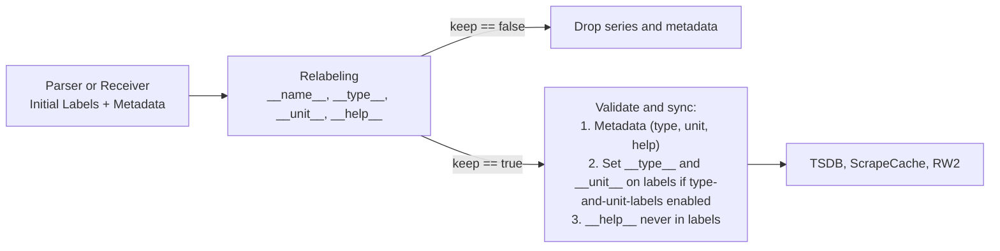

## Metric metadata manipulation via relabeling

* **Owners:**
  * Bartek Plotka [@bwplotka](https://github.com/bwplotka)

* **Implementation Status:** `Not implemented`

* **Related Issues and PRs:**
  * https://github.com/prometheus/prometheus/issues/19832
  * https://github.com/prometheus/prometheus/issues/16610
  * https://github.com/prometheus/prometheus/issues/14013
  * https://github.com/prometheus/prometheus/issues/17619
  * https://github.com/prometheus/prometheus/issues/17900
  * https://github.com/prometheus/prometheus/pull/16743
  * https://github.com/prometheus/prometheus/pull/19563
  * https://github.com/prometheus/prometheus/pull/19675

* **Other docs or links:**
  * [PROM-39: Metric Family Identity Extension: Type and Unit as Labels](./0039-metadata-labels.md)
  * [PROM-78: Native metadata](https://github.com/prometheus/proposals/pull/78)
  * [PROM-94: Unquoted UTF-8 names](./0094-unquoted-utf8-names.md)
  * [PROM-97: PromQL Metadata querying / promotion](https://github.com/prometheus/proposals/pull/97)
  * [PROM-99: Native Metadata support in PromQL](https://github.com/prometheus/proposals/pull/99)
  * [PROM-103: Recording Rule Metadata Storage and Deduction](https://github.com/prometheus/proposals/pull/103)

> TL;DR: This document proposes allowing operators to inspect, rewrite, and drop metric metadata `type`, `unit`, and `help` across `metric_relabel_configs`, `write_relabel_configs`, and `receive_relabel_configs`, initially gated behind an experimental `--enable-feature=metadata-relabeling` flag. It unifies the two unsynchronized metadata paths in Prometheus so that relabeling `__type__`, `__unit__`, and a virtual `__help__` label updates both the `metadata.Metadata` record and the `type-and-unit-labels` series labels, while fixing metadata loss on metric renames and stale metadata retention on dropped series. It also evaluates alternatives including a dedicated `target_metadata` field, dedicated `metadata_replace` and `metadata_drop` actions, and `__metadata_*__` virtual labels.
>
> NOTE: Following community feedback, we will start with `target_label: __type__ | __unit__ | __help__` behind `--enable-feature=metadata-relabeling` (as proposed in [How](#how)), while continuing to evaluate whether future Prometheus versions should move toward a structured `target:` or `target_metadata` configuration (see [Alternative 1](#1-dedicated-target-metadata-field-with-standard-relabel-actions) and [Key differences between target metadata and target label](#key-differences-between-target-metadata-and-target-label)).

## Why

Prometheus gives operators full control over series labels through `metric_relabel_configs` and `write_relabel_configs`, and is adding `receive_relabel_configs` for Remote Write and OTLP ingestion in [prometheus#19675](https://github.com/prometheus/prometheus/pull/19675). However, Prometheus provides no supported, end-to-end mechanism to fix or drop `TYPE`, `UNIT`, and `HELP` metadata.

Historically, metadata in Prometheus was mostly decorative, which made broken or missing metadata tolerable. With [PROM-39](./0039-metadata-labels.md) and `--enable-feature=type-and-unit-labels` (which makes `type` and `unit` part of series identity and selectable in PromQL), `AppenderV2`, native TSDB metadata storage in [prometheus#19563](https://github.com/prometheus/prometheus/pull/19563), and Remote Write 2.0, metadata is now stored per series, used to drive PromQL counter-ness annotations in [`promql/engine.go#L2445-L2462`](https://github.com/prometheus/prometheus/blob/10f69629039e0215d056eb4948f0bd0fd22f5c89/promql/engine.go#L2445-L2462), and required by strongly typed downstream backends such as OpenTelemetry and Google Cloud Managed Service for Prometheus.

When third-party or legacy exporters emit broken or missing metadata, operators cannot patch every target binary and need a way to fix metadata at ingestion or forwarding time:

1. Specifying a missing or wrong `TYPE` or `UNIT`. A large share of exposition in the wild is untyped, including textfile collectors, `statsd_exporter`, JMX exporter, and custom `/metrics` handlers. An operator knows that metrics matching `myapp_.*_total` are counters, or that `http_request_latency_ms` has unit `milliseconds`, or wants to strip a misleading unit declared by a broken exporter. Users sending OTLP or Remote Write directly to Prometheus currently have to deploy an OpenTelemetry Collector with a `transform` processor just to fix a metric unit or description.
2. Relabeling metrics based on `TYPE` or `UNIT` while keeping metadata intact. An operator may want to append `_total` to all `counter` metrics that lack the suffix, drop all `info` metrics, or rename a metric family without losing its `TYPE`, `UNIT`, and `HELP`.
3. Dropping or truncating oversized `HELP` strings. Some exporters emit multi-kilobyte `HELP` text containing whole paragraphs, embedded JSON, or stack traces. This inflates scrape cache memory, TSDB head metadata memory in [prometheus#19563](https://github.com/prometheus/prometheus/pull/19563), WAL records, and Remote Write 2.0 bandwidth. Today, the only knob is `metadata_config.send: false` in Remote Write 1.0, which drops all metadata for all metrics including `TYPE` and `UNIT`.

### Pitfalls of the current solution

Today, Prometheus maintains two parallel metadata channels that do not stay in sync:

| Property                     | Channel 1: `metadata.Metadata` record                                          | Channel 2: `__type__` and `__unit__` labels                           |
|------------------------------|--------------------------------------------------------------------------------|-----------------------------------------------------------------------|
| Keyed by                     | Metric family name in `scrapeCache`, or series in `AppenderV2`                 | Series label set `labels.Labels`                                      |
| Source                       | `# TYPE`, `# UNIT`, `# HELP`, RW2 `Metadata`, OTLP descriptor                  | Parsers and ingestion handlers when `type-and-unit-labels` is enabled |
| Carries `HELP`               | Yes                                                                            | No                                                                    |
| Reaches                      | Metadata WAL records, TSDB native metadata, RW2 `Metadata`, `/api/v1/metadata` | TSDB series labels, PromQL, RW2 `Type` and `Unit`                     |
| Mutable via relabeling today | No                                                                             | Yes, partially and inconsistently                                     |

While TSDB native metadata ([prometheus#19563](https://github.com/prometheus/prometheus/pull/19563), [PROM-78](https://github.com/prometheus/proposals/pull/78)) stores metadata per series outside series labels, `--enable-feature=type-and-unit-labels` ([PROM-39](./0039-metadata-labels.md)) makes `__type__` and `__unit__` part of series identity so series with the same `__name__` but different types or units can coexist and be queried in PromQL today. Until any future convergence between series labels and native metadata, both channels coexist and must stay synchronized.

Inspecting the codebase reveals several bugs and inconsistencies between these two channels:

* The documentation leaves precedence between target exposition and relabeling ambiguous. [`docs/feature_flags.md#L252-L253`](https://github.com/prometheus/prometheus/blob/10f69629039e0215d056eb4948f0bd0fd22f5c89/docs/feature_flags.md#L252-L253) states that all user-provided labels with `__type__` and `__unit__` will be overridden (referring to labels exposed directly by the target), while leaving unspecified what happens when an operator sets `__type__` or `__unit__` via `metric_relabel_configs` or `write_relabel_configs`.
* The `metadata.Metadata` record ignores relabeling. In [`scrape/scrape_append_v2.go#L312-L323`](https://github.com/prometheus/prometheus/blob/10f69629039e0215d056eb4948f0bd0fd22f5c89/scrape/scrape_append_v2.go#L312-L323) and [`scrape/scrape.go#L2047-L2060`](https://github.com/prometheus/prometheus/blob/10f69629039e0215d056eb4948f0bd0fd22f5c89/scrape/scrape.go#L2047-L2060), the scrape loop attaches `lastMeta` straight from the parser. After relabeling `__type__` or `__unit__`, the series labels in TSDB, the `metadata.Metadata` passed to `AppenderV2`, and `/api/v1/metadata` all disagree.
* Renaming a metric in `metric_relabel_configs` silently drops its `metadata.Metadata`. [`scrape/scrape_append_v2.go#L315`](https://github.com/prometheus/prometheus/blob/10f69629039e0215d056eb4948f0bd0fd22f5c89/scrape/scrape_append_v2.go#L315) calls `isSeriesPartOfFamily(lset.Get(model.MetricNameLabel), lastMFName, lastMeta.Type)` using the post-relabel `__name__`. When a rule renames `foo` to `bar`, `isSeriesPartOfFamily` returns `false`, and line 316 sets `lastMeta = nil`, dropping metadata for `bar` and for any subsequent series in the same family.
* Dropping all series of a metric family in `metric_relabel_configs` still leaves the family's metadata in `scrapeCache.metadata` and `/api/v1/metadata`, tracked in [prometheus#14013](https://github.com/prometheus/prometheus/issues/14013), because [`scrape/scrape_append_v2.go#L173-L183`](https://github.com/prometheus/prometheus/blob/10f69629039e0215d056eb4948f0bd0fd22f5c89/scrape/scrape_append_v2.go#L173-L183) writes `EntryType`, `EntryHelp`, and `EntryUnit` directly into `sl.cache` before series are parsed or relabeled.
* Remote Write 2.0 sender and receiver have opposite precedence. When `type-and-unit-labels` is enabled, the RW2 sender in [`storage/remote/queue_manager.go#L1980-L1989`](https://github.com/prometheus/prometheus/blob/10f69629039e0215d056eb4948f0bd0fd22f5c89/storage/remote/queue_manager.go#L1980-L1989) takes `Type` and `Unit` from `seriesLabels` and `Help` from `d.metadata`. On the RW2 receiver in [`storage/remote/write_handler.go#L327-L339`](https://github.com/prometheus/prometheus/blob/10f69629039e0215d056eb4948f0bd0fd22f5c89/storage/remote/write_handler.go#L327-L339), `ts.ToMetadata(req.Symbols)` overwrites incoming `__type__` and `__unit__` labels whenever `m.Type` or `m.Unit` is non-empty. If a sender does not have `type-and-unit-labels` enabled, `write_relabel_configs` injects `__type__` into `d.seriesLabels` while `d.metadata` still sends the old `Type`, which the receiver then uses to overwrite `__type__`.
* `HELP` has no representation in relabeling and is zeroed when constructing metadata from labels in [`storage/remote/queue_manager.go#L1984`](https://github.com/prometheus/prometheus/blob/10f69629039e0215d056eb4948f0bd0fd22f5c89/storage/remote/queue_manager.go#L1984).

## Goals

Goals and use cases for the solution as proposed in [How](#how):

* Allow operators to inspect, set, rewrite, and clear `type`, `unit`, and `help` metadata in `metric_relabel_configs`, `write_relabel_configs`, and `receive_relabel_configs` from [prometheus#19675](https://github.com/prometheus/prometheus/pull/19675), with a design that extends to arbitrary key-value native metadata ([PROM-78](https://github.com/prometheus/proposals/pull/78), [PROM-97](https://github.com/prometheus/proposals/pull/97), [PROM-99](https://github.com/prometheus/proposals/pull/99)).
* Keep `metadata.Metadata` records and `__type__` and `__unit__` series labels synchronized across scrape, TSDB storage, WAL metadata records, `/api/v1/metadata`, Remote Write 2.0, and OTLP ingestion.
* Work consistently whether `--enable-feature=type-and-unit-labels` is enabled or disabled.
* Preserve a metric's metadata when its `__name__` is renamed during relabeling, and exclude metadata from `scrapeCache` when all series of a metric family are dropped as described in [prometheus#14013](https://github.com/prometheus/prometheus/issues/14013).
* Validate relabeled `type` and `unit` values at config load time when static, and at runtime when dynamic.

### Audience

Prometheus server maintainers, operators managing scrape, Remote Write, and OTLP pipelines, and maintainers of downstream Remote Write 2.0 and OTLP backends.

## Non-Goals

* Introducing a new general-purpose transformation DSL such as OpenTelemetry's OTTL into Prometheus configuration.
* Automatic unit value conversion, such as multiplying sample values by `0.001` when rewriting `milliseconds` to `seconds`.
* Automatic sample value conversion between incompatible data structures, such as converting a float series into a native histogram by relabeling `__type__` to `histogram`.
* Deprecating `--enable-feature=type-and-unit-labels` ([PROM-39](./0039-metadata-labels.md)) or deciding whether native metadata ([PROM-78](https://github.com/prometheus/proposals/pull/78)) eventually supersedes it.

## How

We propose making metric metadata `type`, `unit`, and `help` first-class virtual schema labels `__type__`, `__unit__`, and `__help__` during relabeling, initially gated behind an experimental `--enable-feature=metadata-relabeling` feature flag (while bugfixes for preserving metadata across `__name__` renames and excluding dropped families from `scrapeCache` in [prometheus#14013](https://github.com/prometheus/prometheus/issues/14013) apply unconditionally). Starting behind `--enable-feature=metadata-relabeling` lets users opt in and lets us gather operational feedback and explore alternative configuration shapes (such as [Alternative 1](#1-dedicated-target-metadata-field-with-standard-relabel-actions)) before stabilizing. These labels are backed directly by `metadata.Metadata` in the relabel engine so that standard relabel actions `replace`, `keep`, `drop`, `keepequal`, `dropequal`, `lowercase`, `uppercase`, and `labeldrop` work uniformly across labels and metadata.

Handling metadata via `target_label: __type__`, `__unit__`, and `__help__` is simple to implement and use:

* It requires no new fields or actions on `relabel.Config`, keeping `source_labels` and `target_label` symmetric across all actions (`replace`, `lowercase`, `uppercase`, `keepequal`, `dropequal`, `labeldrop`).
* Even outside `type-and-unit-labels`, Prometheus already uses `target_label: __*__` for durable non-label config: in target `relabel_configs`, `target_label: __address__`, `__metrics_path__`, `__scheme__`, `__scrape_interval__`, and `__scrape_timeout__` are never stored as TSDB labels, yet writing to them via `target_label` has durable effects on how the target is scraped. `model/relabel` did not add a `target_scrape_field:` key to `relabel.Config` for those; it used reserved `__*__` names (even though those specific control labels only exist in target `relabel_configs`, not `metric_relabel_configs` or `write_relabel_configs`).
* In `metric_relabel_configs`, `write_relabel_configs`, and `receive_relabel_configs`, `__name__` is already mutated via `target_label: __name__`, and [PROM-39](./0039-metadata-labels.md) extended series identity with `__type__` and `__unit__` using the same `target_label` mechanism.
* On ingestion (scrape exposition, Remote Write, OTLP), `metadata.Metadata` is the single source of truth. Source exposition and Remote Write should not carry `__type__` and `__unit__` as independent source labels; if they are present on the wire, metadata takes precedence as specified in [PROM-39](./0039-metadata-labels.md#prometheus-server-ingestion) (with fallback to incoming `__type__` and `__unit__` labels only when metadata fields are empty, such as Remote Write 1.0). The `--enable-feature=type-and-unit-labels` flag remains the switch that controls whether the post-relabel `meta.Type` and `meta.Unit` are materialized and preserved as `__type__` and `__unit__` labels on the stored series; when the flag is disabled, `__type__` and `__unit__` are stripped from series labels so wire or relabeled values never leak into TSDB as raw labels.

We also detail and compare alternative relabeling designs in [Alternatives](#alternatives), notably a dedicated `target_metadata` field with standard actions ([Alternative 1](#1-dedicated-target-metadata-field-with-standard-relabel-actions)), dedicated `metadata_replace` and `metadata_drop` actions ([Alternative 2](#2-dedicated-metadata-relabel-actions)), and `__metadata_type__`, `__metadata_unit__`, and `__metadata_help__` virtual labels ([Alternative 3](#3-explicit-metadata-prefixed-virtual-labels)).

### 1. Metadata representation during relabeling

Every metric sample or series entering a metric relabel stage (`metric_relabel_configs` on scrape, `write_relabel_configs` on Remote Write, and `receive_relabel_configs` on Remote Write and OTLP receive) carries both its label set and its metadata (`type`, `unit`, `help`):

1. Three reserved label names map to the metric's metadata fields:
   * `__type__` maps to `type`. Following [PROM-39](./0039-metadata-labels.md), `unknown` and `""` are equivalent: reading `__type__` when the metric is untyped (`unknown`) yields `""`, and setting `__type__` to `""` or `"unknown"` sets the metadata type to `unknown` and omits `__type__` from the series labels.
   * `__unit__` maps to `unit`.
   * `__help__` maps to `help`.
2. When `source_labels` (or `target_label` in `keepequal` and `dropequal`) references `__type__`, `__unit__`, or `__help__`, the relabeler reads the value from the metric's metadata.
3. When `replace`, `lowercase`, `uppercase`, or `hashmod` writes to `__type__`, `__unit__`, or `__help__`, or when `labeldrop` matches `__type__`, `__unit__`, or `__help__`:
   * Writing to `__help__` updates the `help` metadata field directly. `__help__` is never added to the series label set in TSDB and never affects series identity.
   * Writing to `__type__` validates and normalizes the type value as described in [Validation](#3-validation-of-type-and-unit-values), updates the `type` metadata field, and updates the `__type__` series label when `--enable-feature=type-and-unit-labels` is enabled.
   * Writing to `__unit__` updates the `unit` metadata field, and updates the `__unit__` series label when `--enable-feature=type-and-unit-labels` is enabled.
4. Because metadata lives separately from regular series labels during relabeling, existing configs using `action: labelkeep` with `regex: __name__|job|instance` or `action: labelmap` will not delete `help`, `type`, or `unit`, nor copy `__help__` into user labels.
5. On scrape, metric family membership is evaluated before `metric_relabel_configs` so renaming `__name__` preserves the metric's metadata under the new name, and metadata is only recorded in the scrape metadata cache when at least one series of the family survives relabeling (fixing [prometheus#14013](https://github.com/prometheus/prometheus/issues/14013)).



### 2. Relabeling examples across use cases

#### Use case 1a: Specify a missing or wrong `TYPE`

```yaml
metric_relabel_configs:
  # Infer type=counter on legacy untyped (__type__ == "") metrics that follow
  # the _total naming convention, so PromQL and storage can rely on type metadata.
  - source_labels: [__name__, __type__]
    regex: 'myapp_.*_total;'
    target_label: __type__
    replacement: counter

  # Force type=gauge on a metric where the exporter wrongly declares counter.
  - source_labels: [__name__]
    regex: 'legacy_current_connections_total'
    target_label: __type__
    replacement: gauge
```

#### Use case 1b: Derive `UNIT` from metric name suffix or strip a wrong unit

```yaml
metric_relabel_configs:
  # Populate unit=milliseconds for metrics ending in _ms that have no unit.
  - source_labels: [__name__, __unit__]
    regex: '.*_ms;'
    target_label: __unit__
    replacement: milliseconds

  # Derive common base units from metric name suffixes when unit is empty.
  - source_labels: [__name__, __unit__]
    regex: '.*_(seconds|bytes)(?:_total|_bucket|_sum|_count)?;'
    target_label: __unit__
    replacement: '$1'

  # Strip a misleading unit declared by an exporter.
  - source_labels: [__name__]
    regex: 'broken_exporter_cache_hit_ratio'
    target_label: __unit__
    replacement: ''
```

#### Use case 1c: Fix metadata on Remote Write or OTLP receive

Combined with `receive_relabel_configs` from [prometheus#19675](https://github.com/prometheus/prometheus/pull/19675), operators can fix metadata pushed via OTLP or Remote Write without deploying a separate OpenTelemetry Collector:

```yaml
otlp:
  promote_resource_attributes: [service.name]
receive_relabel_configs:
  - source_labels: [__name__]
    regex: 'http\.server\.duration'
    target_label: __unit__
    replacement: seconds
  - source_labels: [service_name]
    regex: 'noisy-service'
    target_label: __help__
    replacement: ''
```

#### Use case 2: Relabel based on `TYPE` or `UNIT` and preserve metadata across renames

```yaml
metric_relabel_configs:
  # When migrating to legacy naming conventions, append _total to counter metrics
  # in two RE2 steps to avoid _total_total.
  - source_labels: [__name__, __type__]
    regex: '(.*);counter'
    target_label: __name__
    replacement: '${1}_total'
  - source_labels: [__name__, __type__]
    regex: '(.*_total)_total;counter'
    target_label: __name__
    replacement: '$1'

  # Rename a metric while keeping its original TYPE, UNIT, and HELP intact.
  - source_labels: [__name__]
    regex: 'old_subsystem_(.*)'
    target_label: __name__
    replacement: 'new_subsystem_$1'
```

#### Use case 3: Drop or truncate large `HELP` strings

```yaml
metric_relabel_configs:
  # Drop HELP for a specific noisy metric family.
  - source_labels: [__name__]
    regex: 'jvm_.*'
    target_label: __help__
    replacement: ''

  # Truncate all HELP strings in this job to at most 256 characters.
  - source_labels: [__help__]
    regex: '(.{256}).+'
    target_label: __help__
    replacement: '${1}...'

  # Or drop HELP for all metrics in this job.
  - target_label: __help__
    replacement: ''
```

### 3. Validation of `type` and `unit` values

Unlike `unit` and `help`, which are free-form UTF-8 strings, `type` affects how series are encoded, stored, and queried: Remote Write 2.0 serializes `Metadata.MetricType` as a fixed protobuf enum that cannot represent arbitrary strings, `AppenderV2` and TSDB require the metadata type to remain compatible with the physical sample value encoding (for example, native histogram samples can only have type `histogram` or `gaugehistogram`, as noted in [PROM-103](https://github.com/prometheus/proposals/pull/103)), and PromQL uses `type` for counter/gauge annotations.

To keep `relabel.Process` focused on string key-value transformations while still catching typos early, validation is split across two layers:

1. Config-load validation:
   * When a `replace` rule targets `type` with a static `replacement` string (no `$1` regex expansion), config validation checks `replacement` against `""` and the known `model.MetricType` constants in `prometheus/common/model` (`counter`, `gauge`, `histogram`, `gaugehistogram`, `summary`, `info`, `stateset`, or `unknown`). A typo like `replacement: guage` fails `promtool check config` and config reload immediately.
2. Runtime validation at the metadata and storage boundary:
   * During relabeling, `relabel.Process` treats `__type__`, `__unit__`, and `__help__` as ordinary string values.
   * When constructing `metadata.Metadata` and syncing series labels after relabeling, the ingestion, receiver, or storage layer (`scrape`, Remote Write 2.0, OTLP, and `AppenderV2`) validates the final `type` value. If a dynamic replacement such as `$1` or `uppercase` produced an unrecognized `type` string, that layer normalizes the type to `unknown` and omits `__type__` from series labels rather than storing an invalid type in TSDB or sending an unrepresentable enum over Remote Write 2.0, and checks compatibility with the physical sample value type.

### 4. Extending to arbitrary key-value native metadata

Today, Prometheus `metadata.Metadata` and TSDB per-series metadata in [prometheus#19563](https://github.com/prometheus/prometheus/pull/19563) only carry the three fixed metric descriptor fields `type`, `unit`, and `help`. However, [PROM-78](https://github.com/prometheus/proposals/pull/78), [PROM-97](https://github.com/prometheus/proposals/pull/97), and [PROM-99](https://github.com/prometheus/proposals/pull/99) propose extending native metadata to arbitrary key-value pairs, often scoped by namespace (such as OpenTelemetry `resource.*` and `scope.*` attributes, or Service Discovery `target.*` metadata).

While the built-in metric descriptor fields map to `__type__`, `__unit__`, and `__help__`, arbitrary native metadata keys cannot be exposed as bare names in `source_labels` and `target_label` without colliding with series labels, nor as arbitrary `__<key>__` names without colliding with internal Prometheus labels (`__name__`, `__address__`, `__meta_*`, `__tmp_*`). Under the virtual-label model, arbitrary key-value metadata maps to a reserved prefix namespace such as `__metadata_<key>__` (or `~<key>` if aligned with the PromQL metadata selector syntax in [PROM-99](https://github.com/prometheus/proposals/pull/99); with [PROM-94](./0094-unquoted-utf8-names.md), dotted keys such as `__metadata_resource.service.name__` do not require quoting):

```yaml
relabel_configs:
  # Store a single Kubernetes SD label as target native metadata.
  - source_labels: [__meta_kubernetes_namespace]
    target_label: __metadata_target.k8s.namespace__

  # Bulk-map all Kubernetes pod labels into target native metadata using labelmap.
  - action: labelmap
    regex: '__meta_kubernetes_pod_label_(.+)'
    replacement: '__metadata_target.k8s.pod.label.$1__'

receive_relabel_configs:
  # Rewrite an arbitrary native metadata value on OTLP or Remote Write receive.
  - source_labels: [__metadata_resource.deployment.environment__]
    regex: 'prod-(.+)'
    target_label: __metadata_resource.deployment.environment__
    replacement: 'production'

  # Promote a native metadata key into a series-identifying label.
  - source_labels: [__metadata_resource.service.name__]
    target_label: service_name

  # Demote a high-cardinality series label into native metadata and drop the label.
  - source_labels: [container_id]
    target_label: __metadata_resource.container.id__
  - action: labeldrop
    regex: 'container_id'

  # Bulk-drop noisy native metadata keys by regex.
  - action: labeldrop
    regex: '__metadata_resource\.process\..*__'
```

Under this extension:

* `__type__`, `__unit__`, and `__help__` remain reserved names for the metric's `type`, `unit`, and `help` (or act as short aliases for `__metadata_type__`, `__metadata_unit__`, and `__metadata_help__`; see [Alternative 3](#3-explicit-metadata-prefixed-virtual-labels)).
* `action: labelkeep` only filters series labels, so existing `labelkeep` rules (such as `regex: __name__|job|instance`) never strip native metadata.
* `action: labeldrop` and `action: labelmap` can match and transform arbitrary metadata keys whenever `regex` matches the `__metadata_*__` prefix.

See [Key differences between target metadata and target label](#key-differences-between-target-metadata-and-target-label) for how arbitrary key-value metadata looks under [Alternative 1 (`target_metadata`)](#1-dedicated-target-metadata-field-with-standard-relabel-actions).

## Alternatives

### 1. Dedicated target metadata field with standard relabel actions

As proposed by [@jan--f](https://github.com/prometheus/proposals/pull/104#discussion_r4357249380), instead of targeting `__type__`, `__unit__`, and `__help__` via `target_label`, we could add a dedicated `target_metadata` field to `relabel.Config` that accepts `type`, `unit`, or `help` and is mutually exclusive with `target_label`.

Canonically, `__*__` labels in Prometheus (other than `__name__`) are temporary during relabeling and do not persist in TSDB unless `--enable-feature=type-and-unit-labels` is enabled. Because metric metadata is stored durably in TSDB and forwarded via Remote Write 2.0 even when `type-and-unit-labels` is disabled, targeting `__type__`, `__unit__`, or `__help__` via `target_label` can appear surprising. With `target_metadata`, the configuration states explicitly that the rule mutates the metric's metadata record, while reusing the existing relabel actions (`replace`, `lowercase`, `uppercase`, `hashmod`, `keepequal`, `dropequal`). Clearing a metadata field uses `action: replace` with `replacement: ''`, so no separate `metadata_drop` action is needed:

```yaml
metric_relabel_configs:
  # Use case 1a: Set type=counter on untyped metrics ending in _total.
  - source_labels: [__name__, __type__]
    regex: 'myapp_.*_total;'
    target_metadata: type
    replacement: counter

  # Use case 1b: Derive unit from metric name suffix.
  - source_labels: [__name__, __unit__]
    regex: '.*_ms;'
    target_metadata: unit
    replacement: milliseconds

  # Use case 1b (clear unit): Strip a misleading unit on a specific metric.
  - source_labels: [__name__]
    regex: 'broken_exporter_cache_hit_ratio'
    target_metadata: unit
    replacement: ''

  # Use case 3a: Drop HELP for a specific metric prefix.
  - source_labels: [__name__]
    regex: 'jvm_.*'
    target_metadata: help
    replacement: ''

  # Use case 3b: Truncate HELP to 256 characters.
  - source_labels: [__help__]
    regex: '(.{256}).+'
    target_metadata: help
    replacement: '${1}...'
```

How `target_metadata` works with `--enable-feature=type-and-unit-labels` ([PROM-39](./0039-metadata-labels.md)):

* Because `type-and-unit-labels` is still experimental, we can forbid `target_label: __type__`, `target_label: __unit__`, and `target_label: __help__` at config validation time and require all metadata writes to use `target_metadata: type | unit | help`.
* On ingestion (scrape exposition, Remote Write, OTLP), metadata takes precedence over any wire `__type__` or `__unit__` labels, and `metadata.Metadata` is the single source of truth entering relabeling.
* During relabeling, `__type__`, `__unit__`, and `__help__` in `source_labels` read from `metadata.Metadata`, while all mutations to `type`, `unit`, and `help` go through `target_metadata` (updating `metadata.Metadata` immediately so subsequent rules reading `__type__`, `__unit__`, or `__help__` in `source_labels` see the updated value). Label-only actions (`labelkeep`, `labeldrop`, `labelmap`) only touch series labels and never strip metadata.
* After relabeling, the `--enable-feature=type-and-unit-labels` flag controls whether the post-relabel `type` and `unit` are materialized and preserved as `__type__` and `__unit__` labels on the series.

#### Key differences between target metadata and target label

We are actively debating between `target_label: __type__ | __unit__ | __help__` ([How](#how)) and `target_metadata: type | unit | help` ([Alternative 1](#1-dedicated-target-metadata-field-with-standard-relabel-actions)), so please let us know what you prefer. The decision comes down to the following trade-offs:

1. Precedent for `target_label: __*__` mutating durable non-label config vs contextualized `target_<context>` fields:
   Even outside `type-and-unit-labels`, Prometheus already uses `target_label: __*__` for durable non-label config. In target `relabel_configs`, `target_label: __address__`, `__metrics_path__`, `__scheme__`, `__scrape_interval__`, and `__scrape_timeout__` are never stored as TSDB series labels, yet writing to them via `target_label` has durable effects on how the target is scraped. `model/relabel` did not add a contextualized `target_<context>` key to `relabel.Config` for those; it used reserved `__*__` names.

   If Prometheus instead preferred contextualized target fields (`target_<context>`) whenever a relabel rule mutates non-series-label state (such as `target_metadata` for metric metadata), then `__address__`, `__metrics_path__`, and `__scrape_interval__` in target `relabel_configs` would have needed a separate field such as `target_scrape_options: address` or `target_scrape_options: metrics_path` rather than `target_label: __address__`:

   ```yaml
   # How Prometheus target relabel_configs works today (reserved __*__ in target_label):
   relabel_configs:
     - source_labels: [__meta_kubernetes_pod_ip, __meta_kubernetes_pod_annotation_prometheus_io_port]
       regex: '([^;]+);(\d+)'
       target_label: __address__
       replacement: '$1:$2'
     - source_labels: [__meta_kubernetes_pod_annotation_prometheus_io_path]
       regex: '(.+)'
       target_label: __metrics_path__
       replacement: '$1'

   # What target relabel_configs would look like under a contextualized target_<context> design:
   relabel_configs:
     - source_labels: [__meta_kubernetes_pod_ip, __meta_kubernetes_pod_annotation_prometheus_io_port]
       regex: '([^;]+);(\d+)'
       target_scrape_options: address
       replacement: '$1:$2'
     - source_labels: [__meta_kubernetes_pod_annotation_prometheus_io_path]
       regex: '(.+)'
       target_scrape_options: metrics_path
       replacement: '$1'
   ```

   Using `target_label: __type__`, `__unit__`, and `__help__` follows the existing `target_label: __address__` and `__metrics_path__` convention across `model/relabel`, whereas `target_metadata` introduces the contextualized `target_<context>` pattern only for metric metadata.

2. Read/write asymmetry and rule chaining:
   Even with `target_metadata`, reading metadata in regex rules still requires `source_labels: [__name__, __type__]` or `source_labels: [__help__]` so fields can be concatenated in a defined order. Truncating help (Use case 3b) ends up reading `__help__` in `source_labels` and writing `help` in `target_metadata` in the same rule.

   This asymmetry also affects multi-step relabel pipelines where an earlier rule fixes metadata (for example, setting `type` to `counter` on an untyped metric) and a subsequent rule reads `__type__` in `source_labels` (such as appending `_total` to all counters in Use case 2, or filtering series by type). With `target_label: __type__`, chaining works like any other relabel pipeline because the first rule writes `target_label: __type__` and the next rule reads `source_labels: [__name__, __type__]`. With `target_metadata`, the first rule writes `target_metadata: type` while the next rule must read `__type__` from `source_labels`, obscuring that the first rule's output feeds the second rule's input:

   ```yaml
   # Chaining rules with target_label: rule 1 writes __type__, rule 2 reads __type__.
   metric_relabel_configs:
     - source_labels: [__name__, __type__]
       regex: 'legacy_requests;'
       target_label: __type__
       replacement: counter
     - source_labels: [__name__, __type__]
       regex: '(.*);counter'
       target_label: __name__
       replacement: '${1}_total'

   # The same pipeline with target_metadata: rule 1 writes target_metadata: type,
   # and rule 2 reads __type__ from source_labels.
   metric_relabel_configs:
     - source_labels: [__name__, __type__]
       regex: 'legacy_requests;'
       target_metadata: type
       replacement: counter
     - source_labels: [__name__, __type__]
       regex: '(.*);counter'
       target_label: __name__
       replacement: '${1}_total'
   ```

   If we adopt `target_metadata`, there are three ways to mitigate this in rule chaining:

   * Implicitly update the corresponding `__type__`, `__unit__`, or `__help__` label whenever `target_metadata` is written (which requires forbidding `target_label: __type__ | __unit__ | __help__` so a rule using `__type__` as a temporary label cannot be silently overwritten by a later `target_metadata: type` rule, whereas only populating `__type__` initially before relabeling would break subsequent rules that filter on `__type__`):

     ```yaml
     - source_labels: [__name__, __type__]
       regex: 'legacy_requests;'
       target_metadata: type # Also updates __type__ for subsequent rules and type-and-unit-labels.
       replacement: counter
     ```

   * Allow setting `target_metadata` and `target_label` together when the rule author explicitly wants subsequent rules (or `type-and-unit-labels`) to depend on the new label value:

     ```yaml
     - source_labels: [__name__, __type__]
       regex: 'legacy_requests;'
       target_metadata: type
       target_label: __type__ # Explicitly update __type__ so subsequent rules can depend on the new value.
       replacement: counter
     ```

   * Or also introduce `source_metadata: [type | unit | help]` alongside `source_labels`, concatenated in a fixed order (`source_labels` followed by `source_metadata`, joined by `separator`) when both are specified on a rule:

     ```yaml
     metric_relabel_configs:
       # Match __name__ from source_labels and type from source_metadata ("<__name__>;<type>").
       - source_labels: [__name__]
         source_metadata: [type]
         regex: 'legacy_requests;'
         target_metadata: type
         replacement: counter

       # Subsequent rule reads the updated type from source_metadata.
       - source_labels: [__name__]
         source_metadata: [type]
         regex: '(.*);counter'
         target_label: __name__
         replacement: '${1}_total'

       # Use case 3b: Truncate HELP using only source_metadata and target_metadata.
       - source_metadata: [help]
         regex: '(.{256}).+'
         target_metadata: help
         replacement: '${1}...'
     ```

     Adding `source_metadata` restores symmetry with `target_metadata`, at the cost of a second new field on `relabel.Config` and an implicit concatenation order when a rule combines `source_labels` and `source_metadata`. Forbidding `source_labels` and `source_metadata` in the same rule would avoid that concatenation order without needing `regex_metadata` and `replacement_metadata`, but then a single rule could not match both a label and metadata together (such as matching `__name__` and an empty `type` in Use case 1a, or renaming `__name__` when `type` is `counter` in Use case 2) without copying metadata into a temporary label in a preceding rule.

3. Arbitrary key-value native metadata ([PROM-78](https://github.com/prometheus/proposals/pull/78)):
   When native metadata expands beyond `type`, `unit`, and `help` to arbitrary key-value pairs (such as OpenTelemetry `resource.*` attributes or Service Discovery `target.*` metadata), `source_metadata` and `target_metadata` can accept any metadata key name directly without a `__metadata_...__` wrapper:

   ```yaml
   relabel_configs:
     # Store a single Kubernetes SD label as target native metadata.
     - source_labels: [__meta_kubernetes_namespace]
       target_metadata: target.k8s.namespace

   receive_relabel_configs:
     # Rewrite an arbitrary native metadata value.
     - source_metadata: [resource.deployment.environment]
       regex: 'prod-(.+)'
       target_metadata: resource.deployment.environment
       replacement: 'production'

     # Promote a native metadata key into a series label.
     - source_metadata: [resource.service.name]
       target_label: service_name
   ```

   Separating `source_metadata` and `target_metadata` keeps arbitrary metadata keys in their own namespace so they never collide with label names, and makes single-key promotion (`source_metadata` to `target_label`) and demotion (`source_labels` to `target_metadata`) self-explanatory.

   However, because `target_metadata` only specifies a single static key name, bulk regex operations across metadata keys (such as mapping all `__meta_kubernetes_pod_label_(.+)` labels into `target.k8s.pod.label.$1` metadata, or dropping all `resource.process.*` metadata keys by regex) cannot use existing `labelmap`, `labeldrop`, or `labelkeep`. Supporting bulk key operations under `target_metadata` would require adding parallel `metadatamap`, `metadatadrop`, and `metadatakeep` actions (or a key-level target selector), whereas the prefixed virtual-label approach in [Extending to arbitrary key-value native metadata](#4-extending-to-arbitrary-key-value-native-metadata) reuses `labelmap` and `labeldrop` directly.

4. Consistency with PromQL metadata querying ([PROM-97](https://github.com/prometheus/proposals/pull/97), [PROM-99](https://github.com/prometheus/proposals/pull/99)):
   How metadata is addressed in relabeling also influences how users think about querying metadata in PromQL. In [PROM-97](https://github.com/prometheus/proposals/pull/97) and [PROM-99](https://github.com/prometheus/proposals/pull/99), PromQL selects and promotes native metadata inside the same `{...}` selector block as series labels using a prefix or namespace syntax (such as `foo{~resource.service.name="checkout"}` in [PROM-99](https://github.com/prometheus/proposals/pull/99) or `foo{resource[service.name]="checkout"}` in [PROM-97](https://github.com/prometheus/proposals/pull/97)), rather than introducing a separate metadata clause. Addressing metadata via reserved prefixed names in `source_labels` and `target_label` keeps relabeling and PromQL aligned.

### 2. Dedicated metadata relabel actions

Instead of targeting `__type__`, `__unit__`, and `__help__` with the standard `replace` and `labeldrop` actions (or using `target_metadata` with standard actions), we could introduce dedicated metadata actions (`metadata_replace`, `metadata_drop`) in `relabel.Config`, as suggested by [@roidelapluie](https://github.com/prometheus/prometheus/issues/19832#issuecomment-6214046553):

* `action: metadata_replace` matches `source_labels` against `regex` and writes `replacement` into the metadata field specified by `target_label` or `target_metadata`, which must be `type`, `unit`, or `help`.
* `action: metadata_drop` clears the metadata field specified by `target_label` when `source_labels` matches `regex`.

When trying to express all use cases from [prometheus#19832](https://github.com/prometheus/prometheus/issues/19832) with `action: metadata_replace` and `action: metadata_drop`, `source_labels` must still read the metric's existing metadata via the reserved `__type__`, `__unit__`, and `__help__` names (otherwise [Use case 2](#use-case-2-relabel-based-on-type-or-unit-and-preserve-metadata-across-renames), conditional fixes in Use case 1a, and `HELP` truncation in Use case 3b cannot be expressed). Compared to [Alternative 1 (`target_metadata`)](#1-dedicated-target-metadata-field-with-standard-relabel-actions) and the main proposal, introducing dedicated `metadata_*` actions has several drawbacks:

* Existing actions such as `lowercase`, `uppercase`, `keepequal`, and `dropequal` do not work on metadata without adding `metadata_lowercase`, `metadata_keepequal`, etc.
* `action: metadata_drop` has ambiguous configuration semantics because existing `drop` uses `source_labels` and drops the series, whereas `labeldrop` forbids `source_labels` and matches label names against `regex`. With `target_label` or `target_metadata`, clearing a field uses standard `action: replace` with `replacement: ''`.

### 3. Explicit metadata-prefixed virtual labels

Another option is to keep standard `source_labels`, `target_label`, and standard relabel actions, but name the virtual metadata labels `__metadata_type__`, `__metadata_unit__`, and `__metadata_help__` (or use `__metadata_help__` alongside `__type__` and `__unit__`).

In target relabeling (`relabel_configs`), Prometheus already uses reserved `__*__` control labels such as `__address__`, `__metrics_path__`, `__scheme__`, `__scrape_interval__`, and `__scrape_timeout__` (even though those specific control labels only apply to target `relabel_configs`, not `metric_relabel_configs` or `write_relabel_configs`). Mutating those labels via `target_label` has durable side effects on how the target is scraped without storing literal `__address__` or `__metrics_path__` labels in TSDB. Using the `__metadata_*__` prefix brings that same convention into metric, write, and receive relabeling:

```yaml
metric_relabel_configs:
  # Use case 1a: Set type=counter on untyped metrics ending in _total.
  - source_labels: [__name__, __metadata_type__]
    regex: 'myapp_.*_total;'
    target_label: __metadata_type__
    replacement: counter

  # Use case 3a: Drop HELP for a specific metric prefix.
  - source_labels: [__name__]
    regex: 'jvm_.*'
    target_label: __metadata_help__
    replacement: ''
```

Trade-offs of `__metadata_*__` virtual labels:

* The `__metadata_*__` prefix makes it obvious that these labels read and mutate the metric's metadata record (just as `__address__` and `__metrics_path__` mutate target configuration) rather than acting as ordinary temporary labels.
* It keeps `source_labels` and `target_label` symmetric and requires no new fields or actions on `relabel.Config`.
* However, [PROM-39](./0039-metadata-labels.md) already standardized `__type__` and `__unit__` as the reserved label names when `type-and-unit-labels` is enabled. Introducing `__metadata_type__` and `__metadata_unit__` creates two sets of reserved names for type and unit (`__type__` vs `__metadata_type__`, and `__unit__` vs `__metadata_unit__`) that must be kept in sync during relabeling. Using the prefix only for `__metadata_help__` avoids duplicating `__type__` and `__unit__`, at the cost of inconsistent naming across the three metadata fields (`__type__`, `__unit__`, `__metadata_help__`).

### 4. Separate family-level metadata relabel stage

We could add a separate `metadata_relabel_configs` section to `scrape_config` that runs once per metric family per scrape over a virtual label set `{__name__, __type__, __unit__, __help__}` before `metric_relabel_configs`.

We did not choose this as the primary mechanism because:

* It adds a new configuration block to `scrape_config`, `remote_write`, and receiver configs, and requires users to reason about the ordering between `metadata_relabel_configs` and `metric_relabel_configs`.
* Rules that depend on sample labels, such as fixing metadata only for series with a specific label or dropping metadata when all series of a family are dropped by sample-label rules, cannot be expressed in a pre-sample family pass.
* Remote Write and OTLP ingestion operate on streams of series rather than text-format metric families.
* Caching the post-relabel `metadata.Metadata` on `cacheEntry` in `scrapeCache` already avoids per-scrape relabeling cost after the first scrape of a series.

### 5. Declarative metric metadata overrides or OpenTelemetry Telemetry Policies

Instead of extending `relabel_configs`, we could adopt a declarative policy format where metric metadata fields (`name`, `type`, `unit`, `description`/`help`) are addressed explicitly. This could be a Prometheus-specific `metric_metadata_overrides` block, or OpenTelemetry's [OTEP #4738 Telemetry Policy](https://github.com/open-telemetry/opentelemetry-specification/blob/main/oteps/4738-telemetry-policy.md) format (see example transformation policies in [`1.45.0_to_grpc-42.42.0.yaml`](https://github.com/lmolkova/semantic-conventions/blob/fda9cb2294a0801f80ef63f18e93186e7fea4d09/transformations/grpc/1.45.0_to_grpc-42.42.0.yaml) and [`transformations/README.md`](https://github.com/lmolkova/semantic-conventions/blob/fda9cb2294a0801f80ef63f18e93186e7fea4d09/transformations/README.md)):

```yaml
policies:
  - id: fix-myapp-requests-type
    name: Set counter type on untyped myapp_*_total metrics
    metric:
      matches:
        - {metric_field: name, glob: "myapp_*_total"}
        - {metric_type: unknown}
      transform:
        add:
          - {metric_type: counter, upsert: true}

  - id: fix-http-latency-unit-and-drop-help
    name: Set milliseconds unit and clear description on http_request_latency_ms
    metric:
      matches:
        - {metric_field: name, equals: http_request_latency_ms}
      transform:
        add:
          - {metric_field: unit, value: milliseconds, upsert: true}
          - {metric_field: description, value: "", upsert: true}
```

Telemetry Policies have clear advantages for schema migrations: `metric_field` (`name`, `unit`, `description`) and `metric_type` are first-class typed fields alongside `datapoint_attribute`, and because the format avoids arbitrary regular expressions, the same policy file can be used both to transform ingested data and to rewrite queries against a target schema.

We did not choose this as a replacement for `relabel_configs` in this proposal because:

* By design, Telemetry Policies omit regular expression capture groups and string concatenation (`$1`) so policies stay invertible for query rewriting. As a result, pattern-driven metadata fixes such as extracting `seconds` or `bytes` from `(.*)_seconds` into `unit`, appending `_total` to arbitrary counter names (`${1}_total` in Use case 2), or truncating `HELP` strings to 256 characters (Use case 3b) cannot be expressed without enumerating every metric name.
* Introducing Telemetry Policies in Prometheus requires a second configuration surface alongside `metric_relabel_configs` and `write_relabel_configs`.
* Making `metadata.Metadata` mutable in `relabel` does not preclude supporting Telemetry Policies later; static `metric` policies in a future Telemetry Policy integration can compile down to the same metadata mutation primitives.

### 6. OTTL-style transformation language

Adopting an expression language similar to the OpenTelemetry Collector's `transform` processor across scrape, OTLP, and Remote Write would cover metadata manipulation and arbitrary sample transformations. However, designing, parsing, and maintaining a new transformation DSL in Prometheus has a much larger scope than needed to fix metric metadata, whereas `relabel_configs` is already present at every ingestion and egress point.

### 7. Do nothing and rely on external collectors

Requiring users to deploy an OpenTelemetry Collector or proxy exporter in front of Prometheus just to set `# TYPE`, fix a unit, or drop a bloated `HELP` string adds operational overhead and does not work for pure Prometheus scrape deployments. Even if Prometheus did not add new metadata manipulation features, we would still need to resolve the existing split-brain between `docs/feature_flags.md`, `scrape_append_v2.go`, and Remote Write 2.0.

## Open Questions

1. When sibling series of a single scraped metric family are relabeled to have different `type`, `unit`, or `help` values while keeping the same `__name__`, what should `/api/v1/metadata` and `/api/v1/targets/metadata` return? Returning all distinct metadata variants for that metric name, as TSDB native metadata in [prometheus#19563](https://github.com/prometheus/prometheus/pull/19563) naturally supports, is more accurate than overwriting a single map entry per family name in `scrapeCache.metadata`.
2. Should setting an invalid dynamic `__type__` value at runtime also increment a scrape or ingestion counter metric such as `prometheus_target_scrape_metadata_relabel_invalid_type_total` in addition to falling back to `unknown`?

## Action Plan

* [ ] Add metadata-aware relabeling support in `model/relabel` behind `--enable-feature=metadata-relabeling`, including config-time validation for static `type` replacements.
* [ ] Update `scrape` so metric metadata is relabeled alongside series labels, preserved across metric renames, and only recorded in the scrape metadata cache when series survive relabeling ([prometheus#14013](https://github.com/prometheus/prometheus/issues/14013), [prometheus#19832](https://github.com/prometheus/prometheus/issues/19832)).
* [ ] Update Remote Write 2.0 sender, Remote Write 2.0 receiver, OTLP ingestion, and `receive_relabel_configs` ([prometheus#19675](https://github.com/prometheus/prometheus/pull/19675)) to relabel metadata and apply consistent metadata precedence.
* [ ] Update `docs/configuration/configuration.md` and `docs/feature_flags.md` to document metadata relabeling semantics.
