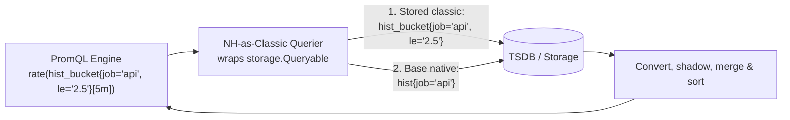

## Querying native histograms as classic histograms in PromQL

* **Owners:**
  * Bartek Plotka [@bwplotka](https://github.com/bwplotka)
  * Raphaël Bizos [@rbizos](https://github.com/rbizos)

* **Implementation Status:** `Partially implemented`

* **Related Issues and PRs:**
  * https://github.com/prometheus/prometheus/issues/16948
  * https://github.com/prometheus/prometheus/pull/18048
  * https://github.com/prometheus/prometheus/pull/19881
  * https://github.com/prometheus/prometheus/pull/19905
  * https://github.com/prometheus/prometheus/pull/19886
  * https://github.com/prometheus/prometheus/pull/19914
  * https://github.com/prometheus/prometheus/pull/17205

* **Other docs or links:**
  * [PROM-31: Store and query classic histograms as native histograms with custom buckets](./0031-classic-histograms-stored-as-native-histograms.md)
  * [PromCon 2026: Benefit from Native Histograms Without Breaking Your PromQL Queries](https://docs.google.com/presentation/d/1fZnzRj7jHwrugT0SXoX3SQ6zSl9T__0qsDGozDlUYnk/edit)

> TL;DR: Add an opt-in `--enable-feature=nh-as-classic` or `nh-from-classic` flag that wraps `storage.Queryable`. When a PromQL selector matches a metric name ending in `_bucket`, `_count`, or `_sum`, the wrapper reads stored native histograms with custom buckets, called NHCB, and exponential native histograms, called NH(E), and converts them into classic float series at query time. Operators can turn on `convert_classic_histograms_to_nhcb: true` or scrape NH(E) to get atomic samples and 70% lower memory and disk usage without rewriting existing dashboards, alerts, or recording rules first.

## Why

Native histograms pack all buckets, count, and sum into one atomic sample on a single series. Even without changing client instrumentation, converting classic histograms to NHCB at scrape time with `convert_classic_histograms_to_nhcb: true` in [PROM-31](./0031-classic-histograms-stored-as-native-histograms.md) cuts storage cost hard. In a benchmark with 4 exporters exposing 36k 12-bucket histograms at a 15s interval, NHCB reduced head series by 93% from 2.0M to 145k, resident memory by 70% from 4.4 GB to 1.3 GB, WAL size by 58% from 5.5 GB to 2.3 GB, and compacted blocks by 60% from 7.9 GB to 3.2 GB. It also stops partial-histogram reads when a scrape or Remote Write batch lands mid-flight across separate `_bucket` series.

Yet almost nobody turns it on in production, because switching a metric to NHCB or NH(E) breaks every classic PromQL query:

| Query intent      | Classic PromQL                                                                           | Native PromQL                                                                                   |
|-------------------|------------------------------------------------------------------------------------------|-------------------------------------------------------------------------------------------------|
| Quantile          | `histogram_quantile(0.99, sum by (le) (rate(http_request_duration_seconds_bucket[5m])))` | `histogram_quantile(0.99, sum(rate(http_request_duration_seconds[5m])))`                        |
| Observations rate | `rate(http_request_duration_seconds_count[5m])`                                          | `histogram_count(rate(http_request_duration_seconds[5m]))`                                      |
| Bucket threshold  | `rate(http_request_duration_seconds_bucket{le="0.1"}[5m])`                               | `histogram_fraction(-Inf, 0.1, rate(http_request_duration_seconds[5m])) * histogram_count(...)` |

### Pitfalls of the current solution

1. Converting a metric to NHCB or NH(E) removes the `_bucket`, `_count`, and `_sum` suffixes and the `le` label. Every existing alert, recording rule, and dashboard panel querying those names goes empty at cutover.
2. Scraping both classic and native histograms via `always_scrape_classic_histograms: true` throws away the memory, WAL, and disk savings during the migration and still breaks long range queries across the cutover timestamp.
3. Rewriting queries to `native_query or classic_query` gives wrong rates right after cutover. The native side returns a result as soon as two native samples exist, so a `1d` rate ends up computed from a few minutes of data.

## Goals

* Run classic PromQL queries on `<metric>_bucket`, `<metric>_count`, and `<metric>_sum` alongside native PromQL queries on `<metric>` against stored NHCB and NH(E) series.
* Leave TSDB chunks and index postings untouched, keeping a single stored series per histogram.
* Keep `rate()` continuous across classic, NHCB, and NH(E) cutovers, rollbacks, and dual-write periods.
* Let users disable conversion or inspect series origin per selector with reserved query labels.

## Non-Goals

* Emitting synthetic `_bucket`, `_count`, `_sum`, or `le` entries from `/api/v1/series`, `/api/v1/labels`, `/api/v1/label/<name>/values`, or `/api/v1/metadata`.
* Converting selectors that match `__name__` with regex or inequality matchers such as `{__name__=~"a_bucket|b_bucket"}` or `{__name__!="foo"}`.
* Expanding NHCB back to classic series on Remote Write egress for legacy long-term storage, which is implemented in [prometheus#17205](https://github.com/prometheus/prometheus/pull/17205).

## How

### 1. Storage queryable wrapper

When the feature flag is enabled, Prometheus wraps its `storage.Queryable` with `NHCBAsClassicQuerier` from [prometheus#18048](https://github.com/prometheus/prometheus/pull/18048):

On each `Select` call:

1. If `__name__` is not an equality matcher (`MatchEqual`) ending in `_bucket`, `_count`, or `_sum`, or if the selector sets `__opt_classic_from="none"`, the wrapper calls the underlying querier directly.
2. Otherwise, it strips the `_bucket`, `_count`, or `_sum` suffix to get the base metric name, removes `le` matchers from the base selection, and runs two queries against the underlying storage: one for stored classic series and one for base native series.
3. The wrapper peeks the first series from each `SeriesSet` in [prometheus#19881](https://github.com/prometheus/prometheus/pull/19881) and picks one of three paths:
   * **Pure classic.** When no base series matches, it returns the classic `SeriesSet` as-is with zero allocations.
   * **Pure NHCB.** When no stored classic series matches, `Next()` streams and converts one NHCB series at a time.
   * **Hybrid.** When both stored classic and native series exist for the metric, it groups series by histogram identity, which is all labels except `__name__` and `le`, resolves timestamp collisions, merges disjoint time ranges, and sorts output series with `labels.Compare`.

### 2. NHCB to classic conversion

NHCB samples carry the original classic upper bounds in `CustomValues` under schema `-53`, so conversion is lossless in [prometheus#18048](https://github.com/prometheus/prometheus/pull/18048) and [prometheus#19881](https://github.com/prometheus/prometheus/pull/19881):

* `<metric>_count` and `<metric>_sum` emit float samples directly from `h.Count` and `h.Sum`.
* `<metric>_bucket` sums bucket counts cumulatively across `CustomValues` and emits one float series per upper bound plus `+Inf`.
* Converted series match `le` numerically so `le="1"` and OpenMetrics `le="1.0"` hit the same bucket. Stored classic series keep exact string matching.

### 3. Exponential native histograms to classic conversion

NH(E) samples have no fixed bucket list. They store sparse spans on a base-2 grid of $2^{i / 2^{\text{schema}}}$ that shift as observations arrive and never land on decimal bounds like `0.1` or `2.5`. Converting each sample's populated spans on the fly breaks `le="0.1"` lookups, drops lower interpolation bounds in `histogram_quantile`, loses `rate()` baselines when a bucket first appears, misaligns `sum by (le)` across pods with different spans, and creates thousands of `_bucket` series at high schemas, as detailed in [prometheus#19886](https://github.com/prometheus/prometheus/pull/19886).

`_count` and `_sum` do not need bucket bounds and use the streaming fast path from `h.Count` and `h.Sum`.

For `_bucket`, `model/histogram.ConvertExponentialToClassic` computes cumulative counts at a sorted list of classic bounds. It sums buckets fully below a bound and interpolates the single straddling bucket with `FloatHistogram.InterpolationBounds` and `Bucket.FractionBelow`, sharing the exact math of `histogram_fraction`. The `+Inf` bucket is `max(h.Count, sum(buckets))`. `Select` picks the target bounds in two ways:

| Path                   | Condition                                            | Behavior                                                                                                                                                                                         | Trade-off                                                                                                                                                                        |
|------------------------|------------------------------------------------------|--------------------------------------------------------------------------------------------------------------------------------------------------------------------------------------------------|----------------------------------------------------------------------------------------------------------------------------------------------------------------------------------|
| 1. Pinned `le` bounds  | `le` matchers pin literal numbers such as `le="0.1"` | Evaluates those exact bounds at the full stored schema on the streaming path.                                                                                                                    | Emits only the requested `le` series. Decimal bounds like `0.1` split an exponential bucket and return interpolated counts, which can skew strict SLO threshold ratios.          |
| 2. Full `_bucket` scan | Unconstrained `le` such as `rate(hist_bucket[5m])`   | Collects the union of lower and upper bounds of every populated bucket across all matched NH(E) series and samples via `AppendExponentialBounds`, capped at `exponentialAsClassicMaxSchema = 2`. | Emits one shared `le` grid of 30 to 45 series per histogram with lower anchors present on every sample, so `rate()`, `sum by (le)`, and `histogram_quantile` work across series. |

### 4. Collisions, shadowing, and staleness

During dual scrapes with `always_scrape_classic_histograms: true`, cutovers, or rollbacks, both classic and native series can exist for the same histogram. `NHCBAsClassicQuerier` handles them per histogram group in [prometheus#19881](https://github.com/prometheus/prometheus/pull/19881):

* **Stored classic wins on equal timestamps.** If a stored classic series has a live sample at timestamp $t$, the wrapper drops all converted native samples for that histogram at $t$. This prevents hybrid bucket sets and duplicate `le="1"` versus `le="1.0"` series.
* **Cutover merging.** Disjoint time ranges across classic, NHCB, and NH(E) transitions merge into one `Series` when `le` values match. Live samples beat `StaleNaN` at the cutover timestamp, and late staleness markers from the old series are ignored once the new series has started.
* **Staleness propagation.** When a native series goes stale, drops a custom bucket bound on a later sample, or yields to a stored classic series with a different `le` format, the converted bucket series emits `StaleNaN`.
* **Unrelated series with colliding names.** Base series that hold plain floats, summaries, or an existing `le` label are skipped during conversion. Stored `_bucket` series without an `le` label, such as a gauge whose name ends in `_bucket`, pass through unchanged.

### 5. Per-selector control and provenance

Queries can override conversion per selector with the `__opt_classic_from` matcher and inspect where each series came from with `__stored_as__` in [prometheus#19905](https://github.com/prometheus/prometheus/pull/19905) and [prometheus#19886](https://github.com/prometheus/prometheus/pull/19886):

| Selector matcher                           | Effect                                                                                          |
|--------------------------------------------|-------------------------------------------------------------------------------------------------|
| Omitted, or matching both `nhcb` and `nhe` | Default when the feature flag is on. Converts both NHCB and NH(E).                              |
| `__opt_classic_from="nhcb"` or `!~"nhe"`   | Converts NHCB only and ignores NH(E).                                                           |
| `__opt_classic_from="nhe"` or `!~"nhcb"`   | Converts NH(E) only and ignores NHCB.                                                           |
| `__opt_classic_from="none"` or `=""`       | Turns off conversion for this selector and returns stored classic series only.                  |
| `__opt_classic_from="debug"`               | Converts without shadowing or merging and adds `__stored_as__="classic"`, `"nhcb"`, or `"nhe"`. |

The PromQL engine strips `__opt_*` matchers even when the feature flag is off, so disabling the flag does not break queries that already use `__opt_classic_from`.

### 6. Performance

In `BenchmarkNHCBAsClassic` from [prometheus#19914](https://github.com/prometheus/prometheus/pull/19914), running a 30m range `histogram_quantile` query over 1,000 series with 30 buckets and 70 samples takes `212.8ms` on NHCB converted to classic, compared to `238.0ms` on stored classic, which is `10.6%` faster with `73.9%` fewer allocations, and `58.5ms` with native PromQL syntax. For NH(E) in [prometheus#19886](https://github.com/prometheus/prometheus/pull/19886), `Select` across 1,000 schema-3 series with 30 buckets and 6 samples takes `77.3ms` for a full `_bucket` scan with 17 synthesized bounds per series, `11.1ms` for a pinned `le="1"` matcher, and `2.7ms` for `_count`.

## Alternatives

1. **Rewrite all queries or use `native_query or classic_query`.** Updating thousands of dashboards, alerts, and recording rules in lockstep with a scrape config change is what stops teams from adopting NHCB and NH(E) in the first place. The `or` workaround also computes rates over incomplete windows right after cutover.
2. **Write synthetic `_bucket`, `_count`, and `_sum` postings into the TSDB index, as in [PROM-31 Options 1 to 3](./0031-classic-histograms-stored-as-native-histograms.md#alternatives).** Keeping $B+3$ index entries per histogram gives back most of the TSDB head memory savings and does not work for NH(E), where bucket bounds depend on the observed values inside the chunks.
3. **Rewrite the PromQL AST instead of wrapping `storage.Queryable`.** Translating `histogram_quantile(0.99, sum by (le) (rate(x_bucket[5m])))` into `histogram_quantile(0.99, sum(rate(x[5m])))` in the parser or engine fails on queries that inspect `_bucket` series directly, such as heatmap panels running `sum by (le) (rate(x_bucket[5m]))`, binary operations between buckets, or mixed fleets where only some targets have migrated. A `storage.Queryable` wrapper makes every classic query work first, and we can still add engine pushdown for common `histogram_quantile` patterns later.

## Open Questions

1. **Feature flag name.** [prometheus#18048](https://github.com/prometheus/prometheus/pull/18048) used `--enable-feature=promql-nhcb-as-classic`. Because the wrapper sits on `storage.Queryable`, which also serves `remote_read`, and converts both NHCB and NH(E), should we rename the flag to `nh-as-classic`, `nh-from-classic`, or `promql-nh-as-classic`?
2. **Schema cap for full NH(E) `_bucket` scans.** Is `exponentialAsClassicMaxSchema = 2`, which gives 4 buckets per power of two and an 18.9% bucket width, the right cap, or should it be configurable?
3. **Mixed classic and NH(E) fleets.** When some targets in a job expose classic histograms and others expose NH(E) at the same timestamp, should `Select` evaluate the NH(E) series at the stored classic `le` bounds so `sum by (le)` aggregates a single bucket layout across the job?

## Action Plan

* [ ] Pick the feature flag name, `nh-as-classic` or `nh-from-classic`, and merge base NHCB conversion in [prometheus#18048](https://github.com/prometheus/prometheus/pull/18048).
* [ ] Merge collision handling, cutover merging, and streaming fast paths in [prometheus#19881](https://github.com/prometheus/prometheus/pull/19881).
* [ ] Merge `__opt_classic_from` selector control and the `__stored_as__` debug label in [prometheus#19905](https://github.com/prometheus/prometheus/pull/19905).
* [ ] Merge NH(E) conversion in [prometheus#19886](https://github.com/prometheus/prometheus/pull/19886) and PromQL benchmarks in [prometheus#19914](https://github.com/prometheus/prometheus/pull/19914).
