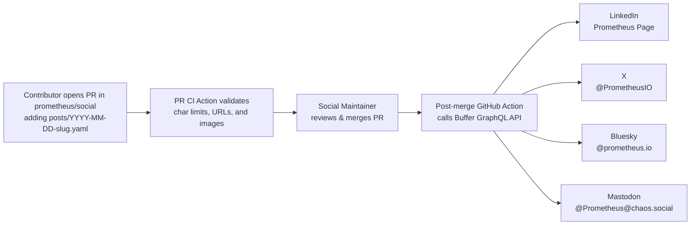

## Reviving Prometheus social media via pull requests

* **Owners:**
  * Bartek Plotka [@bwplotka](https://github.com/bwplotka)

* **Implementation Status:** `Not implemented`

* **Related Issues and PRs:**
  * https://github.com/prometheus/docs/commit/fe36703
  * https://github.com/prometheus/docs/pull/2586
  * https://github.com/prometheus/docs/pull/3007

* **Other docs or links:**
  * [PROM-95: Standardize Prometheus GitHub teams and repository access](./0095-teams-and-org-permissions.md)
  * [Prometheus Community page](https://prometheus.io/community/)
  * [Prometheus Community Roles](https://github.com/prometheus/governance/blob/main/ROLES.md)

> TL;DR: Create an official Prometheus LinkedIn project page, reactivate `@PrometheusIO` on X alongside `@prometheus.io` on Bluesky and `@Prometheus@chaos.social` on Mastodon, and manage all social media announcements and community stories via Git pull requests in a new public `prometheus/social` repository governed by a `@prometheus/social-maintainers` team and published simultaneously across all four platforms via CNCF Buffer's GraphQL API.

## Why

Over the past year, the Prometheus blog in [prometheus/docs](https://github.com/prometheus/docs/tree/main/blog) came back to life. After publishing only one or two posts a year between 2022 and 2024, contributors published over ten technical posts in 2025 and 2026 covering composite samples, uncached IO, the relabeling UI visualizer, the `info()` function, the UX research working group, and the OpenTelemetry interoperability survey. Adding a [blog post proposal template](https://github.com/prometheus/docs/blob/main/.github/ISSUE_TEMPLATE/blog-post-proposal.yml) and a maintainer sponsor model in [prometheus/docs#3007](https://github.com/prometheus/docs/pull/3007) made it obvious how anyone could contribute.

Our social media presence has not kept up. Right now, most of that work happens in silence unless readers check `prometheus.io/blog` directly or subscribe to RSS.

### Pitfalls of the current solution

1. **No LinkedIn presence.** Prometheus does not have an official LinkedIn project page. LinkedIn is now one of the main places where SREs, platform engineers, and end-user companies share production postmortems, architecture write-ups, PromCon talks, and release announcements. Peer CNCF projects such as Kubernetes and OpenTelemetry reach a large practitioner audience there.
2. **Dormant X account `@PrometheusIO` and underused Bluesky account `@prometheus.io`.** In February 2025, we swapped the `@PrometheusIO` link on [prometheus.io/community](https://prometheus.io/community/) for `@prometheus.io` on Bluesky in [prometheus/docs@fe36703](https://github.com/prometheus/docs/commit/fe36703) and added `@Prometheus@chaos.social` on Mastodon in [prometheus/docs#2586](https://github.com/prometheus/docs/pull/2586). Dropping X cut off an established audience of tens of thousands of followers who still use X to track open-source releases. Meanwhile, the Bluesky and Mastodon accounts rarely post either.
3. **A manual bottleneck.** Posting to any official account currently requires someone with raw credentials or CNCF Buffer access to log in and copy text across platforms. Contributors cannot propose a social post the way they propose a doc fix or a blog post, so announcements and community stories simply do not happen.

## Goals

* Create an official Prometheus LinkedIn page and list it on [prometheus.io/community](https://prometheus.io/community/).
* Resume active posting on X `@PrometheusIO`, Bluesky `@prometheus.io`, and Mastodon `@Prometheus@chaos.social`, and list all four active channels on the community page.
* Share both official project announcements and cool community stories, including feature spotlights, real-world debugging stories, mentee projects, and ecosystem news.
* Manage all posts through Git pull requests in a dedicated public `prometheus/social` repository, so any contributor can draft a post and any member of `@prometheus/social-maintainers` can trigger simultaneous publishing across LinkedIn, X, Bluesky, and Mastodon by merging the PR.

### Audience

Prometheus users, contributors, mentees, and maintainers who want to share or follow technical release highlights, engineering deep dives, and production stories across LinkedIn, X, Bluesky, and Mastodon.

## Non-Goals

* Turning Prometheus social accounts into a corporate marketing feed or allowing gated vendor promotions.
* Requiring social maintainers to hold raw account passwords or have write access to `prometheus/docs`.
* Automating replies or interactive community support through GitHub Actions. Support questions remain on CNCF Slack, Matrix, IRC, Discourse, and GitHub Discussions.

## How

### Channels to operate

We will publish to four platforms from a single workflow:

* **LinkedIn.** Create an official "Prometheus" project page, coordinated with CNCF for trademark and admin continuity, with multiple Steering Committee members as page admins.
* **X, `@PrometheusIO`.** Bring the existing account back into regular use and restore its link on [src/app/community/community.md](https://github.com/prometheus/docs/blob/main/src/app/community/community.md).
* **Bluesky, `@prometheus.io`.** Keep the DNS-verified handle active as a first-class channel.
* **Mastodon, `@Prometheus@chaos.social`.** Keep the existing fediverse account active alongside Bluesky, X, and LinkedIn.

### Content strategy and editorial rules

We want the accounts to read like an engineering project run by practitioners, not a corporate marketing feed. Good candidates for posts fall into four buckets:

* **Release highlights that show the feature, not just a version number.** When Prometheus, Alertmanager, `client_golang`, or a major exporter ships a notable release, post a short explanation of a specific problem it solves, paired with a PromQL snippet, benchmark chart, or UI screenshot.
* **Blog posts and deep dives.** When a blog post merges under `blog/posts/` in [prometheus/docs](https://github.com/prometheus/docs), a GitHub Action in `prometheus/docs` can automatically open a ready-to-review PR in `prometheus/social` with the post title, summary, and link.
* **Cool stories from the community.** Users do clever things with Prometheus every week. We should amplify un-gated technical write-ups on how teams debugged a nasty production outage with Prometheus, scaled TSDB or remote write, built an exporter for unusual hardware, or completed an LFX or GSoC mentorship project.
* **Project events and calls for input.** Dev Summit agendas and recaps, PromCon CFP dates and talk recordings, security advisories, and user surveys.

To keep quality high and prevent vendor spam, every PR must pass three editorial rules before a social maintainer merges it:

1. **Technical substance over promotion.** Posts about external blog articles or case studies must link to free, un-gated technical content. Product pitches, vendor landing pages, and press releases will be rejected.
2. **Verify claims and numbers.** If a post quotes a benchmark such as 30% less memory with uncached IO, a maintainer familiar with that area must verify the claim, just like a code or blog review.
3. **Credit contributors.** Tag or name the authors, mentees, or community members who did the work whenever possible.

### PR-driven publishing architecture

We should treat social posts like code and documentation. Nobody should need direct passwords to X, Bluesky, LinkedIn, or Mastodon to propose or approve a post.



### Dedicated public `prometheus/social` repository

We will create a new public `prometheus/social` repository governed by its own `MAINTAINERS.md` and a `social-maintainers` GitHub team, following the repository team structure in [PROM-95](./0095-teams-and-org-permissions.md):

* **Open to community PRs.** Because `prometheus/social` is public, any Prometheus user, exporter author, or GSoC mentee on GitHub can fork the repo and open a pull request to propose a community story or announcement, and all contributions count in CNCF [DevStats](https://devstats.cncf.io/).
* **Scoped merge rights for social maintainers.** In GitHub, merge rights apply to an entire repository rather than a single folder. A dedicated `prometheus/social` repo lets us grant `Maintain` permission to `social-maintainers` without granting write access to `prometheus.io` documentation or the OpenMetrics specification in `prometheus/docs`.
* **Isolated secrets.** Publishing credentials live only in `prometheus/social` inside a protected GitHub Environment named `social-production`. In GitHub Actions, `pull_request` workflows from forks run with read-only permissions and zero access to secrets; secrets only load on the post-merge `push` to `main` after a social maintainer merges the PR.

### Post file format

A contributor creates a new YAML file at `posts/YYYY-MM-DD-<slug>.yaml` in `prometheus/social`. A single shared message works for quick announcements, while optional per-platform overrides let authors write a longer story for LinkedIn or Mastodon and a tighter version for X and Bluesky.

```yaml
# posts/2026-11-05-uncached-io-story.yaml
platforms:
  - linkedin
  - x
  - bluesky
  - mastodon

# Shared default text, used when a platform override is not set.
# Must fit the strictest enabled platform limit of 280 chars for X unless overridden.
text: |
  How do you stop Prometheus compaction from evicting active page cache on Linux?

  In our latest engineering post, @author walks through how Prometheus uses RWF_UNCACHED to keep page cache predictable under heavy TSDB churn.

url: "https://prometheus.io/blog/2026/03/05/uncached-io/"

# Optional image stored in the repo under assets/
media:
  - path: "assets/2026-11-05-uncached-io/benchmark1.png"
    alt: "Graph showing page cache usage staying flat during compaction with uncached IO enabled."

# Optional longer copy for platforms with higher character limits
overrides:
  linkedin: |
    Large TSDB compactions in Prometheus read and write gigabytes of block data that won't be queried again immediately. On Linux, those reads and writes can push hot working-set series out of the kernel page cache.

    In this deep dive, @author explains how we wired Linux's RWF_UNCACHED flag into Prometheus, what we learned benchmarking it on production workloads, and how you can test it today.
```

### Pull request validation on `pull_request`

When a contributor opens or updates a PR touching `posts/*.yaml`, a GitHub Action runs three checks:

1. **Append-only diff check.** The linter verifies that the PR only adds new files in `posts/`, or edits a file that has not been merged yet. Modifying or renaming already-published files fails the check so historical edits never trigger duplicate posts.
2. **Length and media validation.**
   * **X.** Counts weighted characters according to X's rules, capped at 280 characters where URLs always count as 23 characters via `t.co`.
   * **Bluesky.** Counts Unicode graphemes, capped at 300 graphemes.
   * **Mastodon.** Counts characters, capped at 500 characters on `chaos.social` where URLs count as 23 characters.
   * **LinkedIn.** Counts characters, capped at 3,000 characters.
   * **Media.** Verifies that any referenced image exists in the repo, has non-empty `alt` text of at most 300 characters to match Buffer and LinkedIn's limit, and is under 1 MB to match Bluesky's blob upload ceiling.
3. **Preview summary.** The action writes a formatted preview of all four platform variants into the GitHub Actions job summary so reviewers can read the exact rendered character counts before approving.

### Publishing on merge via Buffer's GraphQL API

When a social maintainer merges a PR to `main`, the publishing workflow detects newly added files in `posts/*.yaml` via `git diff --diff-filter=A ${{ github.event.before }} ${{ github.sha }} -- posts/` and publishes them through CNCF's Buffer account using a small Go CLI under `cmd/social-post/` in `prometheus/social`.

Instead of an RSS-to-Zapier pipe, the CLI calls Buffer's GraphQL API via the `createPost` mutation once for each enabled platform `channelId`:

```graphql
mutation CreatePost($channelId: ChannelId!, $text: String!, $imageUrl: String!, $altText: String!) {
  createPost(
    input: {
      channelId: $channelId
      text: $text
      schedulingType: automatic
      mode: shareNow
      assets: [
        {
          image: {
            url: $imageUrl
            metadata: { altText: $altText }
          }
        }
      ]
    }
  ) {
    ... on PostActionSuccess {
      post { id }
    }
    ... on MutationError {
      message
    }
  }
}
```

Why this architecture fits Prometheus well:

* **Per-platform overrides work natively.** Each `createPost` call targets a single `channelId`, so the CLI sends `overrides.linkedin` to the LinkedIn channel ID and the concise `text` to the X, Bluesky, and Mastodon channel IDs.
* **Images and alt text work from Git.** As soon as the PR merges to `main`, any image committed under `assets/...` is publicly reachable at `https://raw.githubusercontent.com/prometheus/social/main/assets/...`. Passing that URL and `metadata.altText` to `createPost` attaches the image and accessibility description on LinkedIn, X, Bluesky, and Mastodon.
* **Single secret, zero OAuth token rotation in CI.** GitHub Actions only stores one `BUFFER_ACCESS_TOKEN` secret plus the four Buffer channel IDs: `BUFFER_CHANNEL_LINKEDIN`, `BUFFER_CHANNEL_X`, `BUFFER_CHANNEL_BLUESKY`, and `BUFFER_CHANNEL_MASTODON`. Buffer handles LinkedIn's 60-day OAuth token refreshes and X API access under CNCF's existing account.

### Governance, access, and contributor recognition

1. **Account ownership.** Master credentials including login passwords, 2FA recovery codes, LinkedIn Page Super Admin roles, and the CNCF Buffer login will be stored in the CNCF and Prometheus Steering Committee shared password vault so the project is never locked out when an individual changes roles.
2. **Social maintainers in `prometheus/social/MAINTAINERS.md`.**
   * Seed `prometheus/social/MAINTAINERS.md` with initial volunteers from the Steering Committee and `docs-maintainers`.
   * New social maintainers can be nominated using the standard maintainer nomination process in [prometheus/governance ROLES.md](https://github.com/prometheus/governance/blob/main/ROLES.md) based on their editorial judgment and consistency in reviewing or drafting announcements and community stories.
   * Branch protection on `main` in `prometheus/social` requires at least 1 approving review from `social-maintainers` and passing CI checks before merge.
3. **Contributor ladder credit.** Authoring and reviewing social announcements and community story spotlights in `prometheus/social` counts as a qualifying non-code contribution under "Promote the project in public" toward Prometheus Organization Membership in [prometheus/governance ROLES.md](https://github.com/prometheus/governance/blob/main/ROLES.md).

## Alternatives

### 1. Direct native API fan-out instead of Buffer

Instead of calling Buffer's GraphQL API, the post-merge Go CLI in `prometheus/social` can call each platform's native API directly using per-platform secrets stored in the `social-production` GitHub Environment:

| Platform                                | API endpoint                                                                        | Auth secret model                                                                              | Cost and operational notes                                                                                                                                                           |
|:----------------------------------------|:------------------------------------------------------------------------------------|:-----------------------------------------------------------------------------------------------|:-------------------------------------------------------------------------------------------------------------------------------------------------------------------------------------|
| **Bluesky** `@prometheus.io`            | AT Protocol: `createSession`, `uploadBlob`, `createRecord`                          | Scoped App Password: `BLUESKY_IDENTIFIER`, `BLUESKY_APP_PASSWORD`                              | Free. App passwords do not expire on a timer and cannot delete the account or change settings.                                                                                       |
| **Mastodon** `@Prometheus@chaos.social` | Mastodon REST API: `POST /api/v2/media` and `/api/v1/statuses`                      | Application access token: `MASTODON_ACCESS_TOKEN` scoped to `write:media` and `write:statuses` | Free. Tokens do not expire unless revoked.                                                                                                                                           |
| **X** `@PrometheusIO`                   | X API v2: `POST /2/tweets` and `/2/media/upload`                                    | OAuth 1.0a User Context: `X_API_KEY`, `X_API_SECRET`, `X_ACCESS_TOKEN`, `X_ACCESS_SECRET`      | X replaced the old free tier with pay-per-use at roughly $0.015 per post. At 10 to 30 posts a month, this costs under $1/month, funded via CNCF project card or X developer credits. |
| **LinkedIn** `Prometheus` Page          | LinkedIn REST Posts API: `POST /rest/posts` with `author: urn:li:organization:<ID>` | OAuth 2.0 `w_organization_social` via LinkedIn Community Management API                        | Free. Access tokens expire after 60 days and refresh tokens last 365 days. Requires automated refresh token rotation in CI.                                                          |

Direct native API calls report synchronous per-platform errors inside the GitHub Actions run and avoid a third-party dependency on Buffer, but require maintaining LinkedIn OAuth app approval, 60-day token rotation, and X API billing separately. Because the YAML schema in `posts/*.yaml` is identical for both approaches, we can start with Buffer and switch any individual channel to direct native API calls later without changing how contributors open PRs.

### 2. Making `prometheus/social` private instead of public

We considered making `prometheus/social` a private repository, which would allow drafting embargoed announcements privately ahead of time. We rejected a private repository because it prevents external community members outside the `prometheus` GitHub org from opening PRs to share their stories, hides contributor activity from CNCF DevStats, and blocks Buffer from fetching images directly via public `raw.githubusercontent.com` URLs:

| Aspect                             | Public `prometheus/social`, proposed                  | Private `prometheus/social`           |
|:-----------------------------------|:------------------------------------------------------|:--------------------------------------|
| **Who can propose a post via PR?** | Anyone on GitHub via fork PR                          | Only `prometheus` GitHub Org Members  |
| **Who can approve and merge?**     | Only `social-maintainers`                             | Only `social-maintainers`             |
| **Are API secrets safe from PRs?** | Yes, secrets only load on post-merge `push` to `main` | Yes                                   |
| **Counts in CNCF DevStats?**       | Yes                                                   | No                                    |
| **Embargoed posts such as CVEs?**  | Social maintainer merges directly when embargo lifts  | Can draft PRs privately ahead of time |

### 3. Storing `social/posts/` inside `prometheus/docs`

Storing social post files inside `prometheus/docs` would let blog post authors include a social post in the same PR as their blog article. However, GitHub repository `Write` and `Maintain` permissions cannot be restricted to a subdirectory. Keeping social posts in `prometheus/docs` would require granting every social maintainer full merge access to `prometheus.io` documentation and the OpenMetrics specification. A dedicated `prometheus/social` repository keeps permissions cleanly separated.

## Action Plan

* [ ] Reach consensus on this proposal in `prometheus/proposals`.
* [ ] Create the public `prometheus/social` repository with `MAINTAINERS.md` and the `social-maintainers` GitHub team.
* [ ] Request creation of the official Prometheus LinkedIn page with CNCF, add Steering Committee admins, and connect LinkedIn, `@PrometheusIO` on X, `@prometheus.io` on Bluesky, and `@Prometheus@chaos.social` on Mastodon to CNCF's Buffer account.
* [ ] Update [src/app/community/community.md](https://github.com/prometheus/docs/blob/main/src/app/community/community.md) in `prometheus/docs` to list LinkedIn, X, Bluesky, and Mastodon.
* [ ] Add `posts/`, `assets/`, `README.md`, the PR validation workflow, and the Buffer GraphQL publisher CLI to `prometheus/social`.
* [ ] Update `.github/ISSUE_TEMPLATE/blog-post-proposal.yml` and `blog/README.md` in `prometheus/docs` to link new blog posts with `prometheus/social`.
* [ ] Publish the initial announcement across LinkedIn, X, Bluesky, and Mastodon via the first merged PR in `prometheus/social`.
