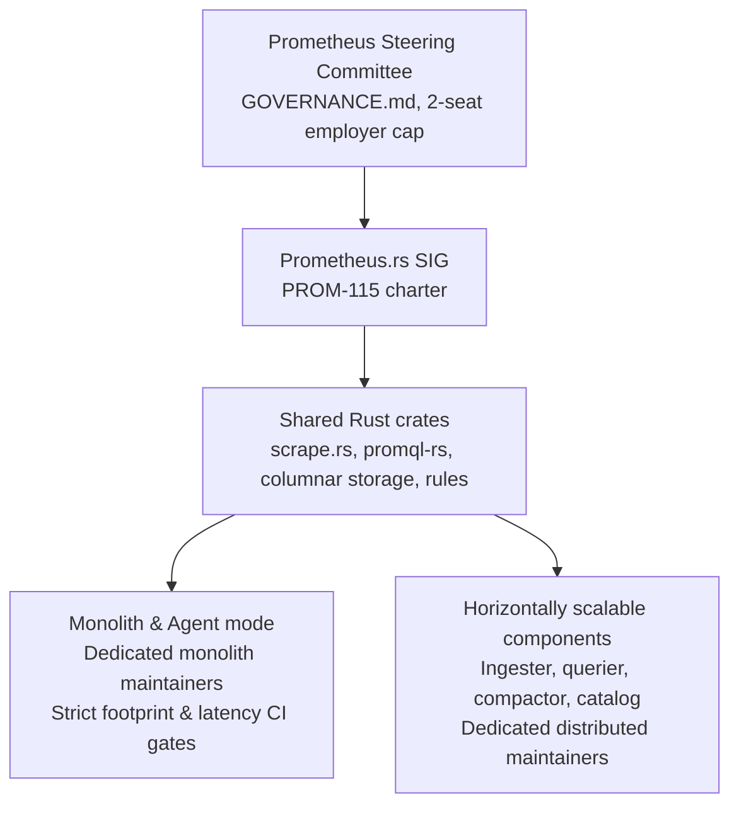

## Horizontally scalable Prometheus in Rust

* **Owners:**
  * Bartek Plotka [@bwplotka](https://github.com/bwplotka)
  * Matthias Loibl [@metalmatze](https://github.com/metalmatze)
  * Saswata Mukherjee [@saswatamcode](https://github.com/saswatamcode)
  * Alan Protasio [@alanprot](https://github.com/alanprot)

* **Implementation Status:** `Not implemented`

* **Related Issues and PRs:**
  * [PROM-115: Establish Prometheus Special Interest Groups](https://github.com/prometheus/proposals/pull/115)
  * [PROM-113: Supporting Multiple Storage Options in Prometheus](https://github.com/prometheus/proposals/pull/113)
  * [PROM-95: Standardize Prometheus GitHub teams and repository access](https://github.com/prometheus/proposals/blob/main/proposals/0095-teams-and-org-permissions.md)
  * [prometheus/prometheus#5868: Index files exceeding 64 GiB](https://github.com/prometheus/prometheus/issues/5868)

* **Other docs or links:**
  * [Prometheus.rs SIG goals and meeting notes](https://docs.google.com/document/d/1uZjrWeAfRaN6fIp4L7pd-lMqc650bClJeg7jGO3gerE/edit)
  * [Thanos 2.0 architecture draft](https://docs.google.com/document/d/1fn8JdEiHe0UBF4MPCVE41GHMtAkQ8n_3T8ovIadfX1A/edit)
  * [Prometheus.rs architecture draft](https://docs.google.com/document/d/1NB5qyEthztPjp2in8AeDq_l8PoYxsAa1QhImanJDQHM/edit)
  * [Prometheus Governance](https://github.com/prometheus/governance/blob/main/GOVERNANCE.md)
  * [Prometheus Community Roles](https://github.com/prometheus/governance/blob/main/ROLES.md)

> TL;DR: Bring horizontally scalable, distributed Prometheus into the Prometheus organization alongside single-node Prometheus. Contributors from Prometheus, Thanos, Cortex, and (potentially) Mimir are rebuilding the next generation of metrics storage and querying from scratch in Rust on an Apache Arrow columnar stack. Rather than splitting that work across competing organizations or inventing a fourth project, we propose building it under the Prometheus umbrella, coordinated by the Prometheus.rs SIG, with explicit structural safeguards that keep single-node monolith Prometheus a first-class priority. Depending on maintainer feedback, this work can live directly in the new Rust Prometheus repository as composable modes or in a separate repository under the `prometheus` organization.

## Why

The core (CNCF related) horizontally scalable Prometheus ecosystem has been split across three projects, Thanos, Cortex, and Mimir, for years. Each project maintained its own ingestion pipeline, object-storage integration, compactor, and query scaling layer on top of Go Prometheus TSDB. As cardinality and ingestion volume grew, the memory and CPU cost of the mutable TSDB head pushed companies like Cloudflare, Shopify, AWS, Red Hat, Grafana, and Dash0 toward internal Rust and columnar prototypes using Apache Arrow, Vortex, and Apache DataFusion. At the same time, upstream maintenance on Thanos slowed sharply, Cortex runs on a small maintainer group across three companies, and Mimir ships fast as a single-vendor AGPL-3.0 project outside CNCF governance.

Because we are rebuilding the stack from scratch, as outlined in the [Thanos 2.0](https://docs.google.com/document/d/1fn8JdEiHe0UBF4MPCVE41GHMtAkQ8n_3T8ovIadfX1A/edit) and [Prometheus.rs](https://docs.google.com/document/d/1NB5qyEthztPjp2in8AeDq_l8PoYxsAa1QhImanJDQHM/edit) drafts, we have a rare chance to reunite the community in one vendor-neutral home. On November 19, 2026, the [Prometheus.rs SIG](https://docs.google.com/document/d/1uZjrWeAfRaN6fIp4L7pd-lMqc650bClJeg7jGO3gerE/edit?tab=t.ok8vuqesxwve#heading=h.ht6fktvkrxsh) discussed where this combined effort should live. We compared reusing the Thanos organization, creating a brand-new organization such as CorThanos or CorThaMir, and bringing the scope under Prometheus itself. The group agreed that Prometheus, with its refreshed governance, elected Steering Committee, and new energy, is the best neutral home.

Historically, Prometheus maintainers resisted bringing Thanos or Cortex style requirements into Prometheus. That resistance made sense. Single-node Prometheus works so well because it is **an autonomous binary with local TSDB and zero external storage dependencies. You can trust it to fire alerts when everything else is broken**. Maintainers worried that distributed microservices and extreme-scale requirements would bloat the monolith and pull focus away from single-node users, especially since roughly 90% of maintainers work at companies that care more about multi-cluster distributed Prometheus than single-node servers.

That risk is real and we should not wave it away. Prometheus is still a single-binary effort first, and if the interests of single-node Prometheus and horizontally scalable Prometheus ever conflict, single-node Prometheus comes first. At the same time, the past decade has shown how costly ecosystem fragmentation is across separate projects. Four things have changed since that original scope boundary was formed:

1. We can protect monolith priority with structure instead of an informal scope ban. Refreshed Prometheus governance gives us explicit SIG charters in [PROM-115](https://github.com/prometheus/proposals/pull/115), per-repository maintainer teams in [PROM-95](https://github.com/prometheus/proposals/blob/main/proposals/0095-teams-and-org-permissions.md), and clear contributor roles in [ROLES.md](https://github.com/prometheus/governance/blob/main/ROLES.md). We can back those up with hard benchmark gates, clean crate boundaries, and dedicated monolith maintainers.
2. The `github.com/prometheus` organization stopped being only the monolith server binary a long time ago. Today the organization maintains client SDKs in six languages, exporters, Alertmanager, `promtool`, `--agent` mode, [prometheus/prometheus-mcp](https://github.com/prometheus/prometheus-mcp), protocol specifications, and experimental Rust projects in [prometheus/scrape.rs](https://github.com/prometheus/scrape.rs) and [prometheus/prometheus.rs](https://github.com/prometheus/prometheus.rs).
3. `prometheus/prometheus` already absorbs complexity for downstream horizontally scalable backends. The codebase carries methods and options that exist solely for Mimir, Cortex, or Thanos, such as [`DB.CompactSelectedSeries`](https://github.com/prometheus/prometheus/blob/2b311b9762bb5834a17374fcf45a8e5b2043293f/tsdb/db.go#L1940-L1963), [`LeveledCompactorOptions.EnableOverlappingCompaction`](https://github.com/prometheus/prometheus/blob/2b311b9762bb5834a17374fcf45a8e5b2043293f/tsdb/compact.go#L183-L185), [`AppendOptions.MetricFamilyName`](https://github.com/prometheus/prometheus/blob/2b311b9762bb5834a17374fcf45a8e5b2043293f/storage/interface_append.go#L51-L60), and the [`--storage.tsdb.delay-compact-file.path`](https://github.com/prometheus/prometheus/blob/2b311b9762bb5834a17374fcf45a8e5b2043293f/cmd/prometheus/main.go#L575-L576) flag. It also tracks scale limits above 100M series like the 64 GiB index cap in [#5868](https://github.com/prometheus/prometheus/issues/5868), and [`AGENTS.md`](https://github.com/prometheus/prometheus/blob/2b311b9762bb5834a17374fcf45a8e5b2043293f/AGENTS.md#L94-L99) explicitly instructs contributors to check Cortex, Thanos, and Mimir before changing exported Go APIs. We already pay the maintenance tax for distributed backends downstream without getting a shared architecture in return.
4. In the AI era, reusable crates with clear boundaries matter more than glue code. Teams and coding agents can wire up custom binaries or integrations cheaply now, while well-scoped libraries with strict interfaces and thorough tests remain the hard part. Clear crate boundaries also give humans and coding agents small, isolated units to change and review safely. Focusing the [prometheus/prometheus.rs](https://github.com/prometheus/prometheus.rs) monorepo on reusable crates lets monolith and distributed modes share those core libraries without tangling their concerns.

### Pitfalls of the current solution

* Fragmented governance across Thanos, Cortex, and Mimir splits engineering effort across three overlapping codebases and nudges large operators toward closed-source Rust forks.
* Downstream horizontally scalable storage and querying requirements still leak into `prometheus/prometheus` as special-case flags and unused library methods instead of clean shared components.
* Shared Rust building blocks such as [prometheus/scrape.rs](https://github.com/prometheus/scrape.rs) and [prometheus-community/promql-rs](https://github.com/prometheus-community/promql-rs) already live under Prometheus organizations, so putting distributed Prometheus components under a different governance body splits one contributor community across two orgs.

## Goals

* Officially bring horizontally scalable, distributed Prometheus into the scope of the Prometheus organization.
* Give contributors from Prometheus, Thanos, Cortex, and Mimir one vendor-neutral home to build the next-generation Rust and columnar metrics stack together.
* Put concrete organizational and technical safeguards in place so single-node monolith Prometheus remains a first-class priority.
* Keep core Rust crates standalone, separately published, and usable on their own so teams running different backends can reuse them and contribute fixes back without adopting the full Prometheus.rs stack.
* Set a clear repository and SIG structure focused on reusable crates with clear boundaries so teams can adopt components incrementally without an upfront rewrite of Go Prometheus.

### Audience

Prometheus maintainers, Steering Committee members, Prometheus Members, and contributors or operators from the Prometheus, Thanos, Cortex, and Mimir communities.

## Non-Goals

* Turning Go `prometheus/prometheus` into a distributed microservice system. Go Prometheus remains a single-node server and agent.
* Deprecating Go `prometheus/prometheus` or deciding if and when a replacement happens. Any deprecation decision is out of scope here and belongs to `prometheus/prometheus` maintainers.
* Providing Go FFI bindings so Go `prometheus/prometheus` can call the Rust crates directly. Contributors are free to experiment, but the SIG does not plan to build or maintain bindings.
* Finalizing technical architecture choices such as Vortex versus Parquet, Kafka versus object-storage WAL, or Iceberg versus DuckLake. Those decisions belong in component design docs and prototypes inside the SIG.
* Making unilateral trademark or CNCF project-boundary changes without coordinating with the Steering Committee, Thanos and Cortex maintainers, and CNCF.

## How

### Scope expansion

This proposal updates the scope of the Prometheus project under [prometheus/governance](https://github.com/prometheus/governance) to include horizontally scalable, distributed Prometheus as an official area of work, alongside single-node Prometheus, agent mode, Alertmanager, exporters, SDKs, and specifications.

Go `prometheus/prometheus` does not change its scope. New horizontally scalable work targets the experimental Rust and columnar ecosystem being developed in the Prometheus.rs SIG.

### Governance and repository structure

The work operates under existing Prometheus governance rules in [GOVERNANCE.md](https://github.com/prometheus/governance/blob/main/GOVERNANCE.md) and [ROLES.md](https://github.com/prometheus/governance/blob/main/ROLES.md):

* Once [PROM-115](https://github.com/prometheus/proposals/pull/115) is accepted, the Prometheus.rs SIG submits a formal SIG charter under `prometheus/governance/sigs/` covering shared Rust crates, the Rust monolith effort, and distributed components, with at least two SIG leads and a Steering Committee liaison.
* Reusable Rust crates with clear boundaries are the primary focus of the [prometheus/prometheus.rs](https://github.com/prometheus/prometheus.rs) monorepo, alongside existing crates like [prometheus/scrape.rs](https://github.com/prometheus/scrape.rs) and [prometheus-community/promql-rs](https://github.com/prometheus-community/promql-rs). Keeping crates small, separately published, and usable on their own across areas like columnar storage and rule evaluation makes them easier for both humans and coding agents to maintain. Teams running different backends can adopt a single crate and contribute bug fixes or tests back without running the rest of the stack.
* Each repository follows [PROM-95](https://github.com/prometheus/proposals/blob/main/proposals/0095-teams-and-org-permissions.md) with its own `MAINTAINERS.md` and dedicated GitHub maintainer team.
* Shared crates and distributed components follow the existing [Prometheus security policy](https://prometheus.io/docs/operating/security/), with the Prometheus security team handling vulnerability reports.
* New distributed components start clearly labeled as `[EXPERIMENTAL]` and graduate to stable status only after meeting conformance tests, operational benchmarks, and multi-company maintainership requirements.

For repository and binary placement, we ask maintainers to weigh in on two options during review of this proposal:

1. Preferred option: bring horizontally scalable Prometheus directly into the [prometheus/prometheus.rs](https://github.com/prometheus/prometheus.rs) monorepo. The workspace keeps core functionality in independent, reusable crates and composes them into modular components for single-node Prometheus and opt-in distributed roles such as ingester, querier, compactor, ruler, and catalog. Single-node Prometheus will not be `-role=all` running every distributed service in one process. The monolith instead composes components suited for a single node, which can use separate implementations from the distributed ones while sharing the same core crates. Maintainers decide how many variants to keep. Keeping everything in one monorepo avoids inventing a new brand name, keeps cross-crate changes coordinated during early prototyping, and lets users scale from a single binary to distributed components with one mental model.
2. Fallback option, detailed in Alternative 1 below: host horizontally scalable Prometheus in a separate repository and binary under the Prometheus organization, incubating in `prometheus-community` first if preferred, while sharing the same Rust crates and SIG.

### Safeguarding monolith priority

Accepting horizontally scalable Prometheus into the Prometheus organization must not come at the expense of single-node Prometheus users. Whenever the interests of single-node Prometheus and horizontally scalable Prometheus conflict, single-node Prometheus comes first. We back that rule up with five concrete guardrails from day one:

* Monolith remains the default UX. Running the binary without distributed flags starts a self-contained single-node server using local storage, zero external coordination services, and familiar Prometheus configuration. Multi-tenancy, object storage, and distributed routing stay strictly opt-in.
* Dependency direction is one-way. Core crates for scraping, PromQL, rule evaluation, and local storage cannot depend on distributed coordination, multi-tenant auth, or cloud object-store SDKs. Distributed layers depend downward on core crates, never the reverse.
* Continuous benchmark gates enforce monolith budgets. CI tracks single-node RSS, CPU, query latency, cold-start time, and binary size on realistic small and medium workloads alongside 100M-series tests. Changes that improve distributed components while regressing monolith footprint or startup simplicity do not merge.
* Separate maintainership protects priorities. Monolith core and distributed components have distinct maintainer rosters or `CODEOWNERS` areas. Monolith maintainers hold approval authority over default behavior, single-node flags, and shared crate interfaces. At the organization level, the Steering Committee's 2-seat-per-employer limit in [GOVERNANCE.md](https://github.com/prometheus/governance/blob/main/GOVERNANCE.md#limitations-on-company-representation) prevents any single vendor from capturing project direction.
* Component interface and upgrade tests protect boundaries. Components must have regression tests and API contract tests across their shared interfaces. Distributed components must also ship with a documented rolling upgrade order, such as upgrading storage components before query components, backed by automated tests verifying that the supported order works.

### Long-term sustainability and quality

During review on CNCF Slack, [@juliusv](https://github.com/juliusv) raised a hard question about long-term sustainability. Looking at Thanos, Cortex, and Mimir over the past five years shows a clear pattern: maintaining a full distributed metrics stack in neutral open source is much harder than maintaining a single-node server.

| Project                 | License and governance      | 2021 PRs | 2022 PRs | 2023 PRs | 2024 PRs | 2025 PRs | 2026 YTD PRs | Open PRs / Issues |
|:------------------------|:----------------------------|---------:|---------:|---------:|---------:|---------:|-------------:|------------------:|
| `thanos-io/thanos`      | Apache-2.0, CNCF Incubating |      549 |      419 |      472 |      380 |      195 |          217 |         335 / 620 |
| `cortexproject/cortex`  | Apache-2.0, CNCF Incubating |      530 |      270 |      376 |      513 |      441 |          416 |         114 / 170 |
| `grafana/mimir`         | AGPL-3.0, Grafana Labs      |      470 |    2,005 |    2,100 |    2,376 |    2,676 |        2,553 |         307 / 694 |
| `prometheus/prometheus` | Apache-2.0, CNCF Graduated  |      864 |      674 |      674 |    1,261 |    1,010 |        1,381 |         617 / 526 |

*Merged PR counts and open backlogs queried from GitHub on November 23, 2026.*

The numbers spell out the risk:

* Thanos merged PR volume fell by more than half from 2021 to 2025, dropped to two minor releases in 2026 (`v0.41.0` and `v0.42.0`), and accumulated 335 open PRs and 620 open issues. Its own `MAINTAINERS.md` notes that maintainers work on it mostly in their free time.
* Cortex recovered PR volume after the 2022 Mimir fork, but depends on just six maintainers across three employers: AWS, Apple, and KakaoEnterprise.
* Mimir sustains over 2,500 merged PRs a year because one vendor funds it directly, under AGPL-3.0 outside CNCF neutral governance.

Bringing horizontally scalable Prometheus into the Prometheus organization does not magically fix open-source economics. If we repeat the same structure, we risk the same decay, except now under the Prometheus brand. We address this risk in four concrete ways:

* Pool fragmented engineering effort under one Apache-2.0 roof. Companies already funding metrics engineers across Thanos, Cortex, and internal Rust forks get one neutral codebase under the Prometheus Steering Committee's 2-seat-per-employer cap. Contributions count directly toward Prometheus Member and Maintainer status and CNCF DevStats, giving employers a stronger reason to fund upstream work than on smaller satellite projects.
* Keep the core value in reusable crates so vendor incentives stay aligned. Thanos and Cortex struggled partly because operators had to adopt an entire microservices stack or fork it. When storage, scraping, PromQL, compaction, and rules live in well-scoped Apache-2.0 crates, cloud providers running custom internal control planes can still co-maintain those crates upstream instead of walking away into closed forks.
* Gate graduation on real multi-company staffing and quality metrics. Distributed components start as `[EXPERIMENTAL]` and cannot graduate to stable until they pass conformance suites, meet operational benchmarks, and have active maintainers from at least two independent employers.
* Enforce periodic health checks with an explicit demotion and archival path. The Prometheus.rs SIG and Steering Committee review distributed component health annually against active multi-company maintainership, security fix turnaround, release cadence, and benchmark stability. If a distributed component drops to single-employer maintainership or goes 6 to 12 months without active maintainers or timely security fixes, the project demotes it back to `[EXPERIMENTAL]` or archives it rather than letting an unmaintained system erode Prometheus quality. Single-node Prometheus ships unaffected either way.

### Relationship with Go `prometheus/prometheus`

Go `prometheus/prometheus` and `prometheus/prometheus.rs` will coexist as independent implementations under the Prometheus organization. Their relationship follows three rules:

* Drop-in monolith goal, separate deprecation decision. Becoming a drop-in replacement for single-node Prometheus is the primary goal of the `prometheus/prometheus.rs` monolith across core scraping, alerting, PromQL, and HTTP APIs, with best-effort compatibility for Prometheus configuration files. Whether or when that leads to deprecating Go `prometheus/prometheus` is out of scope for this proposal and belongs to `prometheus/prometheus` maintainers in a separate proposal. If Go Prometheus is ever deprecated in the future, both a final LTS binary release and the Go packages should receive at least one year of security fixes, and the Go packages can remain maintained beyond that.
* No planned Go bindings for Rust crates. The SIG does not plan to expose the Rust crates to Go `prometheus/prometheus` via CGo or FFI due to the FFI boundary and build overhead. Nothing stops contributors from experimenting with bindings independently, but the SIG does not commit to maintaining them. Instead, components should stay interchangeable behind defined RPC boundaries, with internal component RPCs kept private at first. Where practical, components should reuse existing protocols such as Remote Write 2.0 or OpenTelemetry Arrow Protocol (OTAP) rather than inventing custom schemas.
* Shared API and protocol compatibility, independent internals. `prometheus/prometheus.rs` maintainers do not have to backport internal storage, indexing, or execution optimizations to Go `prometheus/prometheus`. User-facing compatibility is scoped as follows:
  * Wire and ingestion protocols such as OpenMetrics 2 and Remote Write 2 continue to evolve through the shared [Prometheus specifications](https://prometheus.io/docs/specs/) process.
  * Changes or additions to PromQL or the Prometheus HTTP API go through `prometheus/proposals` with review from `prometheus/prometheus` maintainers rather than shipping in Rust alone.
  * Passing shared conformance and interoperability suites in [prometheus/compliance](https://github.com/prometheus/compliance) for PromQL, OpenMetrics, Remote Write, and HTTP API contracts is a graduation requirement before components leave `[EXPERIMENTAL]`. The Prometheus.rs SIG owns adding and maintaining the Rust test targets and missing HTTP API interop tests in `prometheus/compliance`, reviewed jointly with `prometheus/compliance` and `prometheus/prometheus` maintainers.
  * Configuration file compatibility is best-effort rather than a strict contract, and CLI flags are explicitly out of scope for compatibility. `prometheus/prometheus.rs` should support common `prometheus.yml` workflows where practical, without having to mirror Go Prometheus CLI flags or every legacy config option.
  * Experimental or Rust-only extensions to PromQL or the HTTP API without cross-implementation agreement stay behind explicit opt-in flags so default monolith behavior stays compatible with Go Prometheus.

### What this means for the ecosystem

Go `prometheus/prometheus` keeps its current focus and release cadence. Nothing in this proposal forces existing Prometheus users to adopt Rust, columnar storage, or distributed components, and Go `prometheus/prometheus` will not take on clustering features.

For Thanos and Cortex, it is up to the maintainers. However, our proposal would be to officially deprecate them with a 1y runway for active maintenance or longer if distributed Prometheus takes more time to reach feature parity. After that period, the Thanos and Cortex CNCF organizations will be officially moved to Prometheus or closed.

For maintainers and heavy users of those systems, Prometheus becomes a shared neutral place to build the next-generation Rust and columnar components together instead of duplicating work across three Go repos or private forks. Because the new stack is modular, existing Thanos and Cortex deployments can adopt pieces incrementally, for example placing a Rust PromQL querier or columnar compactor alongside existing components, so the migration process for that 1y+ deprecation period can be adjusted.

Operators get a single query engine, shared columnar storage formats, and one governance model from a single node up to a multi-cluster deployment, while small deployments keep running one binary.

Contributors across monolith and distributed Prometheus advance on the same [Prometheus contributor ladder](https://github.com/prometheus/governance/blob/main/ROLES.md) and receive CNCF DevStats credit under one umbrella. That lowers the barrier for engineers working on large-scale storage to contribute back to core Prometheus crates, and vice versa.

## Alternatives

### 1. Separate repository and binary under the Prometheus organization

Bring horizontally scalable Prometheus into the Prometheus organization and the Prometheus.rs SIG, sharing the same Rust crates, but place the distributed binary in its own repository under `github.com/prometheus` or incubating in `github.com/prometheus-community`, similar to how Alertmanager lives in `prometheus/alertmanager`.

This creates the cleanest boundary on binary size, CLI flags, release cadence, and issue trackers, with zero risk of distributed issues crowding the core Prometheus repository. The trade-off is that we must choose and build recognition around a new name, coordinate breaking crate changes across more repositories during early prototyping, and give up a single-binary path that transitions cleanly from monolith to microservices. If maintainers feel strongly that monolith and distributed modes should not share `prometheus/prometheus.rs`, this alternative is a direct fallback that still achieves the core goal of this proposal.

### 2. Shared library crates under Prometheus, distributed binaries in another org

Combine Alternatives 1 and 3. Prometheus expands scope only to govern reusable library crates such as `scrape.rs`, `promql-rs`, and columnar storage alongside the single-node monolith binary in `prometheus/prometheus.rs`. A separate organization such as `thanos-io/thanos.rs` composes those crates into distributed binaries under shared cross-org governance.

This keeps existing Prometheus and Thanos branding and SEO intact, keeps `prometheus/prometheus.rs` strictly single-binary, and lets operators adopt or contribute to shared Rust crates without committing to one distributed binary. The trade-off is that governance stays split across multiple CNCF organizations instead of simplifying the CNCF landscape under one umbrella. Running cross-org governance adds overhead, preserves historical Thanos and Cortex boundaries, and makes it harder for Cortex, Grafana Mimir, and Prometheus contributors to converge in one neutral home.

### 3. Build under the Thanos organization as Thanos 2.0

Keep horizontally scalable Prometheus out of the Prometheus organization and host the new Rust and columnar backend under `github.com/thanos-io`, which is already a CNCF Incubating project dedicated to horizontally scalable Prometheus.

Reusing Thanos avoids expanding Prometheus scope and builds on an established brand. However, it makes unifying Cortex and Mimir contributors harder under one predecessor's name and governance. Thanos OSS maintenance has also slowed down, while Prometheus now has an active Steering Committee and the Prometheus.rs SIG already building shared Rust crates. Putting the distributed layer under `thanos-io` would split contributors working on `prometheus/scrape.rs`, `promql-rs`, and the distributed backend across two separate CNCF governance bodies.

### 4. Create a new organization such as CorThanos or CorThaMir

Start a fresh GitHub organization and pursue a new CNCF Sandbox project for the combined next-generation distributed system.

A new organization starts with zero historical baggage from Prometheus, Thanos, Cortex, or Mimir. In practice, standing up new governance, security processes, CNCF onboarding, CI infrastructure, and brand trust takes months of non-engineering work and splits contributor credit away from Prometheus. Without strong institutional backing, a fresh org risks becoming a fourth fragmented project rather than uniting the existing three.

### 5. Keep horizontally scalable Prometheus out of scope

Maintain the status quo: keep Prometheus strictly focused on single-node server, agent, and shared libraries, and leave horizontal scalability to downstream projects.

This avoids any scope change and preserves the simple historical boundary that Prometheus does not do distributed storage. The downside is that the status quo is already failing to keep the community together. Companies are writing closed-source Rust and Arrow backends independently, Go Thanos maintenance has slowed, and `prometheus/prometheus` still absorbs downstream hooks for distributed backends like `CompactSelectedSeries` and `EnableOverlappingCompaction` without getting a cohesive architecture in return.

## Action Plan

* [ ] Reach consensus on this proposal in `prometheus/proposals`, including agreement on single-repo modes in `prometheus/prometheus.rs` versus a separate repository under the Prometheus organization.
* [ ] Hold a Steering Committee vote under [GOVERNANCE.md](https://github.com/prometheus/governance/blob/main/GOVERNANCE.md#decision-process) to formally include horizontally scalable Prometheus in project scope.
* [ ] Coordinate with Thanos and Cortex maintainers and the CNCF regarding project boundaries, messaging, and any naming implications.
* [ ] Submit the Prometheus.rs SIG charter PR under `prometheus/governance/sigs/` once [PROM-115](https://github.com/prometheus/proposals/pull/115) is merged, documenting monolith-priority rules, graduation and annual health-review or archival criteria for distributed components, repository scope, leads, and Steering Committee liaison.
* [ ] Configure repository teams, `MAINTAINERS.md` per [PROM-95](https://github.com/prometheus/proposals/blob/main/proposals/0095-teams-and-org-permissions.md), `CONTRIBUTING.md` documenting how newcomers join and contribute, crate dependency checks, and monolith benchmark gates before accepting distributed component code.
